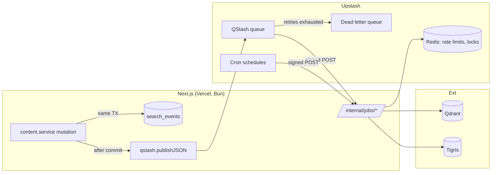

# Background Jobs — Exampify

| Field | Value |
|-------|-------|
| Version | 1.0 |
| Status | Proposed |
| Depends on | [DATABASE_SCHEMA.md](./DATABASE_SCHEMA.md), [SEARCH_ARCHITECTURE.md](./SEARCH_ARCHITECTURE.md), [PRODUCT_ARCHITECTURE.md](./PRODUCT_ARCHITECTURE.md) |
| Referenced by | [MVP_ROADMAP.md](./MVP_ROADMAP.md), [SECURITY_AND_PERMISSIONS.md](./SECURITY_AND_PERMISSIONS.md), [TESTING_STRATEGY.md](./TESTING_STRATEGY.md) |

---

## 1. Purpose and scope

What runs outside a request, how it is triggered, how it retries, and how duplicate execution is made harmless.

**In scope:** job inventory, provider choice and its limits, the outbox pattern, worker endpoint contract, idempotency, retries/dead letters, scheduling, observability, local development.

**Out of scope:** search ranking (`SEARCH_ARCHITECTURE.md`), email copy and deliverability ([EMAIL_AND_NOTIFICATIONS.md](./EMAIL_AND_NOTIFICATIONS.md)), media processing internals.

**Design rule:** a job exists only for work that is (a) too slow for a request, (b) needs retry after a transient failure, or (c) must run on a schedule. Everything else runs inline.

---

## 2. Provider decision

| Option | Guarantees | Verdict |
|---|---|---|
| **Upstash QStash** — HTTP push queue + scheduler | At-least-once delivery, 3 retries by default (configurable), exponential backoff, dead-letter queue with replay, cron schedules, signed requests, delay up to a year, 1,000 messages/day free then $1/100k | **Chosen.** No worker to deploy, works with Vercel functions, retries and DLQ are exactly the guarantees this product needs |
| Upstash Workflow — durable multi-step runs | Per-step retries, sleeps, `context.call`, resume from failure | Not needed in MVP: no job here is a long multi-step workflow. Revisit for bulk content import with human approval |
| Upstash Redis queues / BullMQ | Consumer-driven, needs a long-running worker | Rejected: Vercel has no long-running worker; would add a second deployment |
| Vercel Cron only | Scheduled invocation, no retry semantics, no per-event delivery | Insufficient alone; used as a backstop sweeper |
| Inngest / Trigger.dev | Durable step functions, good DX | Another vendor for a need QStash already covers |

**What Redis is *not* doing here.** Upstash Redis is used for short-lived counters (rate limits) and best-effort locks — **not** as the durable job store and not as a cache for content. Durable job state lives in Turso (`search_events`, `job_runs`), because that is the only place consistency with content is guaranteed ([ADR-021](./ARCHITECTURE_DECISIONS.md#adr-021--qstash-with-a-transactional-outbox), [ADR-027](./ARCHITECTURE_DECISIONS.md#adr-027--redis-limited-to-rate-limits-and-short-locks)).



---

## 3. Job inventory

| Job | Trigger | Cadence | Timeout | Idempotent by | Retry policy |
|---|---|---|---|---|---|
| `index-content` | QStash message per `search_events` row | On publish/unpublish/edit | 30 s | Deterministic Qdrant ids + FTS upsert by `entity_id` | 3 retries, backoff, then DLQ |
| `delete-search-document` | Same worker, `op='delete'` | On unpublish/archive/delete | 15 s | Delete by filter; deleting nothing is success | 3 retries |
| `reindex` | Manual/admin or post-model-change | Manual | 300 s per page | Deterministic ids; resumable | 1 retry per page, then DLQ |
| `expire-attempts` | QStash schedule | Every 15 min | 20 s | `UPDATE … WHERE status='in_progress' AND expires_at < now` | Next run is the retry |
| `prune` | QStash schedule | Daily 03:00 UTC | 60 s | Deletes by age; deleting nothing is success | Next run |
| `reconcile-stats` | QStash schedule | Daily 04:00 UTC | 120 s | Recomputes from items; overwrite | Next run |
| `reconcile-search` | QStash schedule | Daily 05:00 UTC | 180 s | Enqueues repairs; duplicates collapse | Next run |
| `purge-media` | QStash schedule | Daily 03:30 UTC | 90 s | Deletes blobs whose rows are soft-deleted > 30 days | Next run |
| `send-email` | QStash message | On demand | 20 s | `job_runs` key `email:<tokenId>` | 3 retries, then DLQ + alert |
| `warm-sitemap` | QStash schedule | Hourly | 60 s | Rebuilds a cached artifact | Next run |
| `retry-failed-events` | Vercel Cron (backstop) | Every 10 min | 30 s | Re-enqueues due `search_events` | Next run |
| `sweep-jobs` | Vercel Cron (backstop) | Every 10 min | 30 s | Row claim in the worker; a `started` row is re-claimable only after the stale window | Next run |

**Not jobs:** page rendering, grading, session creation, rate-limit checks, media URL signing. Those must be synchronous and predictable.

---

## 4. The outbox pattern

The only reliable way to keep a derived index consistent with a database that does not share its transaction.

1. **Write** the content change and `INSERT INTO search_events (id, entity_type, entity_id, op, status='pending', available_at=now)` in **one** `BEGIN IMMEDIATE` transaction.
2. **Commit.**
3. **Publish** `{ eventId }` to QStash. Failure here is logged, not retried in the request — the row is already durable.
4. **Worker** claims the event atomically, re-reads the authoritative row, performs the side effect, marks `done`.

```ts
// lib/jobs/outbox.ts
export async function enqueueSearchEvent(
  trx: Kysely<DB>, input: { entityType: SearchEntityType; entityId: string; op: 'upsert' | 'delete' },
): Promise<string> {
  const id = uuidv7();
  await trx.insertInto('search_events').values({
    id, entity_type: input.entityType, entity_id: input.entityId, op: input.op,
    status: 'pending', attempts: 0, available_at: Date.now(), created_at: Date.now(), updated_at: Date.now(),
  }).execute();
  return id;
}
```

**Why not publish from inside the transaction:** a publish that succeeds before the commit would index content that later rolls back; a commit that succeeds after a failed publish would leave content unsearchable. The outbox removes both orderings.

---

## 5. Worker endpoint contract

All jobs are `POST /api/v1/internal/jobs/<name>`, JSON, no session cookie.

### 5.1 Authentication

QStash signs every request (`Upstash-Signature`). The handler verifies it with the current and previous signing keys using `@upstash/qstash`'s `Receiver`, against the **raw body** (not the parsed JSON). A missing or invalid signature returns `401` before any work.

```ts
const receiver = new Receiver({ currentSigningKey: env.QSTASH_CURRENT_SIGNING_KEY,
                               nextSigningKey: env.QSTASH_NEXT_SIGNING_KEY });
const raw = await req.text();
const valid = await receiver.verify({ signature: req.headers.get('upstash-signature') ?? '', body: raw });
if (!valid) return unauthorized();
```

Scheduled jobs from Vercel Cron use `Authorization: Bearer $CRON_SECRET` with a constant-time comparison instead, because Vercel Cron does not speak QStash signatures.

### 5.2 Response semantics

| Status | Meaning to QStash |
|---|---|
| `200` | Delivered; do not retry (also used for intentional no-ops: already processed, entity unpublished, nothing due) |
| `4xx` | Permanent failure; do not retry destructively. The handler must still mark or DLQ the record itself |
| `5xx` / timeout | Retry |

Every handler returns `{ data: { processed, skipped, failed } }` and never returns row contents.

### 5.3 Bulk limits

- A job processes at most **100 entities** per invocation. The publisher pages larger sets into separate messages.
- Every query inside a job is bounded (`LIMIT`) and keyset-paginated where it iterates.
- No job opens a transaction spanning an external call: read → close → call Qdrant/Tigris → write.

---

## 6. Idempotency

Delivery is **at-least-once**. Every side effect is designed to be repeatable.

| Side effect | Mechanism |
|---|---|
| Qdrant upsert | Deterministic point ids (`uuidv5(entityId:chunkIndex)`); overwrite is the same row |
| FTS5 row | `DELETE FROM search_documents WHERE entity_id=?` then `INSERT` in one transaction |
| `search_terms` rows | Upsert by `term`, `entity_id` recomputed in the same job |
| Email send | `job_runs` row keyed `email:<verificationId>`; insert-or-ignore decides who sends |
| Media purge | Delete object (idempotent in S3 semantics) then mark row `deleted` |
| Stats reconciliation | Recompute and overwrite, never increment |
| Event claim | Conditional `UPDATE … WHERE status IN ('pending','failed')`; `changes()=0` → skip |

**Idempotency keys are stored, not inferred.** For work with an external, non-repeatable effect (email, future payments), the key is written **before** the effect and its status updated after — a crash between the two leaves `started`, which the sweeper treats as "retry once, then flag for review".

---

## 7. Retries, backoff and dead letters

- QStash: `Upstash-Retries: 3` (default), exponential backoff, `Upstash-Retry-Delay` for explicit scheduling.
- Application-level backoff inside `search_events.available_at`: `min(60s × 2^attempts, 1h)`.
- After 8 attempts an event becomes `failed` and an alert fires with `entityType`/`entityId`/`lastError` (no content, no PII).
- DLQ messages are inspected and **replayed manually** after a fix. A replay is safe because handlers are idempotent.
- Poison-message rule: if the same entity fails 3 consecutive times with a schema/validation error, mark it `failed` immediately and surface it in the studio as "not indexed" rather than burning the retry budget.
- No infinite retries, no silent drops: a `failed` event is visible in `/studio/overview` ("N pages missing from search").

---

## 8. Scheduling

| Schedule | Job | Failure impact |
|---|---|---|
| `*/15 * * * *` | `expire-attempts` | Lazy expiry on read keeps correctness; cron is housekeeping |
| `*/10 * * * *` | `retry-failed-events` (Vercel Cron backstop) | Search index lags; pages remain correct |
| `*/10 * * * *` | `sweep-jobs` (Vercel Cron backstop) | A verification email a failed publish orphaned is delayed, not lost (J-01, J-09) |
| `0 3 * * *` | `prune` (tokens, sessions, audit, events) | Storage grows; no user-visible effect |
| `30 3 * * *` | `purge-media` | Orphaned blobs cost money; no correctness impact |
| `0 4 * * *` | `reconcile-stats` | Dashboard numbers drift; corrected next run |
| `0 5 * * *` | `reconcile-search` | Index drift persists; alert |
| `0 * * * *` | `warm-sitemap` | Sitemap served stale; no correctness impact |

**Timezone:** all schedules are UTC. Nothing in the product depends on a local "today" except dashboard buckets, which are computed in the user's timezone at read time.

**Not scheduled:** anything that must happen exactly once at a precise moment. QStash schedules are best-effort within their window; a publish is not a scheduled job, it is a synchronous state transition.

---

## 9. Redis usage (deliberately narrow)

| Use | Key shape | TTL | Why Redis |
|---|---|---|---|
| Rate limiting | `rl:<route>:<key>` | window length | Atomic `INCR` + `EXPIRE` across function instances; Turso would add write load to the primary database for every request |
| Job dedupe lock | `lock:job:<idempotencyKey>` | 60 s | Prevents two concurrent deliveries racing before the DB claim |
| Suggest cache (optional) | `sg:<sha1(q|subject)>` | 60 s | Only if the Vercel data cache proves insufficient |

**Explicitly not in Redis:** sessions (Better Auth owns them in Turso), content (ISR/CDN), job queues (QStash), attempt state (Turso), feature flags (env).

`@upstash/redis` uses the REST API and works in the Bun runtime without a persistent connection. If Redis is unavailable, rate limiting **fails open** with a logged warning (availability over strictness for read paths) and job locks fall back to the database claim.

---

## 10. Observability

- Every job logs `{ event, jobId, entityType, entityId, attempt, durationMs, outcome }` as structured JSON. Never content, never `answer_key`.
- Metrics that matter: pending event age (p95), failure rate per job, DLQ depth, index lag (publish → searchable).
- Alerts: pending event older than 15 min; DLQ non-empty; 5+ `failed` events in an hour; `reconcile-search` drift > 0.
- `GET /api/v1/health` reports `{ status, db, qdrant, indexLagSeconds, version }` without secrets ([API_CONTRACTS.md](./API_CONTRACTS.md) §8). QStash and Redis are not probed there: a QStash outage shows up as pending-event age and DLQ depth, a Redis outage as fail-open rate limiting with a logged warning (§7).
- A job that silently stops running is the dangerous case: the sweeper's own last-run timestamp is written to `job_runs`, and an alert fires if it is older than 30 minutes.

---

## 11. Local development

- QStash cannot reach `localhost`. The worker endpoints are plain POST routes, so local testing uses `curl` with a bypass header accepted **only** when `NODE_ENV !== 'production'` and `JOBS_DEV_BYPASS=1`.
- The outbox sweeper is exposed as `bun run jobs:drain`, which loops over due `job_runs` rows until empty — the same code path as production, no separate implementation. The cron backstop (`POST /api/v1/internal/cron/sweep-jobs`, `CRON_SECRET`) calls the same function.
- Qdrant: either a Cloud free cluster with a `dev` collection or a local Docker container (`qdrant/qdrant`) at `http://localhost:6333`. Both are supported by the same client.
- Tigris: a `dev` bucket; presigned URLs work from localhost without extra configuration.
- Redis: Upstash free database or `redis-server` locally; the client is chosen by env var.

---

## 12. Edge cases

| # | Case | Handling |
|---|---|---|
| J-01 | Publish succeeds, QStash publish throws | Event stays `pending`; sweeper enqueues within 10 min; page is live immediately |
| J-02 | Same event delivered twice concurrently | DB claim: one wins, the other returns `200 {skipped:true}` |
| J-03 | Content edited twice quickly | Two events; both re-read the current row; the later write wins; ids are deterministic |
| J-04 | Entity deleted between event and worker | Worker finds no row → performs delete → `done` |
| J-05 | Qdrant down for an hour | Events retry with backoff; on recovery the backlog drains; no data loss |
| J-06 | Qdrant rejects a payload (dimension mismatch) | 4xx → event `failed` immediately (poison), alert; no retry storm |
| J-07 | Job exceeds the Vercel function timeout | QStash sees a failure and retries; the handler must be idempotent and bounded (100 entities) |
| J-08 | Clock skew between Vercel and Turso | All times come from the application (`Date.now()`), never `CURRENT_TIMESTAMP` |
| J-09 | Email provider accepts but the response is lost | `job_runs` marked `started`; sweeper retries once; duplicate email is acceptable, silent non-delivery is not |
| J-10 | Reindex runs while authors publish | Both write deterministic ids; last writer wins with current content; convergence guaranteed |
| J-11 | Redis unavailable | Rate limits fail open; job locks degrade to DB claim; logged, not fatal |
| J-12 | DLQ replay after a schema change | Handler re-reads current schema; old payloads carry only ids, so they remain valid |

---

## 13. Acceptance criteria

1. A content mutation and its `search_events` row commit atomically (test injects a failure after the content write and asserts neither persists).
2. Dropping the QStash publish call leaves the entity unindexed for at most 15 minutes, then the sweeper repairs it (integration test with a fake clock).
3. Delivering the same event twice creates exactly one Qdrant point set and one FTS row.
4. A worker invocation with an invalid `Upstash-Signature` returns `401` and performs no writes.
5. A job that processes 0 rows returns `200` (not an error) and is not retried.
6. Failed events are visible in the studio and in `/health`; the count is accurate.
7. No job exceeds its documented entity limit or timeout in a seeded run.
8. Every scheduled job records a `job_runs` heartbeat; a missed run raises an alert within 30 minutes.
9. Redis being unreachable does not break authentication, publishing or search.
10. No job log line contains `answer_key`, an email address, or a token.

---

## 14. Open questions

| # | Question | Impact |
|---|---|---|
| OQ-J1 | Is QStash's free 1,000 messages/day enough for a full reindex during development? | May need a paid plan before launch — **Open — needs:** measure a full development reindex against the 1,000 messages/day allowance; **blocks Phase 6**. |
| OQ-J2 | Do we add Upstash Workflow for bulk content import with approval steps? | Only when import ships — **Open — needs:** decide whether bulk import needs approval steps (Upstash Workflow); import is not in MVP; **blocks Phase 7**. |
| OQ-J3 | Should media processing (thumbnails, PDF previews) run in a job? | Adds a worker dependency; currently the browser uploads final assets — **Open — needs:** decide whether thumbnails and PDF previews are generated server-side; **blocks Phase 2**. |
| OQ-J4 | ~~Is Vercel Cron's minimum interval (once per day on Hobby, per-minute on Pro) acceptable for the backstop?~~ **Resolved: yes** — QStash schedules carry the frequent work and Vercel Cron is only a daily backstop; Pro adds per-minute if a backstop ever needs it (`OQ-D2`) | Nothing |
| OQ-J5 | Do we need per-tenant job isolation later? | Multi-tenant architecture, not MVP — **Open — needs:** decide only if multi-tenancy is ever planned; **blocks post-MVP**. |
