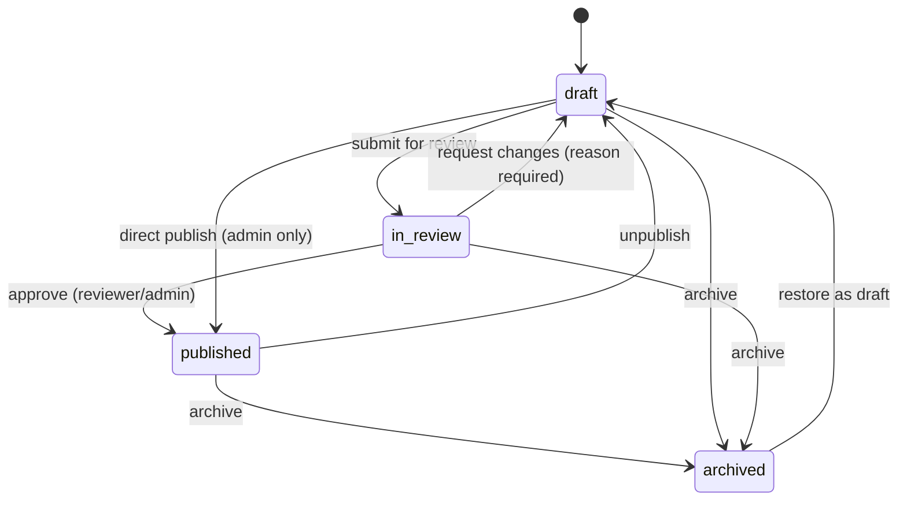

# Content Model — Exampify

| Field | Value |
|-------|-------|
| Version | 1.0 |
| Status | Proposed |
| Supersedes | Version 0.1 (Markdown-only materials + tutorials) — [ADR-022](./ARCHITECTURE_DECISIONS.md#adr-022--block-based-content-with-markdown-inside-rich-text-blocks) |
| Depends on | [DATABASE_SCHEMA.md](./DATABASE_SCHEMA.md), [INFORMATION_ARCHITECTURE.md](./INFORMATION_ARCHITECTURE.md) |
| Referenced by | [QUESTION_ENGINE.md](./QUESTION_ENGINE.md), [API_CONTRACTS.md](./API_CONTRACTS.md), [SEARCH_ARCHITECTURE.md](./SEARCH_ARCHITECTURE.md), [SEO_AND_CONTENT_STRATEGY.md](./SEO_AND_CONTENT_STRATEGY.md) |

---

## 1. Purpose and scope

Defines what each content entity *means*, the rules its fields obey, and how content moves from draft to published. `DATABASE_SCHEMA.md` says what is stored; this document says what makes it valid and how it behaves.

**In scope:** entity semantics, the three content types and how they are derived, block taxonomy and payload rules, publish gates, lifecycle, ordering, reuse, media rules, editorial contract.

**Out of scope:** physical types/indexes (schema doc), HTTP shapes (API doc), scoring (`QUESTION_ENGINE.md`), visual tokens (`DESIGN_SYSTEM.md`).

---

## 2. The product principle this model serves

Exampify is a **learning platform**, not an exam website. A student must be able to arrive at a topic, read an explanation, and leave without ever being asked a question. Practice is an option on the page, not a toll gate in front of it.

That principle produces three content shapes over two entities:

| Shape | Composed of | Student-facing label | Example |
|---|---|---|---|
| **A — Explanation only** | `learning_resources` with blocks, no linked assessment | **Study material** | "Understanding Photosynthesis" |
| **B — Lesson + practice** | the same resource, plus a linked assessment placed `inline` or at `end` | **Lesson + practice** | "Photosynthesis: explanation + 15 questions" |
| **C — Assessment only** | a published `assessments` row with no linked resource | **Practice test** | "Biology mock examination" |

**The label is derived, never stored.** A single `derivedFormat` value is computed in `content.service.ts`:

```ts
type DerivedFormat = 'study_material' | 'lesson_with_practice' | 'practice_test';

function deriveFormat(resource: { publishedAssessmentCount: number } | null,
                      assessment: { linkedResourceCount: number } | null): DerivedFormat {
  if (resource) return resource.publishedAssessmentCount > 0 ? 'lesson_with_practice' : 'study_material';
  if (assessment) return 'practice_test';
  throw new Error('deriveFormat called with neither resource nor assessment');
}
```

Consequences that are easy to get wrong and are therefore normative:

1. A resource gains "lesson" status by linking a **published** assessment. A draft assessment does not change the label.
2. Unlinking the last assessment reverts the resource to study material — no migration, no flag.
3. A resource may have two assessments (a knowledge check `inline`, a longer set at `end`); the label is still `lesson_with_practice`.
4. A "practice test" is a first-class page with its own URL, not a mode of a lesson.

---

## 3. Identifiers and terminology

| Term | Meaning | Maps to |
|---|---|---|
| **Curriculum** | An exam system or programme ("Cambridge International") | `curricula` |
| **Education level** | A stage within a curriculum (IGCSE, AS & A Level) | `education_levels` |
| **Subject / Course** | The publishable course unit ("Biology" at IGCSE). "Course" is the UI word where it reads better; the entity is one row | `subjects` |
| **Chapter / Subtopic** | A syllabus section within a subject ("Cell Biology"). Chapters serve as the subtopic grouping in MVP | `chapters` |
| **Topic** | The study unit that owns resources and assessments. One hub page, one URL | `topics` |
| **Learning resource** | One readable document, composed of ordered blocks | `learning_resources` + `content_blocks` |
| **Block** | One structural unit inside a resource (prose, image, formula, question section…) | `content_blocks` |
| **Assessment** | A gradable collection of questions, standalone or attached to a resource | `assessments` + `assessment_items` |
| **Question** | One gradable item, reusable across assessments and topics | `questions` |
| **Attempt** | A student's run through an assessment or a generated practice set | `assessment_attempts` |

**Why "topic" rather than adding a subtopic level:** the brief asks for browsable subjects → courses → topics → subtopics. A sixth taxonomy level costs a schema change, six route segments and a second nav pattern, for a distinction that chapters already make ("Cell Biology" is the subtopic group; "Mitochondria" is the topic). This is recorded as [ADR-002](./ARCHITECTURE_DECISIONS.md#adr-002--explicit-taxonomy-tables-over-a-generic-tree) (retained) and revisited only if authors produce topics with > 2,000 words and clearly separable sub-parts.

**Why subject is scoped to a level rather than shared across curricula:** a subject is the publishable unit carrying its own syllabus, chapters, SEO metadata and hero, and IGCSE Biology genuinely differs from A Level Biology. Sharing one row across levels forces a level scope onto every chapter and turns "this course has N chapters" into a filtered aggregate. Duplicating a short row is the cheaper trade.

---

## 4. Entity specifications

### 4.1 Curriculum

| Field | Requirement |
|---|---|
| `slug` | Required, kebab-case, unique globally, ≤ 24 chars |
| `name` | Required, 2–80 chars, proper-noun form |
| `short_name` | Required, ≤ 20 chars, used in compact nav |
| `description_md` | Optional, ≤ 4 kB, rendered on the curriculum landing page |
| `status` | `draft` or `published`; a curriculum may publish before all its levels do |
| `position` | Integer, lower first, ties broken by `created_at` |

**Rules:** cannot be archived while a descendant subject is published (explicit action, no cascade). Renaming writes a redirect for the whole prefix.

### 4.2 Education level

`curriculum_id` required; `slug` unique within curriculum; `name` ≤ 40; `description_md` ≤ 2 kB. A level with zero published subjects is `noindex` and shows a "coming soon" state, never an empty grid.

### 4.3 Subject

| Field | Requirement |
|---|---|
| `name` | ≤ 60 chars ("Biology") |
| `slug` | Unique within level |
| `summary` | Required to publish, 40–320 chars, plain text; also the meta-description fallback |
| `subject_group_id` | Required; drives directory placement and default colour |
| `color_token` | Required design token; unique **within a level** |
| `icon_key` | Required; must exist in the icon registry |
| `hero_media_id` | Optional 16:9 image |
| `seo_title` / `seo_description` | Optional; defaults in `SEO_AND_CONTENT_STRATEGY.md` §4 |
| `position` | Required |

**Publish gate:** ≥ 1 published chapter.

### 4.4 Chapter

`title` ≤ 100, sentence case; `slug` unique within subject; `summary` ≤ 240. **Publish gate:** ≥ 1 published topic. A chapter with no topics stays a draft — otherwise a student clicks twice and lands on an empty page.

### 4.5 Topic

| Field | Requirement |
|---|---|
| `title` | ≤ 100 chars |
| `slug` | Unique within chapter |
| `summary` | Required to publish, 40–320 chars |
| `learning_objectives` | 1–12 items, 8–160 chars each, plain text |
| `estimated_minutes` | Optional 5–240; else computed from resource reading time + assessment duration |
| `position` | Required |

**Publish gate (changed in this revision):** ≥ 1 published **learning resource *or* assessment**. The previous gate required a material *and* a question; that encoded the exam-platform assumption this revision removes. A topic that is explanation-only is a legitimate product surface (`FR-CMS-06`).

A topic with **no** published content at all cannot publish. A topic with only an assessment publishes as a practice-only topic and its hub shows the test without a reading section.

### 4.6 Learning resource

| Field | Requirement |
|---|---|
| `topic_id` | Required |
| `title` | Required, ≤ 120 chars; a claim, not a label ("Inertia is resistance to change in motion") |
| `subtitle` | Optional, ≤ 160 chars |
| `slug` | Unique within topic |
| `summary` | Optional, ≤ 240 chars; meta fallback |
| `difficulty` | Editorial judgement, independent of question difficulty |
| `reading_minutes` | Computed on save: `ceil(words / 200)`, minimum 1 |
| `position` | Reading order within the topic |
| `blocks` | 1–80 blocks; ordered; at least one `rich_text` block to publish |

**Block composition rules (publish gates):**

1. ≥ 1 `rich_text` block with ≥ 200 characters of Markdown.
2. First block is not `heading` level 3 (a page cannot open on a sub-subheading).
3. Every `image` block references a `ready` media asset with non-empty `alt_text`.
4. Every `formula` block parses; an unparseable TeX blocks publication with the exact path.
5. Every `question_section` block references a **published** assessment whose scope includes this resource's topic.
6. Every `related_material` block references a published resource in the same subject, never itself.
7. No duplicate `heading` anchors.
8. Total payload ≤ 256 kB (warning at 64 kB, hard limit at save).

**Editorial shape (warnings, not gates):** contains at least one of a worked example callout, a table, an image or a formula; does not end with a "next steps" section (navigation is generated).

### 4.7 Assessment

| Field | Requirement |
|---|---|
| `topic_id` / `subject_id` | Exactly one scope: topic-level, or subject-level (`topic_id = NULL`) for mock exams |
| `title` | ≤ 120 chars ("Cell Division — knowledge check") |
| `slug` | Unique within `scope_key` (topic id, else subject id) |
| `mode` | `practice` (untimed, instant feedback), `test` (timed, feedback after submit), `mock` (long, course-scoped) |
| `duration_seconds` | Required for `test`/`mock`, 60–10 800; forbidden for `practice` |
| `items` | 1–60 questions, ordered, no duplicates |
| `description_md` | Optional, ≤ 2 kB |

**Publish gate:** ≥ 1 published question; every item's question is published and either belongs to the scope topic or is cross-listed to it; `question_count` matches the item count; `duration_seconds` satisfies the mode rule.

**Mode semantics (UI contract):** `practice` — answers are graded per question and feedback is immediate; `test`/`mock` — no correctness until submit, optional countdown, review afterwards. The engine is identical (`QUESTION_ENGINE.md` §7); only `revealPolicy` differs.

### 4.8 Question

Defined fully in [QUESTION_ENGINE.md](./QUESTION_ENGINE.md) §3. Content rules that apply here:

- `stem_md` must not restate its own answer.
- `explanation_md` ≥ 60 chars to publish — it is the teaching payload, not a courtesy.
- Difficulty is editorial, not measured from attempt data in MVP.
- A question's primary topic is fixed at creation; moving it is an explicit action that also rewrites `question_topics`.

### 4.9 Media asset

Metadata row only; bytes live in Tigris. Purpose-based allow-lists:

| Purpose | MIME allow-list | Size cap |
|---|---|---|
| Image (inline, hero) | `image/png`, `image/jpeg`, `image/webp`, `image/avif`, `image/svg+xml` (sanitised) | 8 MB |
| Document (`download` block) | `application/pdf`, `.docx`, `.pptx`, `.zip` | 25 MB |
| Video (`video` block) | Referenced by provider id, not uploaded, in MVP | — |

`alt_text` is required for every image before the referencing resource can publish. Decorative images are not permitted in learning content; they carry no teaching value and consume attention.

---

## 5. Block payload contract

Every payload is `{ v: 1, ... }` and validated by a Zod discriminated union in `lib/validation/blocks.schema.ts`. The same schema runs in the editor, the route handler and the test. Unknown `kind` or unknown keys are rejected — no silent passthrough.

```ts
const BlockPayload = z.discriminatedUnion('kind', [
  z.object({ kind: z.literal('rich_text'), payload: z.object({ v: z.literal(1), markdown: z.string().min(1).max(40_000) }) }),
  z.object({ kind: z.literal('heading'),   payload: z.object({ v: z.literal(1), level: z.union([z.literal(2), z.literal(3)]), text: z.string().min(1).max(160), anchor: z.string().regex(/^[a-z0-9-]+$/).max(80).optional() }) }),
  z.object({ kind: z.literal('image'),     payload: z.object({ v: z.literal(1), mediaId: z.string().uuid(), caption: z.string().max(240).optional(), width: z.number().int().positive().max(4096), height: z.number().int().positive().max(4096) }) }),
  z.object({ kind: z.literal('formula'),   payload: z.object({ v: z.literal(1), latex: z.string().min(1).max(2_000), displayMode: z.boolean() }) }),
  z.object({ kind: z.literal('table'),     payload: z.object({ v: z.literal(1), caption: z.string().max(240).optional(), header: z.array(z.string().max(120)).min(2).max(12), rows: z.array(z.array(z.string().max(500)).min(2).max(12)).max(50) }) }),
  z.object({ kind: z.literal('callout'),   payload: z.object({ v: z.literal(1), tone: z.enum(['tip','warning','example','examtip','definition']), markdown: z.string().min(1).max(8_000) }) }),
  z.object({ kind: z.literal('video'),     payload: z.object({ v: z.literal(1), provider: z.enum(['youtube','vimeo']), providerId: z.string().min(3).max(64), title: z.string().min(1).max(160), durationSeconds: z.number().int().positive().max(14_400).optional() }) }),
  z.object({ kind: z.literal('download'),  payload: z.object({ v: z.literal(1), mediaId: z.string().uuid(), label: z.string().min(1).max(120), byteSize: z.number().int().positive() }) }),
  z.object({ kind: z.literal('question_section'), payload: z.object({ v: z.literal(1), assessmentId: z.string().uuid(), heading: z.string().max(160).optional() }) }),
  z.object({ kind: z.literal('related_material'), payload: z.object({ v: z.literal(1), resourceIds: z.array(z.string().uuid()).min(1).max(6), heading: z.string().max(160).optional() }) }),
]);
```

### 5.1 Markdown inside prose blocks

`rich_text` and `callout` bodies are **GitHub-Flavored Markdown**, rendered server-side through a sanitising pipeline. No raw HTML is stored or rendered.

| Element | Syntax | Output |
|---|---|---|
| Headings | `##`, `###` only (never `#`; level 1 is the page title) | `h2`/`h3` with anchor ids, feeding the table of contents |
| Lists, tables, blockquote, code | GFM | semantics preserved, tables wrapped for horizontal scroll |
| Image | `` or an `image` block | `figure` + `figcaption`, explicit dimensions |
| Link | `[text](url)` | internal → `next/link`; external → `rel="noopener noreferrer"` |
| Formula | `$…$` / `$$…$$` | KaTeX, server-rendered |
| Emphasis, inline code, divider | standard | — |

**Prohibited:** inline styles, `<script>`, `<iframe>`, `<style>`, `<form>`, layout via HTML entities, embedded video outside a `video` block.

**Why both Markdown and blocks:** Markdown inside a prose block keeps authoring fast and diffs readable. Blocks exist for the things Markdown cannot validate or lay out — an assessment section, a downloadable file, a captioned figure with known dimensions. The rejected alternative was a full Notion-style page builder ([ADR-022](./ARCHITECTURE_DECISIONS.md#adr-022--block-based-content-with-markdown-inside-rich-text-blocks)).

### 5.2 Reordering

`position` is contiguous per resource and renumbered in one transaction on a reorder payload. Reordering is a whole-list operation, never per-item ±1 shuffles (which duplicate positions under concurrency). The same rule applies to `assessment_items` and every taxonomy level.

---

## 6. Publication lifecycle

Five statuses shared by curricula, levels, subjects, chapters, topics, resources, assessments and questions.



| Transition | Roles | Rules |
|---|---|---|
| `draft → in_review` | author, reviewer, admin | Publish-gate validation runs; failure returns field errors and blocks the transition |
| `in_review → published` | reviewer, admin | Re-validates; sets `published_at`; increments `version`; invalidates tags; enqueues a search event |
| `in_review → draft` | reviewer, admin | `reason` required (10–500 chars), stored in `audit_logs.metadata` |
| `draft → published` | admin | Seeding/fix shortcut, audited as `direct_publish` |
| `published → draft` | author (own), reviewer, admin | Clears `published_at`, keeps the URL reserved; enqueues search removal |
| `* → archived` | author (own), reviewer, admin | Hidden from public, excluded from selection, retained |
| `archived → draft` | admin | Editing restored; `published_at` is not restored |

**Invariants**

- `published_at` is set exactly when entering `published`, cleared when leaving.
- `version` increments on every save that changes content of a published row — never on status-only changes (those are audited separately).
- **No auto-cascade.** Publishing a chapter never publishes its topics. Publishing a resource never publishes its assessment.
- Every publish/unpublish writes a `search_events` row **inside the same transaction** ([ADR-021](./ARCHITECTURE_DECISIONS.md#adr-021--qstash-with-a-transactional-outbox)).

**Why no cascade:** implicit publication is how unreviewed content reaches students. Each entity passes its own gate.

---

## 7. Reuse and duplication

| Mechanism | Applies to | Behaviour | Why |
|---|---|---|---|
| **Cross-listing** | Questions ↔ topics | One row, one primary topic, N secondary topics via `question_topics`; selection and analytics include secondary topics | Questions genuinely repeat across syllabi; duplicating forks explanations and doubles fixes |
| **Assessment membership** | Assessments → questions | One question in many assessments, ordered per assessment, optional points override | A canonical question with curated sequences around it |
| **Linking** | Resources ↔ assessments | Many-to-many with `placement` (`inline`/`end`/`optional`) | A lesson is a composition, not a copy — and the same question set can serve two lessons |
| **Copy** | Resources, chapters, assessments | Explicit "Duplicate" deep-copies as `draft` with new slugs; `copiedFromId` recorded in the audit log | True sharing of prose needs per-consumer overrides and a second rendering path |

**Copy rules:** copies start as `draft`; slugs get `-copy` / `-2`; the copy inherits the original's `created_by` but the acting user as `updated_by`; copying a resource copies its blocks (fresh ids) but **links** the same assessments rather than duplicating questions; copying an assessment copies items by reference.

**Rejected:** a universal `content_topic_links` table for resources. It would allow one resource to live in two topics, forcing canonical-URL decisions, per-topic ordering and ownership conflicts — real complexity for a case better solved by copy ([ADR-003](./ARCHITECTURE_DECISIONS.md#adr-003--questions-reusable-by-cross-listing-content-copied), retained).

---

## 8. Media

- Allowed types and caps: §4.9. SVG is sanitised server-side (scripts and `foreignObject` stripped).
- Upload flow: browser asks the API for a presigned PUT, uploads **directly to Tigris**, then confirms; the server verifies size/type via HEAD before marking the row `ready` ([ADR-023](./ARCHITECTURE_DECISIONS.md#adr-023--tigris-for-media-with-presigned-uploads)).
- Private assets (draft previews, future attachments) are served by short-lived presigned GET URLs; public content uses the public bucket domain or a custom domain.
- One optional image per question (`media_id`); resources embed many via blocks.
- Deleting an asset is soft and blocked while referenced by published content; blobs purge 30 days after `deleted_at` when unreferenced.
- `next/image` is configured with the Tigris public domain; private images render through `` with a presigned URL and no optimizer caching.
- Diagrams must remain legible at 360 px — an authoring guideline enforced in review.

---

## 9. Authorship and ownership

- Every content row records `created_by` / `updated_by` (`SET NULL` on user deletion, so content survives).
- MVP authoring model: any `author` may edit any content (`A-03`, small trusted team). The studio shows "last edited by X at T".
- `reviewer`/`admin` publish; `author` submits for review. An author cannot publish their own content unless also `reviewer`/`admin` (`OQ-07`).
- No draft is visible to anyone without a staff role, including through the API and search.
- Ownership transfer is not a feature; reassignment happens by editing (audited).

---

## 10. Editorial contract

Review criteria, not code gates, except where noted:

1. **Coverage before depth.** One thin topic in every chapter beats three perfect topics and empty pages elsewhere.
2. **One idea per resource.** Two `##` sections that could stand alone should be two resources.
3. **Explain the reasoning.** "B, because isotopes share protons but differ in neutrons" — never "B is correct."
4. **Practice is optional, never a toll gate.** A resource that only exists to unlock questions is a defect.
5. **Difficulty distribution per topic:** aim for ≥ 30 % easy, ≥ 30 % medium, and at least one hard item.
6. **No copied third-party content** (`A-08`). Every question and diagram is original or licensed with recorded provenance.
7. **Units and notation** are consistent (SI, space before the unit); formulas use the `formula` block, not images of equations.
8. **Tone:** direct, second person, no filler ("simply", "just", "obviously").
9. **No orphan pages** — every published page has at least one inbound internal link (`INFORMATION_ARCHITECTURE.md` §7).
10. **Every claim that can be practised has practice** — but the reverse is not required.

---

## 11. Dependencies

| Consumer | Needs from this document |
|---|---|
| Question engine | Question content rules, stem format, difficulty semantics, assessment modes |
| Studio | Field rules, block payloads, publish gates, lifecycle, ordering, media |
| API | Validation shapes, `derivedFormat`, per-status gates |
| Search | Which fields are indexed, which entities are public, delete semantics |
| SEO | Slugs, titles, summaries, `noindex` for thin pages, structured-data type per format |
| Design system | Block inventory, callout tones, content-type badges |

---

## 12. Edge cases

| # | Case | Behaviour |
|---|---|---|
| CM-01 | Author empties a required field on a published row and saves | Save rejected with field errors; the published version stays intact |
| CM-02 | Last assessment unlinked from a resource | Resource reverts to "study material"; no data loss; the page updates after revalidation |
| CM-03 | Topic moved to another subject | Requires `admin`; writes redirects for the topic and descendants; cross-listings preserved |
| CM-04 | Body contains raw HTML | Stripped on save; the author sees the removed tags |
| CM-05 | Block order has a gap (0,2,3) | Rejected at save; reorder renumbers contiguously |
| CM-06 | Assessment contains a question from another topic | Allowed only when cross-listed to the scope topic; else `422 QUESTION_NOT_IN_SCOPE` |
| CM-07 | Two subjects in a level share a `color_token` | Blocked at save; identity colours must be unambiguous |
| CM-08 | Resource over the payload budget | Rejected at save with a split suggestion |
| CM-09 | Table block has ragged rows | Rejected by Zod with the row index |
| CM-10 | Duplicate action on a published resource | Copy created as draft; original untouched; same assessments linked |
| CM-11 | Archiving a curriculum with published subjects | Blocked, with the list of blockers |
| CM-12 | Slug changed on a published topic | Allowed; redirect written for the full path and every descendant |
| CM-13 | A `question_section` points at a draft assessment | Publish blocked; in draft the section renders a staff-only placeholder |
| CM-14 | Two blocks share a heading anchor | Publish blocked; the editor highlights both |
| CM-15 | Resource with blocks but no prose | Publish blocked ("at least one text block") |
| CM-16 | Assessment published with a deleted question | Impossible: `ON DELETE RESTRICT`; question archiving keeps the item but the assessment shows a gap warning |

---

## 13. Acceptance criteria

1. Every publishable entity enforces the gates in §4 with field-level errors; each gate has a failing fixture.
2. `published_at` is non-null exactly for `status='published'` rows (constraint + test).
3. Markdown rendering is deterministic and sanitised: `<script>alert(1)</script>` renders no script, twice identically.
4. A topic publishes with only a resource, and with only an assessment (both tested).
5. `derivedFormat` returns the documented label for all three shapes, including the unlink case (CM-02).
6. A resource with an unpublished assessment is labelled "study material".
7. Copying a resource produces an independent draft with fresh block ids and the same linked assessments.
8. Cross-listed questions appear in practice for primary and secondary topics without duplicate rows.
9. Reordering produces contiguous positions with no duplicates under concurrent edits.
10. Every content mutation writes exactly one audit entry containing changed field names.
11. Every publish/unpublish writes exactly one `search_events` row in the same transaction.
12. An image without alt text blocks publication of the referencing resource.

---

## 14. Open questions

| # | Question | Impact |
|---|---|---|
| OQ-CM1 | Should a resource ever appear under two topics (shared, not copied)? | Canonical URL rules; currently no — **Open — needs:** decide whether a resource may be shared across topics (changes canonical URLs); **blocks Phase 2**. |
| OQ-CM2 | Do `download` blocks require an email gate or login? | Entitlement/lead-gen decision; currently public — **Open — needs:** decide whether downloads are gated by login or email; **blocks Phase 2**. |
| OQ-CM3 | Is `video` self-hosted in future, or provider-embedded only? | Storage cost vs privacy — **Open — needs:** decide whether any video is self-hosted (storage cost vs privacy); **blocks Phase 7**. |
| OQ-CM4 | Do assessments need a passing threshold shown to students? | Product semantics; `score_percent` only in MVP — **Open — needs:** decide whether assessments display a pass threshold; **blocks Phase 3**. |
| OQ-CM5 | Are computer-marked formulas (numeric answers with tolerance) in scope? | New question type + grading branch — **Open — needs:** decide whether numeric answers with tolerance are in scope (new type plus grader branch); **blocks Phase 3**. |
| OQ-CM6 | Should `related_material` be authored or generated? | Editorial effort vs relevance quality — **Open — needs:** decide authored vs generated related material; **blocks Phase 2**. |
