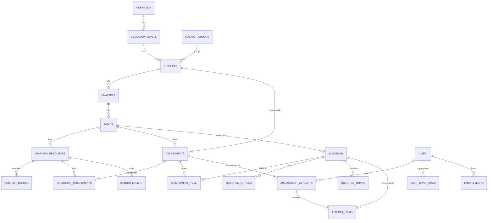

# Database Schema — Exampify

| Field | Value |
|-------|-------|
| Version | 1.0 |
| Status | Proposed — target database is **Turso (libSQL / SQLite dialect)** via Kysely ([ADR-016](./ARCHITECTURE_DECISIONS.md#adr-016--vercel--bun-monolith-with-turso)) |
| Supersedes | Version 0.1 (PostgreSQL 16 + Drizzle) — see [ADR-020](./ARCHITECTURE_DECISIONS.md#adr-020--kysely--libsql-with-reviewed-sql-migrations) |
| Depends on | [PRODUCT_ARCHITECTURE.md](./PRODUCT_ARCHITECTURE.md), [CONTENT_MODEL.md](./CONTENT_MODEL.md), [QUESTION_ENGINE.md](./QUESTION_ENGINE.md) |
| Referenced by | [API_CONTRACTS.md](./API_CONTRACTS.md), [SEARCH_ARCHITECTURE.md](./SEARCH_ARCHITECTURE.md), [SECURITY_AND_PERMISSIONS.md](./SECURITY_AND_PERMISSIONS.md) |

---

## 1. Purpose and scope

Defines every table, column, type, key, constraint and index Exampify needs, plus ownership and row-visibility rules. It is precise enough to hand-write the Kysely schema types and the first migration.

**In scope:** physical model, SQLite type mapping, relationships, constraints, indexes, enums, migration and seed policy, retention, per-table access rules.

**Out of scope:** field meaning and editorial rules ([CONTENT_MODEL.md](./CONTENT_MODEL.md)), grading ([QUESTION_ENGINE.md](./QUESTION_ENGINE.md)), HTTP shapes ([API_CONTRACTS.md](./API_CONTRACTS.md)), index synchronisation ([SEARCH_ARCHITECTURE.md](./SEARCH_ARCHITECTURE.md)).

**Deliberately absent:** payments/invoicing, organizations, assignments, comments, notifications, content revision history, past-paper archives, flashcards. Each has an extension point in §14.

---

## 2. Engine constraints (read before designing anything)

Turso speaks the SQLite dialect through libSQL. Nothing in this schema may assume PostgreSQL.

| Constraint | Consequence for this schema |
|---|---|
| No native `ENUM` type | Enumerations are `TEXT` + `CHECK (col IN (...))`. The canonical list lives in one TypeScript union (`lib/db/enums.ts`) and is repeated in the migration. |
| No `uuid` type, no `uuidv7()` | IDs are `TEXT` holding a UUID v7 generated in the application (`lib/ids.ts`). Opaque in URLs, time-ordered for index locality. |
| No `timestamptz`, no `now()` default | Timestamps are `INTEGER` Unix epoch **milliseconds**, written by the application (`Date.now()`). A `CHECK (x > 0)` guards nonsense. Rendering converts to ISO-8601 at the DTO boundary only. |
| No `numeric` | Scores are **integers in hundredths of a point** (`points_x100`). Partial credit is exact; no floating point anywhere in scoring. |
| No `boolean` | `INTEGER` `0`/`1` with `CHECK (col IN (0,1))`. Kysely types map it to `number`, and the mapper converts to `boolean` for DTOs. |
| No arrays (`text[]`) | JSON-encoded `TEXT` with `CHECK (json_valid(col))`, or a child table when the values are queried. `learning_objectives` is JSON text (never filtered server-side); `question_topics` is a table (joined constantly). |
| No `citext` | Emails are stored lowercased (`COLLATE NOCASE` where compared) and normalised in the service layer. |
| No `tsvector`, GIN, `websearch_to_tsquery` | Full-text is **FTS5** (`search_documents`, §12). Ranking is `bm25()`. |
| No `FOR UPDATE` row locks | Write transactions use `BEGIN IMMEDIATE` and a single writer; correctness for submit comes from a status `CHECK` + conditional `UPDATE ... WHERE status = 'in_progress'` returning `changes()`. See §11. |
| No `RETURNING` guarantees across drivers | Inserts that need the row re-select by primary key inside the same transaction. |
| `ALTER TABLE` is limited | Migrations are **additive-first** and table rebuilds are explicit (§15). |
| One writer at a time (classic SQLite WAL) | Writes are short and never hold a transaction across an HTTP call. Turso's MVCC mode is available but **not** enabled in MVP (must be verified before adoption). |

**Not available and not to be emulated:** row-level security, materialised views, table grants per role beyond Turso token permissions (§10), advisory locks, `LISTEN/NOTIFY`, extensions other than those preloaded by Turso (JSON1, FTS5, R*Tree, SQLean Crypto, SQLean Fuzzy).

---

## 3. Conventions

| Convention | Rule |
|---|---|
| Primary keys | `id TEXT PRIMARY KEY` — UUID v7 from `lib/ids.ts` |
| Naming | Tables plural `snake_case`; join tables `<a>_<b>`; FKs `<entity>_id`; booleans `is_*`/`has_*`; timestamps `*_at` (INTEGER ms) |
| Timestamps | `created_at INTEGER NOT NULL`, `updated_at INTEGER NOT NULL`; no DB defaults (application writes them) |
| Soft delete | `deleted_at INTEGER NULL` only on `user` and `media_assets`. Content uses `status='archived'` |
| Slugs | `TEXT NOT NULL`, lowercase, unique per parent. Global uniqueness only where the entity is globally addressed |
| Enumerations | `TEXT` + `CHECK`; values are identical across docs and code |
| Index names | `idx_<table>_<cols>`; partial: `idx_<table>_<cols>_<predicate>` |
| Cascades | `ON DELETE CASCADE` only parent → content it exclusively owns. Anything referenced by an attempt is `ON DELETE RESTRICT` |
| Foreign keys | `PRAGMA foreign_keys = ON` on every connection. Without it SQLite silently ignores FKs — the single most dangerous default here |
| Text size | `TEXT`; length limits enforced by Zod. A `CHECK (length(x) <= n)` is added only where an unbounded value would break an index or payload budget |
| JSON | `TEXT` + `CHECK (json_valid(col))`; every JSON column has a `v` discriminator and a Zod schema, validated on read and write |

> **Why application-written timestamps:** SQLite defaults are limited to `CURRENT_TIMESTAMP` (second resolution, UTC string). Mixing second-resolution DB time with millisecond application time produces unstable keyset pagination. One clock, one format.

---

## 4. Enumerations

```sql
-- content lifecycle
CHECK (status IN ('draft','in_review','published','archived'))
-- difficulty
CHECK (difficulty IN ('easy','medium','hard','very_hard'))
-- question kind
CHECK (question_type IN ('multiple_choice','multiple_select','true_false','short_answer'))
-- roles (ordered: student < author < reviewer < admin)
CHECK (role IN ('student','author','reviewer','admin'))
CHECK (status IN ('active','suspended','deleted'))          -- user_status
CHECK (status IN ('in_progress','submitted','abandoned','expired'))  -- attempt_status
CHECK (source IN ('topic','chapter','subject','assessment','resource')) -- attempt_source
CHECK (mode IN ('practice','test','mock'))                  -- assessment_mode
CHECK (kind IN ('rich_text','heading','image','formula','table','callout',
                'video','download','question_section','related_material')) -- block_type
CHECK (visibility IN ('public','private'))                  -- media_visibility
CHECK (op IN ('upsert','delete'))                           -- search_event_op
CHECK (status IN ('pending','processing','done','failed'))  -- search_event_status
```

`question_type`, `block_type` and `assessment_mode` are expected to grow. Adding a value is a one-line `CHECK` rebuild (SQLite cannot alter a constraint in place) — see §15. Every `switch` over these unions must be exhaustive so an unknown value fails loudly instead of grading as incorrect.

---

## 5. Identity and access (Better Auth–owned)

Better Auth owns four tables with **singular** names (`user`, `session`, `account`, `verification`). This is a deliberate exception to the plural convention: the library's CLI generates and checks this schema, and renaming its tables requires field remapping that breaks silently on upgrade. Application code never writes these tables directly except through `lib/auth`.

Core columns keep the library's **camelCase** names because the Kysely adapter writes those exact keys; application fields added through Better Auth's schema extension keep this project's snake_case. The DDL in `db/schema.phase1.sql` is the CLI's output for the configured schema — regenerate and diff it after a `better-auth` upgrade ([ADR-017](./ARCHITECTURE_DECISIONS.md#adr-017--better-auth-on-turso-via-kysely--libsqldialect)).

### 5.1 `user`

| Column | Type | Constraints | Notes |
|---|---|---|---|
| `id` | TEXT | PK | Library-generated id |
| `email` | TEXT | NOT NULL, UNIQUE | Lowercased at the boundary |
| `emailVerified` | INTEGER | NOT NULL | Library field; a signed verification token sets it |
| `name` | TEXT | NOT NULL | 2–80 chars, validated by Zod |
| `image` | TEXT | NULL | Avatar URL |
| `role` | TEXT | NULL | Additional field; defaults to `student` in the auth config |
| `status` | TEXT | NULL | `suspended` cannot sign in |
| `last_seen_at` | INTEGER | NULL | Written at most once per hour |
| `age_attested_at` | INTEGER | NULL | When the 16+ attestation was accepted at sign-up ([ADR-034](./ARCHITECTURE_DECISIONS.md#adr-034--minimum-age-16-self-attested-no-date-of-birth-stored)); no date of birth is stored |
| `age_gate_version` | TEXT | NULL | Wording/version of the attestation shown, so a change is auditable |
| `createdAt` / `updatedAt` | DATE | NOT NULL | Stored as ISO-8601 text by the library |
| `deleted_at` | INTEGER | NULL | Soft delete; PII scrubbed in the same transaction |

**Indexes:** `UNIQUE (email)`. Role and signup order are filtered in application queries for now; add indexes when a query needs one.

**Why one `role` column, not `user_roles`:** the four roles are a strict hierarchy and one person holds one role in MVP. Scoped authorship arrives as an additive `role_scopes` table if needed.

### 5.2 `session`

| Column | Type | Constraints |
|---|---|---|
| `id` | TEXT | PK |
| `userId` | TEXT | NOT NULL, FK → `user(id)` ON DELETE CASCADE |
| `token` | TEXT | NOT NULL, UNIQUE (library-managed; hashed per Better Auth's configuration) |
| `expiresAt` | DATE | NOT NULL |
| `ipAddress` | TEXT | NULL (truncated; only if enabled) |
| `userAgent` | TEXT | NULL, ≤ 512 chars |
| `createdAt` / `updatedAt` | DATE | NOT NULL |

**Indexes:** `session_userId_idx (userId)`.

### 5.3 `account`

| Column | Type | Constraints |
|---|---|---|
| `id` | TEXT | PK |
| `userId` | TEXT | NOT NULL, FK → `user(id)` ON DELETE CASCADE |
| `providerId` | TEXT | NOT NULL (`credential`, `google`) |
| `accountId` | TEXT | NOT NULL |
| `accessToken` / `refreshToken` / `idToken` | TEXT | NULL |
| `accessTokenExpiresAt` / `refreshTokenExpiresAt` | DATE | NULL |
| `scope` | TEXT | NULL |
| `password` | TEXT | NULL (scrypt hash for `providerId='credential'`) |
| `createdAt` / `updatedAt` | DATE | NOT NULL |

`account_userId_idx (userId)`.

### 5.4 `verification`

| Column | Type | Constraints |
|---|---|---|
| `id` | TEXT | PK |
| `identifier` | TEXT | NOT NULL (email or user id, depending on purpose) |
| `value` | TEXT | NOT NULL (token or code) |
| `expiresAt` | DATE | NOT NULL |
| `createdAt` / `updatedAt` | DATE | NOT NULL |

`verification_identifier_idx (identifier)`.

> **Password hashing note:** Better Auth's default scrypt runs in the Bun runtime without a native addon. If a hash-cost benchmark on Vercel shows > 300 ms p95 at sign-in, reduce cost parameters rather than moving auth out — documented in ADR-017.

---

## 6. Taxonomy

Five explicit levels: `curricula → education_levels → subjects → chapters → topics`. "Course" in the UI maps to `subjects`; "subtopic" maps to `chapters` (see `INFORMATION_ARCHITECTURE.md` §3). No generic tree ([ADR-002](./ARCHITECTURE_DECISIONS.md#adr-002--explicit-taxonomy-tables-over-a-generic-tree), retained).

### 6.1 `curricula`

| Column | Type | Constraints | Notes |
|---|---|---|---|
| `id` | TEXT | PK | |
| `slug` | TEXT | NOT NULL, UNIQUE | `cambridge-international` |
| `name` | TEXT | NOT NULL | ≤ 80 |
| `short_name` | TEXT | NOT NULL | ≤ 20 |
| `description_md` | TEXT | NULL | ≤ 4 kB |
| `status` | TEXT | NOT NULL DEFAULT `'draft'`, CHECK | |
| `position` | INTEGER | NOT NULL DEFAULT 0 | |
| `created_at` / `updated_at` | INTEGER | NOT NULL | |

`CHECK (slug GLOB '[a-z0-9]*' AND slug NOT GLOB '*[^a-z0-9-]*')`.

### 6.2 `education_levels`

| Column | Type | Constraints |
|---|---|---|
| `id` | TEXT | PK |
| `curriculum_id` | TEXT | NOT NULL, FK → `curricula(id)` ON DELETE CASCADE |
| `slug` | TEXT | NOT NULL |
| `name` | TEXT | NOT NULL (e.g. "IGCSE") |
| `description_md` | TEXT | NULL |
| `position` | INTEGER | NOT NULL DEFAULT 0 |
| `status` | TEXT | NOT NULL DEFAULT `'draft'`, CHECK |
| `created_at` / `updated_at` | INTEGER | NOT NULL |

`UNIQUE (curriculum_id, slug)`, `idx_education_levels_curriculum (curriculum_id, position)`.

### 6.3 `subject_groups`

Catalogue axis only ("Science", "Humanities"). Not publishable.

| Column | Type | Constraints |
|---|---|---|
| `id` | TEXT | PK |
| `slug` | TEXT | NOT NULL, UNIQUE |
| `name` | TEXT | NOT NULL |
| `description` | TEXT | NULL |
| `icon_key` | TEXT | NOT NULL DEFAULT `'book'` |
| `color_token` | TEXT | NOT NULL DEFAULT `'cobalt'` |
| `position` | INTEGER | NOT NULL DEFAULT 0 |

### 6.4 `subjects`

| Column | Type | Constraints | Notes |
|---|---|---|---|
| `id` | TEXT | PK | |
| `education_level_id` | TEXT | NOT NULL, FK → `education_levels(id)` ON DELETE RESTRICT | |
| `subject_group_id` | TEXT | NOT NULL, FK → `subject_groups(id)` ON DELETE RESTRICT | |
| `slug` | TEXT | NOT NULL | |
| `name` | TEXT | NOT NULL | "Biology" |
| `summary` | TEXT | NULL | 40–320 chars when published |
| `color_token` | TEXT | NOT NULL DEFAULT `'cobalt'` | Unique within a level |
| `icon_key` | TEXT | NOT NULL DEFAULT `'atom'` | |
| `hero_media_id` | TEXT | NULL, FK → `media_assets(id)` ON DELETE SET NULL | |
| `status` | TEXT | NOT NULL DEFAULT `'draft'`, CHECK | |
| `published_at` | INTEGER | NULL | |
| `position` | INTEGER | NOT NULL DEFAULT 0 | |
| `seo_title` / `seo_description` | TEXT | NULL | ≤ 60 / ≤ 160 chars |
| `created_by` / `updated_by` | TEXT | NULL, FK → `user(id)` ON DELETE SET NULL | |
| `created_at` / `updated_at` | INTEGER | NOT NULL | |

`UNIQUE (education_level_id, slug)`, `idx_subjects_level (education_level_id, position)`, `idx_subjects_group (subject_group_id)`, `idx_subjects_published (education_level_id, position) WHERE status = 'published'`.

`CHECK (status <> 'published' OR published_at IS NOT NULL)`.

### 6.5 `chapters`

| Column | Type | Constraints |
|---|---|---|
| `id` | TEXT | PK |
| `subject_id` | TEXT | NOT NULL, FK → `subjects(id)` ON DELETE CASCADE |
| `slug` | TEXT | NOT NULL |
| `title` | TEXT | NOT NULL |
| `summary` | TEXT | NULL |
| `position` | INTEGER | NOT NULL DEFAULT 0 |
| `status` | TEXT | NOT NULL DEFAULT `'draft'`, CHECK |
| `published_at` | INTEGER | NULL |
| `created_by` / `updated_by` | TEXT | NULL, FK → `user(id)` |
| `created_at` / `updated_at` | INTEGER | NOT NULL |

`UNIQUE (subject_id, slug)`, `idx_chapters_subject (subject_id, position)`, `idx_chapters_published (subject_id, position) WHERE status = 'published'`.

### 6.6 `topics`

| Column | Type | Constraints | Notes |
|---|---|---|---|
| `id` | TEXT | PK | |
| `chapter_id` | TEXT | NOT NULL, FK → `chapters(id)` ON DELETE CASCADE | |
| `slug` | TEXT | NOT NULL | |
| `title` | TEXT | NOT NULL | |
| `summary` | TEXT | NULL | |
| `learning_objectives` | TEXT | NOT NULL DEFAULT `'[]'`, `CHECK (json_valid(learning_objectives))` | JSON array of 1–12 strings |
| `estimated_minutes` | INTEGER | NULL | 5–240 |
| `position` | INTEGER | NOT NULL DEFAULT 0 | |
| `status` | TEXT | NOT NULL DEFAULT `'draft'`, CHECK | |
| `published_at` | INTEGER | NULL | |
| `created_by` / `updated_by` | TEXT | NULL, FK → `user(id)` | |
| `created_at` / `updated_at` | INTEGER | NOT NULL | |

`UNIQUE (chapter_id, slug)`, `idx_topics_chapter (chapter_id, position)`, `idx_topics_published (chapter_id, position) WHERE status = 'published'`.
`CHECK (status <> 'published' OR published_at IS NOT NULL)`.

---

## 7. Learning content

Three tables replace the previous `learning_materials` + `tutorials` pair: a **resource** (readable content), its ordered **blocks**, and **assessments** (gradable content) that may stand alone or attach to a resource.

### 7.1 `learning_resources`

A single explanation document — article, study guide, or the explanatory half of a lesson.

| Column | Type | Constraints | Notes |
|---|---|---|---|
| `id` | TEXT | PK | |
| `topic_id` | TEXT | NOT NULL, FK → `topics(id)` ON DELETE CASCADE | |
| `slug` | TEXT | NOT NULL | |
| `title` | TEXT | NOT NULL | ≤ 120 |
| `subtitle` | TEXT | NULL | ≤ 160, optional dek |
| `summary` | TEXT | NULL | ≤ 240 |
| `reading_minutes` | INTEGER | NOT NULL DEFAULT 0 | Computed on save |
| `difficulty` | TEXT | NOT NULL DEFAULT `'medium'`, CHECK | Editorial |
| `position` | INTEGER | NOT NULL DEFAULT 0 | |
| `status` | TEXT | NOT NULL DEFAULT `'draft'`, CHECK | |
| `published_at` | INTEGER | NULL | |
| `version` | INTEGER | NOT NULL DEFAULT 1 | |
| `created_by` / `updated_by` | TEXT | NULL, FK → `user(id)` | |
| `created_at` / `updated_at` | INTEGER | NOT NULL | |

`UNIQUE (topic_id, slug)`, `idx_resources_topic (topic_id, position, status)`, `idx_resources_published (topic_id, position) WHERE status = 'published'`, `idx_resources_updated (updated_at DESC)`.

**Body size budget:** the sum of block payloads is checked in the service layer (default 256 kB per resource, warning at 64 kB). SQLite handles large rows, but a resource that big is a modelling error, not a storage problem.

### 7.2 `content_blocks`

One row per structural unit. Ordering is explicit, so a block can be moved without rewriting its neighbours.

| Column | Type | Constraints | Notes |
|---|---|---|---|
| `id` | TEXT | PK | |
| `resource_id` | TEXT | NOT NULL, FK → `learning_resources(id)` ON DELETE CASCADE | |
| `kind` | TEXT | NOT NULL, CHECK (10 values) | Discriminator |
| `position` | INTEGER | NOT NULL | Contiguous per resource, renumbered on reorder |
| `payload` | TEXT | NOT NULL, `CHECK (json_valid(payload))` | Kind-specific, `v`-versioned |
| `created_at` / `updated_at` | INTEGER | NOT NULL | |

`UNIQUE (resource_id, position)`, `idx_blocks_resource (resource_id, position)`.

**Payload contract** (full Zod definitions in `CONTENT_MODEL.md` §5):

| `kind` | Payload (JSON) | Extra integrity rule (service layer) |
|---|---|---|
| `rich_text` | `{ v, markdown }` | Markdown ≥ 1 char; sanitised at render |
| `heading` | `{ v, level: 2\|3, text, anchor? }` | `level` never 1; anchors unique per resource |
| `image` | `{ v, mediaId, caption?, width, height }` | Media must exist and have alt text |
| `formula` | `{ v, latex, displayMode }` | Parsed at render; invalid TeX blocks publish |
| `table` | `{ v, caption?, header: string[], rows: string[][], align? }` | Rectangular; ≤ 12 columns |
| `callout` | `{ v, tone: tip\|warning\|example\|examtip\|definition, markdown }` | Closed tone set |
| `video` | `{ v, provider, providerId, title, durationSeconds? }` | Provider allow-list; no raw `<iframe>` |
| `download` | `{ v, mediaId, label, byteSize }` | MIME allow-list (PDF, DOCX, ZIP) |
| `question_section` | `{ v, assessmentId, heading? }` | Assessment must be published and topic-compatible |
| `related_material` | `{ v, resourceIds[], heading? }` | Same subject; excludes self; ≤ 6 |

**Why one table with a JSON payload instead of a table per block type:** ten tables, ten joins and ten validators for content that is always read as a whole. The trade-off is that SQL cannot constrain payload shape — Zod is the integrity gate, and every read parses. This is the same trade recorded in ADR-004 for `answer_key`, now applied to presentation as well. Recorded in [ADR-022](./ARCHITECTURE_DECISIONS.md#adr-022--block-based-content-with-markdown-inside-rich-text-blocks).

**Why blocks at all, when the previous revision stored Markdown:** the product now needs a material to contain an assessment, a downloadable file, an image with a caption, and a formula — each with its own validation and rendering. Markdown alone cannot express those with integrity. Markdown remains the format *inside* a `rich_text`/`callout` block, so authors still write prose, not a page builder.

### 7.3 `assessments`

A gradable unit. May be standalone (Type C), attached to a resource (Type B), or used for quick practice inside a lesson.

| Column | Type | Constraints | Notes |
|---|---|---|---|
| `id` | TEXT | PK | |
| `topic_id` | TEXT | NULL, FK → `topics(id)` ON DELETE RESTRICT | NULL for course-wide mock exams |
| `subject_id` | TEXT | NOT NULL, FK → `subjects(id)` ON DELETE RESTRICT | Denormalised for scoping and analytics |
| `slug` | TEXT | NOT NULL | Unique within topic, or within subject when `topic_id IS NULL` |
| `title` | TEXT | NOT NULL | ≤ 120 |
| `description_md` | TEXT | NULL | ≤ 2 kB |
| `mode` | TEXT | NOT NULL DEFAULT `'practice'`, CHECK | `practice` \| `test` \| `mock` |
| `difficulty` | TEXT | NOT NULL DEFAULT `'medium'`, CHECK | Displayed, not enforced |
| `duration_seconds` | INTEGER | NULL | NULL = untimed; enforced client-side + on submit |
| `question_count` | INTEGER | NOT NULL DEFAULT 0 | Derived on save from items |
| `status` | TEXT | NOT NULL DEFAULT `'draft'`, CHECK | |
| `published_at` | INTEGER | NULL | |
| `version` | INTEGER | NOT NULL DEFAULT 1 | |
| `created_by` / `updated_by` | TEXT | NULL, FK → `user(id)` | |
| `created_at` / `updated_at` | INTEGER | NOT NULL | |

`UNIQUE (topic_id, slug)` — for course-wide assessments use a generated `scope_key` column (`topic_id` or `subject_id`) and `UNIQUE (scope_key, slug)`; SQLite treats `NULL` values as distinct in a unique index, so the plain composite would allow duplicate course-level slugs. The migration therefore adds `scope_key TEXT NOT NULL` maintained by a trigger-free service rule and indexed `UNIQUE (scope_key, slug)`.

`idx_assessments_topic (topic_id, status)`, `idx_assessments_subject (subject_id, mode, status)`, `idx_assessments_published (published_at DESC) WHERE status = 'published'`.

`CHECK (status <> 'published' OR published_at IS NOT NULL)`, `CHECK (question_count >= 0)`.

### 7.4 `assessment_items`

| Column | Type | Constraints | Notes |
|---|---|---|---|
| `id` | TEXT | PK | |
| `assessment_id` | TEXT | NOT NULL, FK → `assessments(id)` ON DELETE CASCADE | |
| `question_id` | TEXT | NOT NULL, FK → `questions(id)` ON DELETE RESTRICT | |
| `position` | INTEGER | NOT NULL | |
| `points_x100_override` | INTEGER | NULL, `CHECK (BETWEEN 100 AND 1000)` | Overrides the question's points |

`UNIQUE (assessment_id, position)`, `UNIQUE (assessment_id, question_id)`, `idx_assessment_items_question (question_id)`.

### 7.5 `resource_assessments`

Many-to-many: which assessments belong to which resource, and where.

| Column | Type | Constraints |
|---|---|---|
| `resource_id` | TEXT | NOT NULL, FK → `learning_resources(id)` ON DELETE CASCADE |
| `assessment_id` | TEXT | NOT NULL, FK → `assessments(id)` ON DELETE CASCADE |
| `placement` | TEXT | NOT NULL DEFAULT `'end'`, `CHECK (placement IN ('inline','end','optional'))` |
| `position` | INTEGER | NOT NULL DEFAULT 0 |

`PRIMARY KEY (resource_id, assessment_id)`, `idx_resource_assessments_assessment (assessment_id)`.

**Derivation rule (not stored):** a resource with zero linked published assessments is presented as **"Study material"**; a resource with one or more is **"Lesson + practice"**; a published assessment with no linked resource is **"Practice test"**. This is computed in the content service so the label can never contradict the data.

### 7.6 `media_assets`

Metadata only — bytes live in Tigris ([ADR-023](./ARCHITECTURE_DECISIONS.md#adr-023--tigris-for-media-with-presigned-uploads)).

| Column | Type | Constraints | Notes |
|---|---|---|---|
| `id` | TEXT | PK | |
| `provider` | TEXT | NOT NULL DEFAULT `'tigris'` | Future-proofs a second backend |
| `storage_key` | TEXT | NOT NULL, UNIQUE | `content/<yyyy>/<mm>/<uuid>.<ext>` |
| `public_url` | TEXT | NULL | Set only for `visibility='public'` |
| `mime_type` | TEXT | NOT NULL | Allow-list by purpose (image, pdf, docx, zip) |
| `byte_size` | INTEGER | NOT NULL, `CHECK (byte_size > 0 AND byte_size <= 26214400)` | 25 MB ceiling |
| `width` / `height` | INTEGER | NULL | Images/video only |
| `alt_text` | TEXT | NOT NULL DEFAULT `''` | Required before content can publish |
| `checksum_sha256` | TEXT | NULL | Duplicate detection |
| `visibility` | TEXT | NOT NULL DEFAULT `'public'`, CHECK | `private` → presigned GET only |
| `status` | TEXT | NOT NULL DEFAULT `'pending'` | `pending` (URL issued) → `ready` → `deleted` |
| `uploaded_by` | TEXT | NULL, FK → `user(id)` ON DELETE SET NULL | |
| `created_at` / `updated_at` | INTEGER | NOT NULL | |
| `deleted_at` | INTEGER | NULL | Blob purged by job after 30 days |

`idx_media_checksum (checksum_sha256)`, `idx_media_status (status, created_at)`, `idx_media_uploader (uploaded_by, created_at DESC)`.

**Why `status='pending'`:** a presigned PUT can be issued but never completed. Without a pending state the table accumulates rows pointing at nothing and the studio shows broken images. A sweeper deletes `pending` rows older than 24 h.

---

## 8. Question bank

### 8.1 `questions`

| Column | Type | Constraints | Notes |
|---|---|---|---|
| `id` | TEXT | PK | |
| `topic_id` | TEXT | NOT NULL, FK → `topics(id)` ON DELETE RESTRICT | Primary topic |
| `question_type` | TEXT | NOT NULL, CHECK | |
| `stem_md` | TEXT | NOT NULL | 10–4000 chars |
| `media_id` | TEXT | NULL, FK → `media_assets(id)` ON DELETE SET NULL | Optional single image |
| `difficulty` | TEXT | NOT NULL DEFAULT `'medium'`, CHECK | |
| `explanation_md` | TEXT | NOT NULL DEFAULT `''` | ≥ 60 chars to publish |
| `answer_key` | TEXT | NOT NULL, `CHECK (json_valid(answer_key))` | Discriminated union; **server-only** |
| `points_x100` | INTEGER | NOT NULL DEFAULT 100, `CHECK (BETWEEN 100 AND 1000)` | 1–10 points |
| `status` | TEXT | NOT NULL DEFAULT `'draft'`, CHECK | |
| `published_at` | INTEGER | NULL | |
| `version` | INTEGER | NOT NULL DEFAULT 1 | Incremented on content-changing save |
| `created_by` / `updated_by` | TEXT | NULL, FK → `user(id)` | |
| `created_at` / `updated_at` | INTEGER | NOT NULL | |

**Indexes:** `idx_questions_topic_status (topic_id, status)`, `idx_questions_topic_difficulty (topic_id, difficulty, status)`, `idx_questions_published (status, published_at DESC)`, `idx_questions_author (created_by, updated_at DESC)`.

`CHECK (status <> 'published' OR (published_at IS NOT NULL AND length(trim(explanation_md)) >= 60))`.

> **`answer_key` is fetched only by the studio read path and the grader.** No generic `SELECT *` helper exists for questions: every read uses an explicit projection (`PublicQuestionRow`, `GradableQuestionRow`). Enforced by lint rule + leak tests.

### 8.2 `question_options`

| Column | Type | Constraints |
|---|---|---|
| `id` | TEXT | PK |
| `question_id` | TEXT | NOT NULL, FK → `questions(id)` ON DELETE CASCADE |
| `label` | TEXT | NOT NULL, `CHECK (label IN ('A','B','C','D','E','F','G','H'))` |
| `content_md` | TEXT | NOT NULL |
| `feedback_md` | TEXT | NULL |
| `position` | INTEGER | NOT NULL |

`UNIQUE (question_id, label)`, `UNIQUE (question_id, position)`.

Correctness lives **only** in `answer_key` ([ADR-004](./ARCHITECTURE_DECISIONS.md#adr-004--one-json-scoring-payload), retained). `question_options` is presentational.

### 8.3 `question_topics` (cross-listing)

| Column | Type | Constraints |
|---|---|---|
| `question_id` | TEXT | NOT NULL, FK → `questions(id)` ON DELETE CASCADE |
| `topic_id` | TEXT | NOT NULL, FK → `topics(id)` ON DELETE CASCADE |
| `is_primary` | INTEGER | NOT NULL DEFAULT 0, `CHECK IN (0,1)` |

`PRIMARY KEY (question_id, topic_id)`, `CREATE UNIQUE INDEX uq_question_topics_primary ON question_topics (question_id) WHERE is_primary = 1`, `idx_question_topics_topic (topic_id)`.

**Invariant:** exactly one primary row per question, matching `questions.topic_id`. Enforced in one service transaction; a nightly integrity job reports violations (no triggers — they are hard to test and easy to forget during a table rebuild).

---

## 9. Attempts and progress

### 9.1 `assessment_attempts`

The single attempt record for practice inside a lesson, a standalone test, or a mock exam.

| Column | Type | Constraints | Notes |
|---|---|---|---|
| `id` | TEXT | PK | |
| `user_id` | TEXT | NOT NULL, FK → `user(id)` ON DELETE CASCADE | |
| `source` | TEXT | NOT NULL, CHECK | `topic` \| `chapter` \| `subject` \| `assessment` \| `resource` |
| `assessment_id` | TEXT | NULL, FK → `assessments(id)` ON DELETE SET NULL | Set for a curated assessment |
| `resource_id` | TEXT | NULL, FK → `learning_resources(id)` ON DELETE SET NULL | Practice launched from a lesson |
| `subject_id` | TEXT | NOT NULL, FK → `subjects(id)` ON DELETE RESTRICT | Denormalised for dashboards |
| `chapter_id` / `topic_id` | TEXT | NULL, FK → `chapters(id)` / `topics(id)` ON DELETE RESTRICT | |
| `config` | TEXT | NOT NULL, `CHECK (json_valid(config))` | Immutable selection snapshot |
| `question_count` | INTEGER | NOT NULL, `CHECK (BETWEEN 1 AND 100)` | Actual selected count |
| `status` | TEXT | NOT NULL DEFAULT `'in_progress'`, CHECK | |
| `started_at` | INTEGER | NOT NULL | |
| `last_activity_at` | INTEGER | NOT NULL | |
| `expires_at` | INTEGER | NOT NULL | `started_at + 24h`, refreshed on activity |
| `submitted_at` | INTEGER | NULL | |
| `answered_count` | INTEGER | NOT NULL DEFAULT 0 | |
| `correct_count` | INTEGER | NOT NULL DEFAULT 0 | |
| `score_x100` | INTEGER | NOT NULL DEFAULT 0 | Sum of awarded hundredths |
| `max_score_x100` | INTEGER | NOT NULL DEFAULT 0 | Sum of item maxima |
| `score_percent_x100` | INTEGER | NULL | 0–10000 (i.e. 100.00 %) |
| `duration_seconds` | INTEGER | NULL | |
| `idempotency_key` | TEXT | NULL | Client-supplied |
| `created_at` / `updated_at` | INTEGER | NOT NULL | |

**Indexes:**
- `idx_attempts_user_started (user_id, started_at DESC)` — history
- `idx_attempts_user_topic (user_id, topic_id, started_at DESC)` — topic accuracy
- `idx_attempts_user_subject (user_id, subject_id, started_at DESC)`
- `idx_attempts_open (status, expires_at) WHERE status = 'in_progress'` — expiry sweep
- `UNIQUE (user_id, idempotency_key) WHERE idempotency_key IS NOT NULL`

**Constraints:**
- `CHECK (status <> 'submitted' OR submitted_at IS NOT NULL)`
- `CHECK (source <> 'topic' OR topic_id IS NOT NULL)`
- `CHECK (source <> 'assessment' OR assessment_id IS NOT NULL)`
- `CHECK (correct_count <= answered_count AND answered_count <= question_count)`
- `CHECK (score_x100 >= 0 AND score_x100 <= max_score_x100)`
- `CHECK (score_percent_x100 IS NULL OR score_percent_x100 BETWEEN 0 AND 10000)`

### 9.2 `attempt_items`

| Column | Type | Constraints | Notes |
|---|---|---|---|
| `id` | TEXT | PK | |
| `attempt_id` | TEXT | NOT NULL, FK → `assessment_attempts(id)` ON DELETE CASCADE | |
| `question_id` | TEXT | NOT NULL, FK → `questions(id)` ON DELETE RESTRICT | |
| `question_version` | INTEGER | NOT NULL | Snapshot at selection |
| `position` | INTEGER | NOT NULL | |
| `points_x100_max` | INTEGER | NOT NULL | Snapshot of points (or override) |
| `selected_answer` | TEXT | NULL, `CHECK (selected_answer IS NULL OR json_valid(selected_answer))` | `NULL` untouched, `'{}'`-style cleared |
| `is_correct` | INTEGER | NULL, `CHECK (is_correct IS NULL OR is_correct IN (0,1))` | NULL until graded |
| `points_x100_awarded` | INTEGER | NULL | NULL until graded |
| `feedback` | TEXT | NULL, `CHECK (feedback IS NULL OR json_valid(feedback))` | Keyword hits, partial credit detail |
| `response_ms` | INTEGER | NULL | Advisory |
| `answered_at` | INTEGER | NULL | |

`UNIQUE (attempt_id, position)`, `UNIQUE (attempt_id, question_id)`, `idx_attempt_items_attempt (attempt_id, position)`.

**Snapshot policy:** `question_version` and `points_x100_max` are snapshotted; question text is not ([ADR-005](./ARCHITECTURE_DECISIONS.md#adr-005--attempts-snapshot-versions-and-points-not-question-text), retained). Review renders current text and shows a "content updated since you answered" notice when versions differ.

### 9.3 `user_topic_stats` (derived cache, Phase 5)

| Column | Type | Constraints |
|---|---|---|
| `user_id` | TEXT | NOT NULL, FK → `user(id)` ON DELETE CASCADE |
| `topic_id` | TEXT | NOT NULL, FK → `topics(id)` ON DELETE CASCADE |
| `answered_count` | INTEGER | NOT NULL DEFAULT 0 |
| `correct_count` | INTEGER | NOT NULL DEFAULT 0 |
| `accuracy_x100` | INTEGER | NOT NULL DEFAULT 0 |
| `last_practiced_at` | INTEGER | NOT NULL |
| `updated_at` | INTEGER | NOT NULL |

`PRIMARY KEY (user_id, topic_id)`, `idx_topic_stats_user_accuracy (user_id, accuracy_x100 ASC)`.

**This table is a cache, never a source of truth.** It is recomputed after each submit by a QStash job and by a nightly reconciliation. Deleting every row must not change a number the product shows.

### 9.4 `entitlements` (inert in MVP)

Subscription and entitlement *metadata*, so the later paywall has a home. No code reads it in MVP ([ADR-012](./ARCHITECTURE_DECISIONS.md#adr-012--no-payments-or-entitlements-in-mvp), retained; table added at the user's request for forward compatibility).

| Column | Type | Constraints |
|---|---|---|
| `id` | TEXT | PK |
| `user_id` | TEXT | NOT NULL, FK → `user(id)` ON DELETE CASCADE |
| `plan_code` | TEXT | NOT NULL (e.g. `free`, `plus`) |
| `scope_type` | TEXT | NOT NULL, `CHECK (scope_type IN ('global','subject','curriculum'))` |
| `scope_id` | TEXT | NULL |
| `starts_at` | INTEGER | NOT NULL |
| `ends_at` | INTEGER | NULL |
| `status` | TEXT | NOT NULL DEFAULT `'active'`, `CHECK (status IN ('active','expired','revoked'))` |
| `created_at` / `updated_at` | INTEGER | NOT NULL |

`idx_entitlements_user (user_id, status, ends_at)`. Documented as inert so nobody mistakes it for a working paywall.

---

## 10. Search, jobs and operations

### 10.1 `search_events` (transactional outbox)

Written in the **same transaction** as the content change. QStash delivery is an optimisation; this table is the guarantee ([ADR-021](./ARCHITECTURE_DECISIONS.md#adr-021--qstash-with-a-transactional-outbox)).

| Column | Type | Constraints | Notes |
|---|---|---|---|
| `id` | TEXT | PK | Also the job idempotency key |
| `entity_type` | TEXT | NOT NULL | `learning_resource` \| `assessment` \| `topic` \| `subject` \| `chapter` \| `curriculum` |
| `entity_id` | TEXT | NOT NULL | |
| `op` | TEXT | NOT NULL, CHECK | `upsert` \| `delete` |
| `status` | TEXT | NOT NULL DEFAULT `'pending'`, CHECK | |
| `attempts` | INTEGER | NOT NULL DEFAULT 0 | |
| `last_error` | TEXT | NULL | Truncated to 1 kB, no secrets |
| `available_at` | INTEGER | NOT NULL | Retry backoff |
| `created_at` / `updated_at` | INTEGER | NOT NULL | |
| `processed_at` | INTEGER | NULL | |

`idx_search_events_due (status, available_at)` — the sweeper query. `idx_search_events_entity (entity_type, entity_id)`.

### 10.2 `job_runs` (durable job receipts)

| Column | Type | Constraints |
|---|---|---|
| `idempotency_key` | TEXT | PK — `email:<template>:<tokenId>` for auth mail |
| `job` | TEXT | NOT NULL |
| `status` | TEXT | NOT NULL, `CHECK (status IN ('pending','started','succeeded','failed','uncertain','skipped'))` |
| `attempts` | INTEGER | NOT NULL DEFAULT 0 |
| `payload` | TEXT | NULL, `CHECK (payload IS NULL OR json_valid(payload))` — the rendered job input; for `send-email`, the message |
| `created_at` | INTEGER | NOT NULL |
| `started_at` | INTEGER | NULL — when the current claim was taken |
| `finished_at` | INTEGER | NULL |
| `error` | TEXT | NULL |
| `error_code` | TEXT | NULL — a stable code (`SMTP_550`, `RETRY_EXHAUSTED`), never prose |

`idx_job_runs_status (status, created_at)` — the sweeper and health queries.

Statuses are the honest outcomes, not a boolean: `pending` is queued, `started` is claimed, `succeeded` means the relay took responsibility, `failed` is a permanent refusal or an exhausted budget, `uncertain` means the message may have been submitted and must never be retried automatically, and `skipped` means the send was deliberately not attempted (a suppressed address). `EMAIL_AND_NOTIFICATIONS.md` §4.1 is the mapping.

The row is written **before** the effect and updated after, so a crash between the two leaves `started` — re-claimable after two minutes — rather than a silent non-delivery. `payload` lives here because the QStash message carries only the key: a redelivered message must never carry stale content, and `J-12` depends on it.

Retention: 30 days. Used where a QStash redelivery could double-apply a side effect (emails, media purge).

### 10.3 `search_documents` (FTS5)

```sql
CREATE VIRTUAL TABLE search_documents USING fts5(
  entity_id UNINDEXED,
  entity_type UNINDEXED,
  title,
  summary,
  body,
  tokenize = 'unicode61 remove_diacritics 2'
);
```

One row per published public entity. `entity_id` is the primary key of the source row (rowid is internal). Content is written by the indexer, never by request handlers. **Never** contains questions, `answer_key`, drafts, or private media names.

### 10.4 `search_terms` (autocomplete vocabulary)

| Column | Type | Constraints | Notes |
|---|---|---|---|
| `term` | TEXT | PK | Lowercased, normalised surface form |
| `display` | TEXT | NOT NULL | Casing as authored ("Mitochondria") |
| `kind` | TEXT | NOT NULL | `topic` \| `subject` \| `resource` \| `assessment` \| `synonym` |
| `entity_id` | TEXT | NULL | Deep link target when applicable |
| `weight` | INTEGER | NOT NULL DEFAULT 0 | Popularity; incremented by query log |
| `updated_at` | INTEGER | NOT NULL | |

`idx_search_terms_prefix (term)` — SQLite uses this for `term LIKE 'mito%'`. `idx_search_terms_weight (weight DESC)`.

Autocomplete queries this table; it is *not* a Qdrant responsibility ([ADR-018](./ARCHITECTURE_DECISIONS.md#adr-018--hybrid-search-turso-lexical--qdrant-dense)).

### 10.5 `redirects`

| Column | Type | Constraints |
|---|---|---|
| `id` | TEXT | PK |
| `source_path` | TEXT | NOT NULL, UNIQUE, `CHECK (source_path LIKE '/%')` |
| `target_path` | TEXT | NOT NULL |
| `status_code` | INTEGER | NOT NULL DEFAULT 301, `CHECK (status_code IN (301,308))` |
| `reason` | TEXT | NULL (`slug_change`, `topic_moved`, `manual`) |
| `created_at` | INTEGER | NOT NULL |

`idx_redirects_target (target_path)` — detects chains.

### 10.6 `audit_logs`

| Column | Type | Constraints |
|---|---|---|
| `id` | TEXT | PK |
| `actor_id` | TEXT | NULL, FK → `user(id)` ON DELETE SET NULL |
| `action` | TEXT | NOT NULL (`question.publish`, `resource.update`, `user.role_change`) |
| `entity_type` | TEXT | NOT NULL |
| `entity_id` | TEXT | NULL |
| `metadata` | TEXT | NOT NULL DEFAULT `'{}'`, `CHECK (json_valid(metadata))` — changed field names, transitions. **No answer keys, no PII** |
| `created_at` | INTEGER | NOT NULL |

`idx_audit_entity (entity_type, entity_id, created_at DESC)`, `idx_audit_actor (actor_id, created_at DESC)`, `idx_audit_created (created_at)`.

Append-only: the runtime token may `data_add` but not `data_update`/`data_delete` on this table (§11). Retention 400 days.

### 10.7 `usage_events` (product analytics)

| Column | Type | Constraints |
|---|---|---|
| `id` | TEXT | PK (UUID v7) |
| `name` | TEXT | NOT NULL — must exist in `lib/analytics/events.ts` |
| `occurred_at` | INTEGER | NOT NULL — client-supplied for UI events, server time otherwise |
| `received_at` | INTEGER | NOT NULL — server time, **the column of record** |
| `user_id` | TEXT | NULL, FK → `user(id)` ON DELETE SET NULL |
| `anonymous_id` | TEXT | NULL — random cookie id, never linked to an account |
| `entity_type` | TEXT | NULL (`learning_resource`, `assessment`, `attempt`, `topic`) |
| `entity_id` | TEXT | NULL |
| `props_json` | TEXT | NOT NULL DEFAULT `'{}'`, `CHECK (json_valid(props_json))` — ids, enums, numbers only; **no free text, no email, no query strings** |
| `request_id` | TEXT | NULL |
| `app_version` | TEXT | NULL — commit SHA |

`idx_usage_name_time (name, received_at)`, `idx_usage_user_time (user_id, received_at)`, `idx_usage_entity (entity_type, entity_id, received_at)`.

Write-only from the application: the runtime token has `data_add` but **not** `data_update`/`data_delete` except the `prune` job's token (§11). Reads happen only through the staff analytics endpoints ([OBSERVABILITY_AND_ANALYTICS.md](./OBSERVABILITY_AND_ANALYTICS.md) §7). Retention 90 days.

### 10.8 `email_suppressions`

| Column | Type | Constraints |
|---|---|---|
| `email_hash` | TEXT | PK — HMAC-SHA-256 of the lowercase address with a server-side pepper, never the address itself |
| `reason` | TEXT | NOT NULL (`hard_bounce`, `complaint`, `manual`, `invalid`) |
| `source` | TEXT | NULL — `smtp` for a synchronous rejection during the SMTP conversation, `ops` for a manual reconciliation of bounce mail (Google provides no delivery events, ADR-037) |
| `created_at` | INTEGER | NOT NULL |

No email address is stored here, so the table is safe to keep beyond account deletion: suppression survives deletion, which is the point ([EMAIL_AND_NOTIFICATIONS.md](./EMAIL_AND_NOTIFICATIONS.md) §6). The worker checks it before every send; a suppressed address is skipped and logged, never retried.

---

## 11. Ownership, permissions and the two enforcement layers

Turso supports **table + action scoped tokens** (`-p all:data_read -p audit_logs:data_add`), so the previous least-privilege posture survives even without Postgres roles.

| Token | Used by | Permissions |
|---|---|---|
| `app_rw` | Next.js runtime | `all:data_read,data_add,data_update,data_delete` **minus** `audit_logs:data_update,data_delete` via explicit per-table rules |
| `app_read` | Sitemap/ISR warmers, analytics exports | `all:data_read` only |
| `migrator` | CI migration job | `schema_add` + full data permissions; separate secret, never in the app runtime |

Because permissions only *grant*, `app_rw` is expressed as per-table grants rather than a deny rule:
`all:data_read`, `all:data_add`, `all:data_update`, `all:data_delete`, then a second token variant is not possible — so the practical construction is **explicit table list**: every table except `audit_logs` gets `data_update,data_delete`; `audit_logs` gets `data_add` only. This list must be updated when a table is added (recorded in the migration checklist).

**Application layer** (the only layer that can express row ownership):

| Table | Student | Author | Reviewer | Admin |
|---|---|---|---|---|
| `assessment_attempts` / `attempt_items` | own rows only | own rows | own rows | read all |
| `user` | own row, no role edits | own row | own row | all |
| Content tables | read published | read all, write | transition to published | all |
| `questions` | read published, **never** `answer_key` pre-submit | write | review | all |
| `audit_logs` | none | own actions | own actions | all |
| `search_events` / `job_runs` | none | none | none | read |

MVP simplification: any `author` may edit any content (`A-03`, small trusted team). Per-subject ownership is an additive `owner_id` when the team grows.

**Never selected by generic helpers:** `account.password`, `user.email` (except account settings), `questions.answer_key`, `attempt_items.feedback` before submit, `media_assets` rows with `visibility='private'` outside the issuing user's scope.

---

## 12. Indexing and query strategy

| Query | Shape | Index |
|---|---|---|
| Resolve topic by full slug path | 4 joins filtered by slug + `status='published'` | per-parent uniques + `idx_*_published` |
| Topic hub | resources + assessments + counts by `topic_id` | `idx_resources_topic`, `idx_assessments_topic` |
| Resource render | blocks ordered | `idx_blocks_resource` |
| Practice selection | `questions WHERE topic_id=? AND status='published' AND difficulty IN (…)` | `idx_questions_topic_difficulty` |
| Scope selection (chapter/subject) | join `question_topics` | `idx_question_topics_topic` |
| Random sampling | `ORDER BY random_key` | column + index below |
| Attempt history | keyset on `(started_at, id)` | `idx_attempts_user_started` |
| Topic accuracy | aggregate items joined to attempts | `idx_attempts_user_topic` + `idx_attempt_items_attempt` |
| Studio lists | filter status/author, sort `updated_at` | `idx_questions_published`, add `idx_*_updated (updated_at DESC)` |
| Autocomplete | `term LIKE 'x%'` ordered by weight | `idx_search_terms_prefix` |
| Lexical search | `search_documents MATCH ?` ordered by `bm25()` | FTS5 index |
| Index queue | pending events due now | `idx_search_events_due` |
| Sitemap | published rows by `published_at` | partial published indexes |

**Random sampling without `ORDER BY random()`.** Add `random_key INTEGER NOT NULL` to `questions`, assigned once at insert (`crypto.getRandomValues`), indexed `idx_questions_random (topic_id, random_key)`. Selection draws `WHERE topic_id=? AND random_key >= ? ORDER BY random_key LIMIT n`, wrapping once when short. This is O(log n) instead of a full sort, and stable under concurrent inserts.

**Keyset pagination is mandatory** for attempt history, studio lists and search. Cursor = base64 of `(sortValue, id)`. OFFSET is banned in review.

**Query budget per page:** ≤ 6 statements for a topic hub, ≤ 3 for a resource page, ≤ 2 for search. Enforced by an integration test that counts queries through the Kysely logger.

---

## 13. Relationships



---

## 14. Extension points

| Future feature | Change | Why it is additive |
|---|---|---|
| New question types (`matching`, `fill_in_the_blank`, `essay`) | Add a `question_type` value (constraint rebuild), a Zod variant, one grading branch | `selected_answer`/`feedback` are JSON, type-agnostic |
| New block types (interactive simulation, code runner) | Add a `block_type` value + payload schema + renderer | Blocks are already discriminated |
| Content revisions | `content_revisions (entity_type, entity_id, version, snapshot TEXT, created_by)` | Live rows unchanged |
| Assignments/classes | `classes`, `class_members`, `assignments`; nullable `assignment_id` on attempts | Nullable FK |
| Real paywall | Read `entitlements` in the existing content read choke point; add `plans` | No content change |
| Past papers | `paper_documents`, `paper_files` | Independent |
| Comments/Q&A | `topic_comments` + moderation status | Independent |
| Multi-locale | `locale` on content tables; uniques gain the column (table rebuild) | No data loss, but a rebuild |
| Subject-scoped authorship | `role_scopes` + nullable `owner_id` | Additive |
| Per-user media | `media_assets.owner_id` + private visibility rules | Additive |

---

## 15. Migrations, seeding, retention

**Migration policy** ([ADR-020](./ARCHITECTURE_DECISIONS.md#adr-020--kysely--libsql-with-reviewed-sql-migrations))

- Kysely's `Migrator` with a file provider; each migration is a numbered TypeScript module exporting `up`/`down`, and the compiled SQL is committed as a `.sql` snapshot for review.
- Forward-only in production. `down` exists for local development only and is never run against production.
- Additive-first: add nullable column → backfill → enforce in a later migration. A dropped or renamed column ships at least one deploy after the code stops using it.
- **Table rebuilds** are the one exception to "additive": SQLite cannot drop or alter a `CHECK`/column in place, so a constraint change uses the 12-step rebuild (create `<table>_new`, copy, drop, rename, recreate indexes and triggers) inside a single transaction. Every rebuild migration must state its row-count assumption and be rehearsed against a production-shaped dump.
- Naming: `NNNN_snake_case_description.ts`.
- CI runs migrations against a fresh Turso database branch (or an ephemeral libSQL file), then the full test suite.

**Pragmas applied per connection**

```sql
PRAGMA foreign_keys = ON;      -- mandatory
PRAGMA journal_mode = WAL;     -- local/dev; Turso manages the remote equivalent
PRAGMA busy_timeout = 5000;    -- bound write contention instead of instant failure
PRAGMA synchronous = NORMAL;   -- durability/latency trade-off, documented
```

**Seed data (`seed/`)**

1. Lookup rows: subject groups.
2. One curriculum, two levels, four subjects.
3. Two chapters per subject, three topics per chapter.
4. Per topic: one explanation-only resource (5–8 blocks incl. image, formula, callout), one lesson resource linked to a 10-question assessment, one standalone 15-question practice test.
5. Two users per role with known dev-only credentials.
6. Idempotent: `INSERT … ON CONFLICT DO NOTHING` keyed on natural keys (slug paths, emails).

**Retention**

| Table | Retention |
|---|---|
| `verification` | 30 days after expiry |
| `session` | 30 days after expiry |
| `search_events` | 90 days after `done` |
| `job_runs` | 30 days |
| `usage_events` | 90 days (pruned by the same cron) |
| `email_suppressions` | Until manually cleared; contains no address |
| `audit_logs` | 400 days |
| `assessment_attempts` | Indefinite (product value); removed on user deletion |
| `media_assets` | Soft delete; blob purged 30 days after `deleted_at` when unreferenced |
| `entitlements` | Indefinite |

---

## 16. Edge cases

| # | Case | Handling |
|---|---|---|
| DB-01 | Topic deleted while questions reference it | `ON DELETE RESTRICT`; studio forces move-or-archive with a clear message |
| DB-02 | Question in a published assessment is archived | Assessment keeps the item; practice filters to published and reports a smaller count; studio warns |
| DB-03 | Two primary topics for one question | Partial unique index + service validation |
| DB-04 | Duplicate question in an attempt | `UNIQUE (attempt_id, question_id)` + `DISTINCT` selection |
| DB-05 | Score division by zero | `score_percent_x100` stays NULL; attempts forbid `question_count = 0` |
| DB-06 | User deleted with submitted attempts | Cascade; retaining anonymised aggregates is deferred (`OQ-06`) |
| DB-07 | `answer_key` invalid JSON | Rejected by Zod on write; read path parses and fails closed (question unavailable, error logged) |
| DB-08 | Slug case collision | Lowercased before uniqueness check; `COLLATE NOCASE` on slug indexes where the parent allows mixed input |
| DB-09 | Assessment linked to a resource in another topic | Blocked at save (`422 ASSESSMENT_SCOPE_MISMATCH`) unless the question is cross-listed |
| DB-10 | Double submit | Conditional `UPDATE … SET status='submitted' WHERE id=? AND status='in_progress'`; `changes()=0` → return the stored result |
| DB-11 | Points changed mid-attempt | `points_x100_max` snapshot keeps the attempt self-consistent |
| DB-12 | `search_events` row never processed | Sweeper re-enqueues after `available_at`; index converges without user action |
| DB-13 | Course-wide assessment slug duplicates a topic-scoped one | `scope_key` (topic id, else subject id) drives uniqueness |
| DB-14 | `PRAGMA foreign_keys` accidentally off | Startup assertion in `lib/db` throws in every environment except a read-only script |
| DB-15 | Large resource (200 kB of blocks) | Rejected at save above the budget with a split suggestion |
| DB-16 | Two writers contend on submit | `BEGIN IMMEDIATE` + `busy_timeout`; the loser retries once, then returns `409 SESSION_EXPIRED` if it lost the status race |

---

## 17. Acceptance criteria

1. `bun run db:migrate` applies cleanly to an empty database and to a database at the previous version; running it twice is a no-op.
2. Every foreign key has an explicit `ON DELETE` policy, and a test proves `PRAGMA foreign_keys` is on for every pooled connection.
3. Slugs are unique per parent for all slugged entities (constraint test per entity).
4. No published row exists without `published_at` (constraint test per entity).
5. `answer_key` appears in no student-facing query: a runtime scan of every practice/attempt response finds no key, and the projection helper cannot select it.
6. `audit_logs` rejects `UPDATE`/`DELETE` for the runtime token (permission test against a real Turso branch).
7. Practice selection returns only published questions inside the requested scope, with a distribution test over 1,000 draws.
8. `score_x100 = SUM(attempt_items.points_x100_awarded)` for every submitted attempt (integrity test).
9. `user_topic_stats` equals a fresh aggregate after any submit (reconciliation test).
10. An FTS5 row exists for every published resource and none for drafts/archived rows (sync test).
11. Seed runs twice without duplicates.
12. No query in the codebase uses `OFFSET` (lint rule + grep test).

---

## 18. Open questions

| # | Question | Impact |
|---|---|---|
| OQ-DB1 | ~~Enable Turso MVCC mode for concurrent writes?~~ **Resolved for MVP: not enabled** (§2). Adoption requires the submit-burst benchmark named here | The benchmark is the gate; no earlier phase depends on MVCC |
| OQ-DB2 | Keep libSQL or migrate to Turso Database before launch? | libSQL is production-proven; Turso Database is the vendor's direction. ADR-016 records the hedge — **Open — needs:** decide libSQL vs Turso Database before launch; the vendor hedge is already recorded; **blocks Phase 7**. |
| OQ-DB3 | Is `user_topic_stats` needed at launch? | One table + job vs a live aggregate; measure in Phase 5 — **Open — needs:** measure live aggregates before adding the cache table; **blocks Phase 5**. |
| OQ-DB4 | Retain deleted users' attempts anonymously? | `ON DELETE` policy and privacy posture — **Open — needs:** decide whether anonymised attempts survive account deletion (ties `D-05`); **blocks Phase 2**. |
| OQ-DB5 | ~~Is a resource allowed to have zero blocks?~~ **Resolved: draft yes, publish no** — a resource may be created empty, and the publish gate requires at least one block (`CONTENT_MODEL.md` §5) | Nothing; enforced by the publish validator rather than a schema constraint |
| OQ-DB6 | Do questions need a stable external id for import/export? | Additive `external_id` column — **Open — needs:** decide whether import/export needs a stable external id; **blocks Phase 7**. |
| OQ-DB7 | Should `content_blocks` be copied on resource duplication, or shared? | Copy is simple and assumed; sharing needs reference counting — **Open — needs:** decide copy vs shared blocks when duplicating a resource; **blocks Phase 2**. |
| OQ-DB8 | Store block payloads as JSON text or as one `body` document per resource? | JSON text is queryable per block and supports `position` reordering; a document blob is smaller — **Open — needs:** settle the block storage shape before the first migration; **blocks Phase 1**. |
