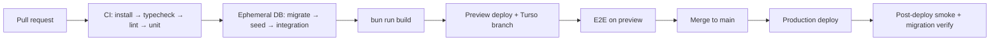

# Deployment, Runtime and Environments — Exampify

| Field | Value |
|-------|-------|
| Version | 1.0 |
| Status | Proposed |
| Depends on | [PRODUCT_ARCHITECTURE.md](./PRODUCT_ARCHITECTURE.md), [ARCHITECTURE_DECISIONS.md](./ARCHITECTURE_DECISIONS.md) |
| Referenced by | [MVP_ROADMAP.md](./MVP_ROADMAP.md), [SECURITY_AND_PERMISSIONS.md](./SECURITY_AND_PERMISSIONS.md), [TESTING_STRATEGY.md](./TESTING_STRATEGY.md) |

---

## 1. Purpose and scope

Where the application runs, how it is built and released, which environment variables exist, and how the previously documented PostgreSQL/Drizzle architecture is migrated to this one.

**In scope:** Vercel project configuration, Bun runtime requirements and limits, environment matrix, secrets inventory, CI/CD, preview environments, migrations in the deploy pipeline, observability, rollback, cost envelope, migration plan.

**Out of scope:** local feature workflow (`TECHNICAL_STANDARDS.md`), job semantics (`BACKGROUND_JOBS.md`), search internals (`SEARCH_ARCHITECTURE.md`).

---

## 2. Runtime decision

| Layer | Choice | Status |
|---|---|---|
| Hosting | **Vercel** | Requested; replaces the previous "undecided" (`D-01`) |
| Runtime | **Bun** via `bunVersion`, currently `"1.x"` (Bun 1.3.x) | **Beta on Vercel.** Accepted with a documented fallback |
| Framework | Next.js App Router, Node-compatible function runtime (not Edge) | Required: Better Auth scrypt, `@libsql/client` and the AWS SDK all expect Node APIs |
| Region | Single region, co-located with the Turso primary and the Qdrant cluster (EU or US) | Latency-critical; see §3.4 |
| Edge runtime | **Not used in MVP** | Would break auth hashing and the libSQL driver |

### 2.1 Vercel + Bun requirements

```jsonc
// vercel.json
{
  "$schema": "openapi.vercel.sh/vercel.json",
  "bunVersion": "1.x",
  "functions": {
    "src/app/api/v1/internal/jobs/*/route.ts": { "maxDuration": 60 }
  },
  "crons": [
    { "path": "/api/v1/internal/cron/retry-failed-events", "schedule": "*/10 * * * *" }
  ]
}
```

```jsonc
// package.json (excerpt)
{
  "scripts": {
    "dev": "bun run --bun next dev",
    "build": "bun run --bun next build",
    "start": "bun run --bun next start",
    "typecheck": "tsc --noEmit",
    "db:migrate": "bun run scripts/migrate.ts"
  }
}
```

**Rules that are easy to break and fail loudly in production:**

1. **Do not set `engines.node`** in `package.json`. If it is present without a Bun version, Vercel runs Node and logs a warning — the application then works but is not on the requested runtime.
2. **ISR requires the `--bun` flag** on `next build` and `next dev`. Without it, prerendering can behave differently between build and function execution.
3. `bunVersion` accepts only `"1.x"` or `"1.4.x"`. Bun 1.4 is a Rust rewrite with breaking changes; adopting it is a deliberate migration (`OQ-D1`), not a patch bump.
4. Bun on Vercel runs on Fluid compute with Active CPU pricing. Long CPU spikes (scrypt, Markdown rendering of a large resource) are billed differently from wall-clock idle time — relevant to the cost model, not correctness.
5. Bun is **beta** on Vercel. The fallback is removing `bunVersion` (Node 22) while keeping Bun for local development and `bun install`. Nothing in the application may depend on a Bun-only API, so the fallback is a config change, not a rewrite ([ADR-025](./ARCHITECTURE_DECISIONS.md#adr-025--bun-on-vercel-with-a-node-fallback)).

### 2.2 Dependency compatibility matrix

Verify each of these in the **Phase 1 spike**, on a deployed preview, before building features on top.

| Dependency | Bun concern | Mitigation |
|---|---|---|
| `next` | Officially supported on Bun per Vercel docs; ISR needs `--bun` | Pin the version; run the spike with a real ISR page |
| `@libsql/client` | Native bindings for `file:` URLs do not exist in the Bun/Vercel function bundle | Import from **`@libsql/client/web`** (Hrana over HTTP/WebSocket) for remote Turso. Local scripts use the Node entry |
| `@libsql/kysely-libsql` | Thin dialect over the client; inherits the above | Pass an existing `client` created from the web entry |
| `kysely` | Pure TypeScript | None |
| `better-auth` | Default scrypt runs in Bun's crypto; no native addon expected | Benchmark sign-in p95; lower cost parameters if > 300 ms |
| `@qdrant/js-client-rest` | Fetch-based | None |
| `@upstash/qstash`, `@upstash/redis` | Fetch/REST based | None |
| `@aws-sdk/client-s3` (Tigris) | Works in Node-compatible runtimes; presigning uses crypto | Use only in route handlers, never in client components |
| `next/image` + Tigris | Needs `remotePatterns` | Configured in §5 |
| Markdown/KaTeX pipeline | CPU-bound | Measure build vs request cost; render at publish time if it exceeds 150 ms |

**Escalation rule:** if a dependency fails only under Bun, the fallback is to deploy that route on the Node runtime (`export const runtime = 'nodejs'`) while the rest of the app stays on Bun — not to fork the architecture. If more than two critical dependencies fail, drop `bunVersion` entirely.

---

## 3. Environments

| Environment | Purpose | Database | Search | Storage | Jobs |
|---|---|---|---|---|---|
| **Local** | Development | Turso dev database or `file:./.data/dev.db` | Docker Qdrant or `dev` collection | `dev` bucket | `bun run jobs:drain` (no QStash) |
| **Preview** | Every PR | Turso **branch** per PR (`preview/pr-<n>`) | Shared `content_preview` collection, filtered by `environment` payload | `preview` bucket | QStash disabled by default; drain on demand |
| **Production** | Live | Turso production database | `content_v1` | `production` bucket | QStash + Vercel Cron |

### 3.1 Preview isolation

Turso supports branching, which gives each preview deployment a copy-on-write database without copying data. Preview databases are created by CI on PR open and deleted on merge/close by a scheduled cleanup. If branching is unavailable on the plan, the fallback is a single staging database with destructive tests forbidden and seed-only data — documented, not silently different.

Qdrant has no branching. Preview uses a separate collection with an `environment: "preview"` payload field and **every** query filters on it. Preview never writes to the production collection, and the preview collection is truncated weekly.

### 3.2 Secrets per environment

Never shared between preview and production: `TURSO_DATABASE_URL`, `TURSO_AUTH_TOKEN`, `BETTER_AUTH_SECRET`, `QDRANT_API_KEY`, `TIGRIS_SECRET_ACCESS_KEY`, `QSTASH_TOKEN`, `UPSTASH_REDIS_REST_TOKEN`, `CRON_SECRET`.

Shared safely: `NEXT_PUBLIC_SITE_URL` differs per environment; nothing else is public.

### 3.3 Region co-location

Choose one geography and stay in it: Vercel function region = Turso primary location = Qdrant cluster region. A cross-continent libSQL round trip costs 80–150 ms **per query**; a topic hub makes up to 6. This is the single largest performance decision in the stack and cannot be fixed later by caching alone.

### 3.4 Execution limits

| Limit | Value (verify per plan) | Design response |
|---|---|---|
| Function duration | 10 s default, 60 s configured for jobs, up to 800 s (Pro) | Jobs bounded to 100 entities; nothing streams for minutes |
| Memory | 1–2 GB typical | Markdown rendering is per-resource, not bulk |
| Bundle size | 250 MB standard | No native binaries, no ML models in the function |
| Request body | 4.5 MB | Media bypasses functions entirely (presigned PUT) |
| Cron frequency | Per-minute on Pro; daily on Hobby | QStash schedules carry the frequent work |

---

## 4. Environment variables

### 4.1 Inventory

| Variable | Scope | Required | Notes |
|---|---|---|---|
| `TURSO_DATABASE_URL` | server | yes | `libsql://…` in deployed environments, `file:./.data/dev.db` locally |
| `TURSO_AUTH_TOKEN` | server | yes (remote) | Database-scoped token, not a platform token |
| `BETTER_AUTH_SECRET` | server | yes | ≥ 32 random bytes; rotating it invalidates sessions |
| `BETTER_AUTH_URL` | server | yes | Exact public origin, no trailing slash |
| `GOOGLE_CLIENT_ID` / `GOOGLE_CLIENT_SECRET` | server | no | OAuth is SHOULD; omit to disable the button |
| `QDRANT_URL` | server | yes | Cluster endpoint |
| `QDRANT_API_KEY` | server | yes | Cluster-scoped |
| `QDRANT_COLLECTION` | server | yes | `content_v1` / `content_preview` |
| `TIGRIS_BUCKET` | server | yes | Bucket name |
| `TIGRIS_ENDPOINT` | server | yes | `https://t3.storage.dev` |
| `TIGRIS_ACCESS_KEY_ID` / `TIGRIS_SECRET_ACCESS_KEY` | server | yes | S3-compatible credentials; never public |
| `TIGRIS_PUBLIC_URL` | server + client | yes | Public bucket domain or custom domain, used by `next/image` |
| `QSTASH_TOKEN` | server | yes | Publish token |
| `QSTASH_CURRENT_SIGNING_KEY` / `QSTASH_NEXT_SIGNING_KEY` | server | yes | Verify inbound job requests |
| `UPSTASH_REDIS_REST_URL` / `UPSTASH_REDIS_REST_TOKEN` | server | yes | Rate limits, short locks |
| `CRON_SECRET` | server | yes | Vercel Cron bearer |
| `NEXT_PUBLIC_SITE_URL` | public | yes | Canonical origin for metadata, sitemap, links |
| `EMAIL_PROVIDER` | server | yes | `sendust` in deployed environments; `stub` in tests and local development ([ADR-035](./ARCHITECTURE_DECISIONS.md#adr-035--sendust-as-the-mail-transport-over-an-smtp-relay)) |
| `EMAIL_SMTP_HOST` | server | yes | `smtp.gmail.com` — the relay, not the transport ([ADR-037](./ARCHITECTURE_DECISIONS.md#adr-037--google-smtp-as-the-mail-relay)) |
| `EMAIL_SMTP_PORT` | server | yes | `465` (implicit TLS); `587` (STARTTLS) is the documented alternative |
| `EMAIL_SMTP_SECURE` | server | yes | `tls` on 465, `starttls` on 587; `lib/env.ts` rejects a port/security mismatch instead of letting the transport fail at the first send |
| `EMAIL_SMTP_USER` / `EMAIL_SMTP_PASS` | server | yes | Full Google address and a 16-character **app password** — not the account password. The sending account needs 2-Step Verification first, and app passwords disappear if the account switches to security-key-only 2SV or Advanced Protection |
| `EMAIL_FROM` | server | yes | `Exampify <no-reply@mail.<domain>>` on the verified sending subdomain |
| `ERROR_TRACKING_DSN` | server | yes in production | Sentry DSN ([ADR-032](./ARCHITECTURE_DECISIONS.md#adr-032--sentry-for-error-tracking-and-source-maps)); empty disables the SDK locally, and production fails at boot if missing |
| `SENTRY_AUTH_TOKEN` | build/CI | yes for production builds | Uploads source maps; never exposed to the runtime bundle |
| `SENTRY_ORG` / `SENTRY_PROJECT` | build/CI | yes | Slugs for `withSentryConfig` |
| `JOBS_DEV_BYPASS` | server | no | **Local only**; must be absent in production (startup assertion) |

### 4.2 Validation

`lib/env.ts` parses `process.env` with a Zod schema at module load: server schema and public schema are separate, so a server secret can never be imported into a client bundle. A missing or malformed variable throws at boot (build fails on Vercel) rather than at first use. `NEXT_PUBLIC_*` names are restricted by a lint rule.

### 4.3 Never

- `NEXT_PUBLIC_` prefix on any secret.
- Turso **platform** API tokens in the app (only database tokens).
- `TIGRIS_SECRET_ACCESS_KEY` in a client component, a log, a presigned URL or an error message.
- `@sendust/ts` with a floating version or outside `serverExternalPackages` — the native addon then fails to load in production rather than at build time.
- The Google **account password** in `EMAIL_SMTP_PASS` — it must be an app password, and the account password both fails to authenticate and puts the whole account in a secret store.
- The founder's primary Google account as the sending identity — use a dedicated account, because rotation and suspension both take the mailbox with them.
- Real secrets in `.env.example`, tests or documentation.

---

## 5. Build and release pipeline



1. `bun install --frozen-lockfile` (lockfile committed; CI fails on drift).
2. `tsc --noEmit`, ESLint, unit tests.
3. Migrations against an ephemeral database, then integration tests.
4. `bun run --bun next build`.
5. Preview deploy; migrations for preview run against its branch.
6. E2E on the preview URL (4 journeys).
7. Production deploy. **Migrations run before the new deployment serves traffic** — additive-first policy makes this safe for one version skew.
8. Post-deploy: `/health`, one topic page, one authenticated attempt, one search query.

**Rollback:** promote the previous deployment (Vercel instant rollback). Because migrations are additive-first, the previous build runs against the new schema. A destructive migration is therefore forbidden in the same release as the code that stops using the column — that is the rule that makes rollback real.

---

## 6. Storage and image configuration

```ts
// next.config.ts (excerpt)
const nextConfig = {
  images: {
    remotePatterns: [
      { protocol: 'https', hostname: new URL(env.TIGRIS_PUBLIC_URL).hostname, pathname: '/**' },
    ],
    formats: ['image/avif', 'image/webp'],
  },
  experimental: { optimizePackageImports: ['remeda'] },
};
```

- Public images: `next/image` with explicit `width`/`height` from `media_assets`; Tigris serves through its global endpoint or a custom domain with managed TLS.
- Private images: presigned GET (≤ 5 min) rendered with a plain ``; the optimizer is skipped because caching a short-lived URL is pointless and leaks it into the CDN.
- Uploads: `POST /api/v1/studio/media/upload-url` → presigned PUT (5 min, exact `Content-Type` and `Content-Length` in the signature) → browser uploads directly → `POST …/confirm` verifies with `HEAD` and marks `ready`.
- **Tigris presigned URLs are valid up to 90 days**, but the application never issues more than 5 minutes for uploads and 10 minutes for private reads. A long-lived URL is a leaked credential.
- Deleting an object is idempotent; replacing an asset writes a new key and updates the reference, so CDN caches never serve stale bytes under the same URL.

---

## 7. Observability and operations

| Concern | Mechanism |
|---|---|
| Errors | Error-tracking SDK in `instrumentation.ts` + `error.tsx` boundaries, with `requestId` |
| Logs | Structured JSON to Vercel logs; no PII, no tokens, no `answer_key` |
| Traces | `requestId` propagated to Qdrant/QStash calls; a slow-query log above 100 ms |
| Health | `/api/v1/health` checks Turso (`SELECT 1`), Qdrant (collection info), and reports index lag; no secrets |
| Alerts | Error rate > 2 % for 5 min; p95 search > 1 s; pending `search_events` > 100; DLQ non-empty |
| Backups | Turso point-in-time restore (1 day free, longer on paid) + a nightly logical dump to Tigris (`backups/yyyy/mm/dd.sql.gz`), 30-day retention |
| Restore drill | Once before launch, quarterly after: restore a dump into a scratch database and render a topic + review an attempt ([OPERATIONS_RUNBOOK.md](./OPERATIONS_RUNBOOK.md) R8) |
| Runbooks | Every alert maps to an entry in [OPERATIONS_RUNBOOK.md](./OPERATIONS_RUNBOOK.md); an alert without one is deleted |
| Product events | `usage_events`, server-side, 90 days ([OBSERVABILITY_AND_ANALYTICS.md](./OBSERVABILITY_AND_ANALYTICS.md) §6) |

**RTO/RPO target:** RPO ≤ 24 h (logical dump) or ≤ 1 h with point-in-time restore; RTO ≤ 4 h. Documented because "the database is managed" is not a backup strategy.

---

## 8. Cost envelope (order of magnitude, verify before committing)

| Service | Free tier | First paid step | Notes |
|---|---|---|---|
| Vercel | Hobby | Pro ~$20/user/mo | Commercial use requires Pro, so the Pro line is an **assumption of this envelope** pending `OQ-D2`; Fluid compute billing |
| Turso | 5 GB, 500 M rows read, 10 M rows written, 100 DBs | Developer ~$5–6/mo (9 GB) | Search + page reads dominate row reads |
| Qdrant Cloud | 1 free cluster | ~$25/mo+ for a production cluster | Free cluster is for development and the spike |
| Tigris | Free tier with limits | Usage-based, no egress fees | Media volume is small for text-first content |
| Upstash QStash | 1,000 msg/day | $1 per 100k | Index events only |
| Upstash Redis | 10k commands/day (typical free) | Pay-as-you-go | Rate limits only |
| Email (`@sendust/ts` + Google SMTP) | Personal Gmail or Workspace trial: 500 messages/day; paid Workspace: 2,000/day. No free tier for a custom sending domain | Google Workspace, per user/month | The transport is a library with no fee. The cap is a **hard refusal** with no vendor queue, and the alias for `mail.<domain>` needs Workspace (`ADR-037`) |
| Error tracking (Sentry) | 1 user, 5,000 errors/mo, 5 GB logs | Team $26/mo | Error volume stays low only if expected control-flow errors are not reported (`OBSERVABILITY_AND_ANALYTICS.md` §3.4) |

**Realistic MVP floor: $0–5/month** on free tiers with light traffic, **$50–90/month** once Vercel Pro, a paid Qdrant cluster and a small Turso plan are in place — the Pro line assumes a commercial launch (`OQ-D2`); a confirmed non-commercial launch removes it and leaves **$30–70/month**. Every one of these can become a launch blocker if a free tier pauses (Qdrant sleeping clusters, Upstash daily caps, Turso row-read limits under a search-heavy crawl). Mitigations: CDN caching, suggest caching, and a documented upgrade order — Qdrant first, then Turso, then Vercel.

---

## 9. Migration from the previous architecture

The application does not exist yet, so this is a **documentation and plan migration**, not a data migration. The sequence below is the order to build in, and it doubles as the answer to "what would change if code already existed".

| Previous | New | Action |
|---|---|---|
| Next.js on Node runtime | Next.js on Bun (Vercel), Node fallback | Config only; no application rewrite. `--bun` on build/dev, drop `engines.node` |
| PostgreSQL (Neon class) | Turso (libSQL) | Schema rewrite: enums → `CHECK`, `timestamptz` → `INTEGER` ms, `jsonb` → `TEXT` + `json_valid`, arrays → JSON text, `numeric` → integer hundredths |
| Drizzle ORM + Drizzle Kit | Kysely + Kysely `Migrator` | Hand-written schema types; migrations as numbered TS modules with SQL snapshots |
| `tsvector` + GIN + `websearch_to_tsquery` | FTS5 `search_documents` + `bm25()`; Qdrant for semantics | New search module; `MATCH` expressions built from tokens, bound as parameters |
| Postgres row locks + transactions | `BEGIN IMMEDIATE` + conditional `UPDATE … WHERE status=?` | Submit idempotency reimplemented; no `FOR UPDATE` |
| Drizzle relations / joins | Kysely joins, explicit projections | Same queries, different builder; N+1 rule unchanged |
| Auth library undecided | **Better Auth** with `LibsqlDialect` | Confirmed supported path; auth tables owned by the library |
| Postgres roles | Turso table/action-scoped tokens | `app_rw`, `app_read`, `migrator` tokens; per-table grant list maintained by hand |
| `learning_materials` + `tutorials` | `learning_resources` + `content_blocks` + `assessments` | Content re-modelled around the three product shapes |
| `practice_sessions` / `question_sets` | `assessment_attempts` / `assessments` | Attempts are the same engine with a wider scope; sets become assessments |
| Object storage (unspecified) | Tigris | Presigned upload/download, metadata only in Turso |
| No queue | QStash + transactional outbox | Only for indexing, email, schedules |
| Postgres FTS search + no vector search | Hybrid Qdrant + FTS5 | New subsystem; see `SEARCH_ARCHITECTURE.md` |
| `es-toolkit` | **Remeda** | Mechanical import change |
| Hosting undecided | Vercel | `vercel.json`, cron, env matrix |

**What does *not* change:** the taxonomy hierarchy, cross-listed questions, `answer_key` as the single scoring payload, attempt snapshots of version/points, app-layer authorisation, REST as the only mutation contract, TanStack Query conventions, ISR + tag invalidation, the design system, and the editorial rules. Those were sound and independent of the database engine.

**What must be validated before Phase 2** (the "spike", ~2 days):

1. Bun + Next.js build and serve an ISR page on Vercel.
2. `@libsql/client/web` + `LibsqlDialect` query and transact against a Turso branch.
3. Better Auth signs up, signs in, persists a session and revokes it, on Bun.
4. Tigris presigned PUT from a browser and `next/image` renders the public object.
5. Qdrant Cloud Inference embeds with `query:`/`passage:` prefixes and returns a sensible neighbour.
6. QStash delivers a signed request to a preview deployment; an invalid signature is rejected.
7. `bun run --bun next build` output size and cold-start duration are acceptable.

If any item fails, the response is documented in `ARCHITECTURE_DECISIONS.md` before proceeding — not worked around silently.

---

## 10. Edge cases

IDs here are prefixed `DEP-` so they cannot be confused with the ADR decision IDs `D-01`–`D-11` (`ARCHITECTURE_DECISIONS.md` §5), which this document cites elsewhere.

| # | Case | Handling |
|---|---|---|
| DEP-01 | `engines.node` is present in `package.json` | Vercel silently runs Node; a CI check fails the build if `engines.node` exists while `bunVersion` is set |
| DEP-02 | Bun 1.4 adopted accidentally | `bunVersion` is pinned to `"1.x"`; upgrading requires a PR that runs the full suite |
| DEP-03 | Preview writes to the production Qdrant collection | Collection is chosen by env and every query filters `environment`; a startup assertion compares `QDRANT_COLLECTION` to `VERCEL_ENV` |
| DEP-04 | Migration fails mid-deploy | Deploy is blocked before traffic shifts; the previous deployment keeps serving; the failure is surfaced in CI |
| DEP-05 | Rollback after a destructive migration | Forbidden by policy: destructive changes ship one release after the code stops using them |
| DEP-06 | Turso token expires | Health check fails and alerts; tokens are created without expiry for the runtime and rotated on a schedule |
| DEP-07 | Function region drifts from the database region | Latency alert on p95 DB time; region pinned in `vercel.json` |
| DEP-08 | A 4.6 MB JSON body | Rejected by the platform before the handler; the API documents the upload path for large files |
| DEP-09 | Secret committed to the repo | Rotate immediately; `.env*` gitignored; CI secret scan blocks the PR |
| DEP-10 | Qdrant free cluster throttles at launch | Upgrade order documented (§8); lexical-only degradation keeps search usable |
| DEP-11 | Build works locally, fails on Vercel Bun | Reproduce with `bun run --bun next build` locally; if irreproducible, drop `bunVersion` and file the incompatibility |

---

## 11. Acceptance criteria

1. `bun install --frozen-lockfile && bun run --bun next build` succeeds on a clean checkout.
2. The deployed preview reports `bun` as the runtime and serves an ISR page with correct cache headers.
3. Removing `bunVersion` and redeploying still works (Node fallback proven, not assumed).
4. `lib/env.ts` fails the build when a required variable is missing, and never exposes a server variable to the client bundle.
5. A PR gets an isolated Turso branch and an isolated Qdrant namespace; merging deletes the branch.
6. Migrations run before traffic and are idempotent; a failed migration blocks the release.
7. Instant rollback to the previous deployment serves correctly against the current schema.
8. Presigned uploads work from a browser with no credentials present; a wrong `Content-Type` is rejected by storage.
9. `/health` reports each dependency and leaks nothing.
10. A restore from the nightly dump reproduces a topic page and an attempt review.

---

## 12. Open questions

| # | Question | Impact |
|---|---|---|
| OQ-D1 | Adopt Bun 1.4 (`bunVersion: "1.4.x"`) at launch or stay on `1.x`? | 1.4 is a rewrite with breaking changes; `1.x` is the conservative default — **Open — needs:** decide Bun 1.4 timing after the 1.x spike; **blocks Phase 7**. |
| OQ-D2 | Vercel plan tier (Hobby vs Pro) at launch? | Commercial use requires Pro and non-commercial use does not, so the answer turns on whether launch is commercial, which is **not assumed** here. §8 uses Pro as its cost basis until that is settled. Hobby is viable only for a non-commercial launch; the frequent sweeps run on QStash and the Vercel Cron backstop works on either tier (`OQ-J4`) — **Open — needs:** state whether the launch is commercial (and therefore whether Pro's terms apply); **blocks Phase 7**. |
| OQ-D3 | Which region for Vercel + Turso + Qdrant? | Latency; depends on the launch audience (Indonesia vs global) **Open — needs:** decide the region from the launch audience (`OQ-01`); **blocks Phase 1**. |
| OQ-D4 | Turso branching on the chosen plan, or a single staging database? | Preview isolation quality — **Open — needs:** decide Turso branching vs a single staging database on the chosen plan; **blocks Phase 1**. |
| OQ-D5 | ~~Is a custom domain on Tigris required for branded asset URLs?~~ **Resolved: no.** `TIGRIS_PUBLIC_URL` accepts the Tigris global endpoint and `next/image` reads its hostname (§6); a custom domain with managed TLS is a branding option that changes one variable, not a dependency | Nothing blocks. Add a domain only if brand/SEO work asks for one |
| OQ-D6 | ~~Error tracking vendor?~~ Resolved: Sentry ([ADR-032](./ARCHITECTURE_DECISIONS.md#adr-032--sentry-for-error-tracking-and-source-maps)) | Observability completeness |
| OQ-D7 | Backup retention beyond 30 days? | Cost vs compliance — **Open — needs:** decide whether backups must outlive 30 days (cost vs compliance); **blocks Phase 7**. |
