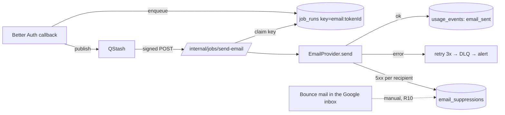

# Email and Notifications — Exampify

| Field | Value |
|-------|-------|
| Version | 1.0 |
| Status | Proposed |
| Depends on | [BACKGROUND_JOBS.md](./BACKGROUND_JOBS.md), [SECURITY_AND_PERMISSIONS.md](./SECURITY_AND_PERMISSIONS.md), [PRIVACY_AND_DATA_PROTECTION.md](./PRIVACY_AND_DATA_PROTECTION.md), [DEPLOYMENT_AND_ENVIRONMENTS.md](./DEPLOYMENT_AND_ENVIRONMENTS.md) |
| Referenced by | [MVP_ROADMAP.md](./MVP_ROADMAP.md), [OPERATIONS_RUNBOOK.md](./OPERATIONS_RUNBOOK.md) |

---

## 1. Purpose and scope

Every transactional email the product sends: what triggers it, how it is queued, how duplicates and failures are handled, how it is delivered and how it is tested.

**In scope:** provider abstraction and selection criteria, the message inventory, the delivery pipeline, templates and copy rules, deliverability (SPF/DKIM/DMARC, suppression), anti-abuse, privacy, testing.

**Out of scope:** marketing campaigns, newsletters, product announcements, in-app notification centre, push notifications. None of these exist in MVP and adding them requires a new decision.

**Principle:** email is a **delivery channel for an action the user already took**, never a growth channel. If an email is not required to complete a task or secure an account, it does not ship.

---

## 2. Provider decision

**`@sendust/ts` sends the mail; Google SMTP is the relay behind it** (`OQ-05`, [ADR-035](./ARCHITECTURE_DECISIONS.md#adr-035--sendust-as-the-mail-transport-over-an-smtp-relay) for the transport, [ADR-037](./ARCHITECTURE_DECISIONS.md#adr-037--google-smtp-as-the-mail-relay) for the relay). The transport owns the SMTP conversation; Google owns the account, the sending IPs and the quota. Application code depends on `EmailProvider`, so a relay swap is an environment-variable block and a transport swap is one file.

**Google gives us no delivery events.** There is no webhook and no delivery API for `smtp.gmail.com` — only the synchronous SMTP reply at send time (ADR-037). Everything below about suppression, the delivery SLO and the runbook follows from that one absence, so do not reintroduce a webhook-shaped assumption without a new ADR.

### 2.1 The adapter

```ts
// lib/email/provider.ts
export type TransportStatus = 'accepted' | 'rejected' | 'unknown';

export interface EmailMessage {
  to: string;
  subject: string;
  text: string;
  html: string;
  /** The `job_runs` key: the correlation id in logs and the only duplicate guard (ADR-036). */
  idempotencyKey: string;
  tags?: { template: EmailTemplate };
}

export interface SendOutcome {
  status: TransportStatus;
  recipients: { address: string; status: TransportStatus }[];
  response?: { code: number; message: string };
}

export interface EmailProvider {
  readonly name: 'sendust' | 'stub';
  send(message: EmailMessage): Promise<SendOutcome>;
}
```

There is no `verifyWebhook`: the relay has none (ADR-037). If a future relay provides delivery events, that is a new method and a new ADR, not an optional hook left lying around.

One implementation file per transport, selected by `EMAIL_PROVIDER` in `lib/env.ts`. Application code calls `sendEmail()` and never imports `@sendust/ts` outside that file.

`accepted` means **the relay took responsibility**, never that a mailbox received the message — SMTP cannot tell us that, and with Google there is no delivery event to ask afterwards (§2.4). There is no `providerMessageId`: SMTP has no per-message id a caller can rely on, so the log line carries the `job_runs` key and the relay's final reply text.

### 2.2 Selection criteria (evaluate, do not assume)

| Criterion | Why it matters | Verified how |
|---|---|---|
| SMTP over TLS from the deployed function | The transport speaks SMTP only and has no plaintext mode | Spike: one send on port 465 from the deployed runtime |
| Duplicate protection we control | SMTP has no idempotency primitive and the relay offers none, so the database must carry it alone | A repeated QStash delivery produces exactly one message |
| Behaviour at the daily cap | It decides whether a spike fails sign-ups or only delays them | Send past the cap (2,000/day on paid Workspace, 500 otherwise) and capture the refusal |
| Delivery feedback | The suppression list needs a source | Google gives only the synchronous reply; later bounces arrive as mail and are reconciled by hand for MVP (`OQ-E6`, decided in §5) |
| Sender identity control | `From` must be the account or a verified alias | Send with the intended `From` and confirm Gmail does not rewrite or cloak it |
| SPF/DKIM/DMARC instructions for a subdomain | Deliverability to Gmail/Outlook | Set up `mail.<domain>` in the spike |
| Free tier adequate for auth volume | Verification + reset at low thousands/month | Pricing page, recorded in the spike note |
| Data location / DPA available | Privacy posture ([PRIVACY_AND_DATA_PROTECTION.md](./PRIVACY_AND_DATA_PROTECTION.md) §8) | Provider DPA page |

Do not claim a provider's limits from memory. The choice is recorded with a dated spike note and a link to the pricing page that was read.

### 2.3 The transport: `@sendust/ts`

`@sendust/ts` is an SMTP transport — a narrow TypeScript facade over a Node-API addon — not an email provider. It has no account, no API key of its own and no webhooks; it opens sessions to whatever relay the environment configures. Facts below are read from the published package `1.0.0` on 2026-11-21 (the tarball's `README.md` and type definitions — the package publishes no docs site), and the full record with sources is [ADR-035](./ARCHITECTURE_DECISIONS.md#adr-035--sendust-as-the-mail-transport-over-an-smtp-relay).

| Property | Value | Consequence for us |
|---|---|---|
| API | `createTransport({ host, port, secure: 'tls' \| 'starttls', auth })`, `transport.send(message)`, `transport.close()`, `transport.stats` | One file, no provider SDK in domain code |
| Result | `{ status: 'accepted' \| 'rejected' \| 'unknown', recipients[], response? }` — relay acceptance, never delivery | The mapping in §4.1 is the contract; `unknown` is the case that must not be retried |
| TLS | Always on; no plaintext mode and no switch to disable verification | A wrong port fails loudly instead of leaking credentials |
| Internal retries | Only transient failures (a `4xx` final reply, or a connect/operation timeout before `DATA`), `maxAttempts` default 3 | Transport retries are inside `send()`; ours are outside it |
| Queue | Bounded (10,000 messages / 64 MiB by default); beyond it `send()` throws `LIMIT_QUEUE_FULL` | A burst becomes a job failure with a stable code, not unbounded memory |
| Errors | `SendustError` with a stable `code` and a `category` (`validation`, `configuration`, `limit`, `tls`, `authentication`, `protocol`, `timeout`, `closed`, `busy`, `internal`); bodies and credentials never appear in `details` | Branch on `code`, never on message text; the code is what lands in `job_runs.error_code` |
| Runtime | Node ≥ 22.23.5; prebuilt per-platform optional dependencies (`@sendust/ts-linux-x64-gnu` on Vercel) | The binary must be traced into the function bundle and the version pinned |
| Message | `from`, `to`/`cc`/`bcc`/`replyTo`, `subject`, `text`/`html`, `headers`, in-memory attachments or path attachments only when explicitly enabled | Our templates are text + HTML, no attachments |

**Pin and trace.** `@sendust/ts` is pinned to an exact version (no `^`), and `next.config.ts` lists it in `serverExternalPackages` so the platform `.node` file is traced into the serverless function instead of being inlined by the bundler. Both are review checklist items: a floating version silently changes transport behaviour, and a missing binary fails at the first sign-up rather than at build time.

### 2.4 The relay: Google SMTP

| Property | Value (read 2026-11-21) | Why it fits |
|---|---|---|
| SMTP endpoint | `smtp.gmail.com` — port `465` implicit SSL/TLS, `587` STARTTLS | Port 465 means TLS from the first byte; we configure `secure: 'tls'` |
| Credentials | Username is the **full Google address**, password is a 16-character **app password** (not the account password) | Nothing new to procure, but the credential belongs to a Google account, not to the app |
| Prerequisite | 2-Step Verification on the sending account; app passwords are unavailable on security-key-only 2SV, under Advanced Protection, or when a Workspace admin disables them | Checked before the first send, not discovered at 3 a.m. |
| Daily limit | 2,000 messages/day per user on paid Workspace, 500 on personal Gmail or a Workspace trial; rolling 24 h, shared with every other client using the account | 500/day covers the spike; 2,000/day covers launch |
| Recipients per message | 100 per message over SMTP | Irrelevant to auth mail, relevant if a digest is ever added |
| Delivery events | **None** — no webhook, no delivery API; only the synchronous SMTP reply | This is the constraint the rest of this document is built around |
| Duplicate protection | None | `job_runs` is the only guard |
| Sender identity | `EMAIL_FROM` must be the account address or a verified "Send mail as" alias | A `mail.<domain>` sender needs Workspace plus a verified alias |

Sources: [Gmail IMAP, POP and SMTP](https://developers.google.com/workspace/gmail/imap/imap-smtp), [sign in with app passwords](https://support.google.com/mail/answer/185833), [Gmail sending limits](https://knowledge.workspace.google.com/admin/gmail/gmail-sending-limits-in-google-workspace), [send email from an app](https://knowledge.workspace.google.com/admin/gmail/send-email-from-a-printer-scanner-or-app).

**The cap is a hard refusal, not a queue.** At 2,000 messages in a rolling day (500 on a personal account) Gmail rejects further mail; nothing holds it for us. The worker records `quota_exhausted`, schedules no retry until the window rolls, and alerts (`OPERATIONS_RUNBOOK.md` `R10`). **The exact reply is a spike item** (`ADR-037` gate 4) — it decides whether we observe `rejected` or transient retries followed by `rejected`.

**Suppression without events.** Two very different bounce cases exist, and only one is observable:

1. **Synchronous refusal.** Google rejects the recipient during the SMTP conversation (unknown mailbox, blocked domain). The send path sees it as `rejected` with a 5xx, and this is what still writes `email_suppressions` automatically.
2. **Asynchronous bounce.** Google accepts the message and bounces it minutes later. No event reaches us; a bounce report arrives as mail in the sending account's inbox. An operator reconciles it into `email_suppressions` with `reason='hard_bounce'` during the `R10` check. The same is true of spam complaints.

Do not describe the suppression list as provider-fed. It is accurate for case 1 and operator-maintained for case 2, and the difference matters when someone asks why a dead address got a second reset email.

**No delivery SLO from events.** `accepted` proves Google took responsibility; whether the message landed is unobservable from the application. The SLO is therefore built on `rejected` rate, `unknown` rate, user reports and the bounce inbox — not on a delivered event that does not exist.

**Fallback relay: none configured.** The constraint is Google-only (ADR-037), so there is no second relay to switch to by environment variable. If Google cannot carry the mail, that is a decision to reopen, not a config change. **Fallback transport:** if the addon cannot load in the deployed runtime after the Node-runtime fallback (ADR-025), an HTTP adapter for Google's API (OAuth 2.0) returns behind the same `EmailProvider` — a code change, and the reason ADR-035 names an HTTP adapter as the exit.

**What would reopen the relay decision:** auth volume approaching 2,000/day; a launch spike exhausting the cap; deliverability failures traced to Google's shared reputation; the alias for `mail.<domain>` failing verification; Google blocking SMTP from the deployed runtime or suspending the account; or async bounces frequent enough that manual reconciliation misses suppressions (ADR-037).

### 2.5 Transport lifecycle in a serverless function

- **One transport per instance, created at module scope** in `lib/email/provider.ts`. Creating one per request throws away the pool, pays a TLS handshake per send, and leaks native sessions.
- **`close()` is a shutdown operation, not a request operation.** It drains for up to `closeMs` (125 s default) and cancels an in-flight send as `unknown`, so it belongs in a process-signal handler — never in a `finally` around a send.
- **Sockets outlive the request but not the instance.** Defaults are safe; if a long-lived instance accumulates sessions, lower `maxConnections`/`sessionIdleMs` rather than calling `close()`.
- **`EMAIL_PROVIDER=stub` is the local default**, so tests and `bun dev` open no sockets.

### 2.6 Why not send inline from the request

Better Auth requires a `sendVerificationEmail` callback. Sending inside it couples sign-up latency and success to a third-party API. The callback instead **enqueues** and returns; the QStash job sends.

Fallback: if enqueueing fails (QStash unavailable), the callback performs one direct send with a 3-second timeout, then returns. The user is told "we couldn't send the email — try resending in a minute" instead of silently receiving nothing. Enqueue health is therefore a user-facing concern, not an internal one.

---

## 3. Message inventory

| Template | Trigger | Recipient | Blocking? | Link / token | Retention of token |
|---|---|---|---|---|---|
| `verify-email` | Sign-up, or "resend verification" | New account | Yes — sign-in works, practice does not until verified | `GET /verify?token=` | 30 days (Better Auth default, documented) |
| `reset-password` | "Forgot password" | Account email | No | `GET /reset-password?token=` | 1 hour, single use |
| `email-change` | Change email in account settings | **New** address | — | `GET /verify?token=&kind=change` | 1 hour |
| `password-changed` | Password changed or reset completed | Account email | No | none | — |
| `account-deleted` | Account deletion | Account email (last message) | No | none | — |

**Deliberately absent:** welcome drips, "you haven't practised in 3 days", attempt-result digests, studio invitations, comment notifications. Each is a retention/marketing feature with its own consent and unsubscribe obligation; none is in MVP.

**Copy rules**

- Subject ≤ 60 characters, states the action ("Verify your Exampify email"), never urgency theatre ("Act now!").
- One primary link, one purpose, no secondary marketing links.
- Plain-text part is a real alternative, not a stub — some clients only show it.
- Expiry is stated in the body when the token expires in under a day.
- Support path: `support@<domain>` or the contact page, never "reply to this email" unless the reply-to is monitored.

---

## 4. Delivery pipeline



1. **Enqueue.** Generate the token (Better Auth), render the template, write a `job_runs` row keyed `email:<template>:<tokenId>` with `status='pending'`, then publish `{ jobRunId }`.
2. **Send.** The worker atomically claims the key (`UPDATE … WHERE status='pending'`), calls the provider with `idempotencyKey = <jobRunId>`, and maps the result (§4.1) before releasing the claim.
3. **Retry.** A thrown `SendustError` (validation, configuration, limit, TLS, auth, timeout, closed, internal) ⇒ `status='pending'`, `attempts+1`, retried by QStash (3 attempts, exponential). Exhausted ⇒ `failed`, DLQ, alert, `email_failed` event. A returned `rejected` or `unknown` is **not** a thrown error and is handled by the mapping, never by a blind retry.
4. **Duplicate.** A second delivery finds `status='done'` and returns `200` without calling the provider. There is no relay-side idempotency behind that check (ADR-036), so the row is the only guard.

**4.1 Result mapping — what SMTP makes different from an HTTP API**

| Transport result | `job_runs` | Retry? | Why |
|---|---|---|---|
| `accepted` | `done` | no | The relay took responsibility. Delivery is proven only by `email.delivered`. |
| `rejected` | `failed` | no | An explicit relay refusal; repeating it produces the same refusal. A 5xx per-recipient rejection **during the SMTP conversation** also writes `email_suppressions`. |
| `unknown` | `uncertain` | **never automatically** | `DATA` may have reached the relay. A retry can double-send a verification email; `R10` reconciliation against the relay decides. |
| `SendustError` before `DATA` | `pending` → retry | yes, within QStash's budget | Nothing was submitted, so a retry is safe. |

`uncertain` is a first-class outcome, not an error string: it is queryable, alertable, and counted in the delivery SLO as unproven rather than silently as failed or succeeded.

Only a refusal inside the SMTP conversation is observable. A message Google accepts and bounces later produces no event at all, so it never reaches this table — the operator reconciles it from the account's bounce mail (§2.4, `R10`).

**4.2 Batch and attachment constraints**

`transport.send()` submits one message per call for one recipient set — there is no per-recipient fan-out. Attachments are in-memory buffers; path attachments stay disabled (`attachments.allowFileAccess` unset) because a serverless filesystem is not a trusted input. Auth mail uses neither.

**Idempotency key semantics**

| Situation | Key | Result |
|---|---|---|
| Same token delivered twice | `email:verify-email:<tokenId>` | Second call is a no-op |
| User requests resend | new token ⇒ new key | A second email is sent (intended) |
| Retry after a transport error before `DATA` | same key | The row prevents the repeat; the relay offers no duplicate suppression |
| `unknown` after `DATA` | same key | Not retried; reconciled against the relay dashboard (§4.1) |

**Never** key on the recipient address alone: two people can share an inbox (family, school), and two templates to the same address are legitimately different messages.

---

## 5. Anti-abuse and enumeration

| Control | Rule |
|---|---|
| Uniform response | "Reset password" and "resend verification" always return the same `200` body and timing shape, whether or not the address exists |
| Rate limits | 3 verification emails/hour/account; 3 resets/hour/address; 10/hour/IP via Upstash counters |
| Token scope | Single use; bound to the account id; invalidated on password change where applicable |
| Link origin | Absolute URLs built from `BETTER_AUTH_URL`, never from the request `Host` header |
| Content | No user-controlled text in the subject or preheader (no injection into headers) |
| Bounce/complaint | A synchronous 5xx at send time suppresses the address automatically; a later bounce or a spam complaint is **not** visible to the app, so the operator adds it from the account's bounce mail (`R10`, decision below). Further sends skip suppressed addresses and are logged, never retried forever |

**Bounce reconciliation is manual for MVP (`OQ-E6`, resolved 2026-11-21).** A later bounce or complaint never reaches the application (ADR-037 clause 3), so an operator reads the sending account's bounce mail and inserts the row: `reason='hard_bounce'` or `'complaint'`, `source='ops'`. There is no IMAP parser, no mailbox poller and no second schedule in MVP.

Why manual first:

- **Scope.** Only auth mail is sent — verification, resets, email change, deletion notice — at low thousands per month (§2.2). The absolute number of hard bounces in that traffic is small enough for a weekly sweep, and the operator already opens the inbox then for complaints.
- **Bounce mail is free-form and remote-authored.** A parser is a heuristic over MTA-specific formats and locales. A wrong parse either suppresses a live address, blocking a real user's password reset with no self-serve recovery, or silently misses one — which is the failure we already have. Making the heuristic trustworthy means its own tests, alerting and dead-letter path.
- **The cost is paid before the need exists.** A job needs a second credential on the Google account, a schedule, a QStash path and a runbook entry. Manual needs a checklist and a table row.
- **Failure stays visible.** Skipping the sweep shows up as repeated resets to a dead address, caught by `R10`'s weekly item. A parser that has stopped working looks exactly like "no bounces".

What manual commits us to: the `R10` weekly check and an extra check after any campaign-like spike; one suppression row per reported address; and never re-sending to an address whose bounce an operator has already seen.

**Switch trigger** — any one of the following moves the work to a parser, or to a relay with delivery events (a new ADR, since the stack is Google-only). These are chosen operational thresholds, not measurements:

1. An address that already bounced is sent to again two or more times in a month — the weekly interval is coarser than the harm it is meant to prevent.
2. The sweep takes more than 30 minutes a week for two consecutive weeks, or bounce mail can no longer be found reliably among the account's other mail.
3. `source='ops'` suppressions exceed 25 in a week for three consecutive weeks — a volume at which a hand-checked list stops being trustworthy.

---

## 6. Deliverability

| Item | Requirement |
|---|---|
| Sending domain | `mail.<domain>` requires Google Workspace with the domain added and a verified "Send mail as" alias; on a personal Gmail account the sender is `@gmail.com` and the root-domain isolation is unavailable (ADR-037) |
| SPF | Google's include (`_spf.google.com`), exactly one record — only meaningful when sending from a Workspace domain we control |
| DKIM | Workspace DKIM key for the domain, generated in the admin console and published in DNS; selector recorded in the ops notes |
| DMARC | `p=none` at launch with reporting to a monitored mailbox; move to `quarantine` after two clean weeks |
| From | `Exampify <no-reply@mail.<domain>>`; display name matches the brand |
| Reply-To | Monitored support address (or absent, with the contact page linked) |
| Reverse DNS / dedicated IP | Not needed at MVP volume; revisit only if deliverability degrades |
| Warm-up | Not applicable at low volume; a new domain sends only auth mail, which is the best possible warm-up |
| Link policy | Plain absolute URLs, no redirect/tracking domains — link-wrapping domains damage trust and deliverability |

**No open/click tracking pixels in MVP.** They cost deliverability, add a consent question, and the product question they answer is already answered by `user_signed_in` and attempt data.

---

## 7. Templates and rendering

- Templates are functions: `renderVerifyEmail({ url, expiresInHours }) => { subject, text, html }`, colocated in `lib/email/templates/`.
- HTML is a single table-free, inline-styled document under 20 KB, with a max width of 600 px; no external CSS, no web fonts, no images except the logo (with `alt`).
- Every template has a **text** counterpart tested for the presence of the URL.
- Locale: English at launch; strings live beside the template so a second locale is a data change, not a rewrite ([INTERNATIONALIZATION.md](./INTERNATIONALIZATION.md)).
- Tokens are never logged and never appear in `usage_events`.

---

## 8. Testing

| Level | What |
|---|---|
| Unit | Rendering: URL present in text and HTML, subject length, expiry sentence, escaping of any interpolated value |
| Integration | Enqueue → worker with a stub provider: exactly one send, `job_runs` transitions, duplicate delivery is a no-op, a thrown `SendustError` ⇒ retry then `failed` |
| Transport mapping | Stub provider returns each status: `accepted` ⇒ `done`, `rejected` ⇒ `failed` with no retry, `unknown` ⇒ `uncertain` with no QStash retry |
| Transport lifecycle | One transport per process, never closed inside a request; a second send in the same process reuses the pool (`transport.stats.connections` does not grow per request) |
| Queue full | `LIMIT_QUEUE_FULL` surfaces as a job failure with the code in `error_code`, not an unhandled rejection |
| Synchronous bounce | A stub `rejected` carrying a 5xx recipient code writes `email_suppressions`; a later send skips the address |
| Manual suppression | A `reason='manual'` row blocks the send and is logged; there is no webhook to test (ADR-037) |
| Sender identity (manual) | One real send asserts `EMAIL_FROM` arrives unrewritten, with no "on behalf of" |
| Rate limit | 4th request in an hour returns the uniform `200` but sends nothing |
| Enumeration | Unknown address and known address produce identical responses (body + status) |
| Manual, per provider | One real email to a Gmail and one to an Outlook address before launch; check SPF/DKIM/DMARC pass in the headers |
| Deliverability smoke | Mail-tester-style check once per domain change, recorded in the release note |

`EMAIL_PROVIDER=stub` is the default in tests and in local development; it writes messages to `.data/mail/` so a developer can open them.

---

## 9. Dependencies

| Needs | From |
|---|---|
| `job_runs` claim semantics, QStash retries, DLQ | `BACKGROUND_JOBS.md` §4–§6 |
| `email_suppressions` table, retention | `DATABASE_SCHEMA.md` §10.8, §15 |
| Token tables (`verification`) owned by Better Auth | `DATABASE_SCHEMA.md` §8 |
| `EMAIL_PROVIDER`, `EMAIL_SMTP_HOST`/`PORT`/`SECURE`/`USER`/`PASS`, `EMAIL_FROM` | `DEPLOYMENT_AND_ENVIRONMENTS.md` §4 |
| Uniform-response rule, rate limits | `SECURITY_AND_PERMISSIONS.md` §8 |

---

## 10. Edge cases

| # | Case | Behaviour |
|---|---|---|
| EM-01 | User signs up twice with the same address | Second sign-up is refused generically; no second email unless "resend" is pressed |
| EM-02 | Verification link opened after expiry | Page explains, offers one-click resend, does not reveal account state |
| EM-03 | Email lands in spam | Auth pages link to a "didn't get it?" help section with the sending address to whitelist |
| EM-04 | Provider outage during sign-up | Sign-up succeeds, email is queued and retried; the UI says verification may take a few minutes |
| EM-05 | QStash unavailable | Direct-send fallback (§2.6); if that also fails, the user sees a retry affordance |
| EM-06 | Address hard-bounces | Suppressed; account can still sign in but cannot receive resets — surfaced in studio user detail |
| EM-07 | User changes email to one that bounces | Change is not confirmed; old address remains until a successful verification |
| EM-08 | The same bounce report is reconciled twice during the manual check | The suppression insert is `ON CONFLICT DO NOTHING`; a duplicate changes nothing |
| EM-09 | Same person has two accounts | Two independent sends; no cross-account dedupe |
| EM-10 | Token appears in a support ticket | Treat as compromised: invalidate the token, issue a new one |
| EM-11 | Send queue is full (`LIMIT_QUEUE_FULL`) | `job_runs` stays `pending` with the code recorded; QStash retries with backoff; the alert fires if the queue stays full for 5 minutes |
| EM-12 | Relay outcome is `unknown` | `job_runs.status='uncertain'`, no automatic retry, `R10` reconciliation against the relay before anything is re-sent |

---

## 11. Acceptance criteria

1. Sign-up, resend verification, reset password, email change, password-changed notice and account-deleted notice all deliver end to end in preview through real Google SMTP.
2. Every send is idempotent: a repeated QStash delivery produces one message and one `email_sent` event, and an `unknown` disposition is never retried automatically (test).
3. A provider failure is retried, then dead-lettered, and raises an alert with a runbook link.
4. Reset and resend responses are indistinguishable for existing and unknown addresses (test).
5. Rate limits hold at 3/hour per account and 10/hour per IP.
6. A synchronous 5xx recipient rejection updates `email_suppressions`, and suppressed addresses are skipped without error. Asynchronous bounces are reconciled manually — no webhook exists (ADR-037).
7. SPF, DKIM and DMARC pass for the sending subdomain (checked on a real message).
8. No token, address or presigned URL appears in logs, events or error reports (redaction test).
9. `EMAIL_PROVIDER=stub` keeps tests and local development fully offline.
10. Every template has a text part containing the action URL.
11. `@sendust/ts` is pinned exactly and traced into the server bundle, and one real message is sent on port 465 from the deployed runtime with SPF/DKIM/DMARC passing (ADR-036 spike gate).

---

## 12. Open questions

| # | Question | Impact |
|---|---|---|
| OQ-E1 | ~~Which provider (`OQ-05`)?~~ Resolved: `@sendust/ts` over Google SMTP ([ADR-035](./ARCHITECTURE_DECISIONS.md#adr-035--sendust-as-the-mail-transport-over-an-smtp-relay), [ADR-037](./ARCHITECTURE_DECISIONS.md#adr-037--google-smtp-as-the-mail-relay)); Google-only is a constraint, so there is no fallback relay and the fallback transport is Google's own API behind the adapter | Adapter implementation, DPA, account setup |
| OQ-E2 | ~~Is a dedicated sending subdomain available on the chosen domain?~~ **Resolved: the sender is a verified alias on the dedicated Google account** ([ADR-037](./ARCHITECTURE_DECISIONS.md#adr-037--google-smtp-as-the-mail-relay)). `mail.<domain>` is used when the chosen domain is on Workspace and the alias verifies; otherwise mail ships from the account address and ADR-037's reversal condition #3 applies. The domain itself is still `OQ-02` | No DNS *decision* remains here: alias verification is ADR-037 spike gate 3, before Phase 2 sends |
| OQ-E3 | Do we require email verification before *any* practice, or only before submitting? | Friction vs fake-account prevention; **Open — needs:** decide the verification gate; **blocks Phase 2**. |
| OQ-E4 | Do we send an attempt-result digest (retention feature)? | Consent + unsubscribe obligations; currently excluded. **Open — needs:** decide whether the digest ships, which pulls in consent and unsubscribe; **blocks Phase 5**. |
| OQ-E5 | ~~Should account deletion email be sent before or after data removal?~~ **Resolved: before removal** — §5.2 step 6 writes it from the address captured at the start, before the `user` row is deleted | Nothing; the deletion procedure orders it and the notice can state it |
| OQ-E6 | ~~Reconcile asynchronous bounces by hand, or add an IMAP bounce-parsing job?~~ **Resolved: manual**, an operator sweeping the sending account's inbox under `R10` (`source='ops'`); no IMAP job in MVP. Rationale and the switch trigger are in §5, and the reversal condition is ADR-037's #5 | Google still has no delivery events (ADR-037), so a parser stays the escalation — triggered by the thresholds in §5, not by preference |
