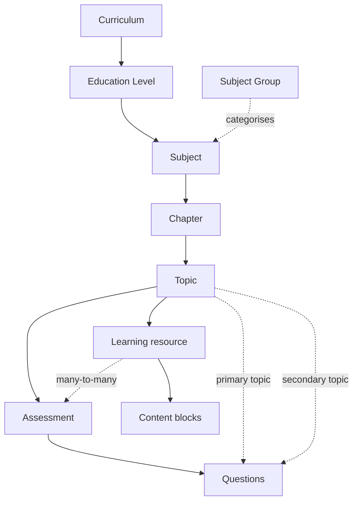

# Information Architecture — Exampify

| Field | Value |
|-------|-------|
| Version | 1.0 |
| Status | Proposed — URL conventions freeze at Phase 1 exit |
| Supersedes | Version 0.1 (materials + tutorials, no assessment routes) |
| Depends on | [PRODUCT_REQUIREMENTS.md](./PRODUCT_REQUIREMENTS.md), [CONTENT_MODEL.md](./CONTENT_MODEL.md) |
| Referenced by | [API_CONTRACTS.md](./API_CONTRACTS.md), [SEO_AND_CONTENT_STRATEGY.md](./SEO_AND_CONTENT_STRATEGY.md), [UI_UX_GUIDELINES.md](./UI_UX_GUIDELINES.md) |

---

## 1. Purpose and scope

How content is organised, named, browsed and addressed by URL. This is the contract between authors, designers, engineers and SEO. Changing a route or hierarchy level after Phase 1 is expensive, which is why it is written before any UI exists.

**In scope:** hierarchy and rationale, the three content shapes, navigation, route tables, slug rules, canonicalisation, redirects, breadcrumbs, cross-linking, sitemap structure.

**Out of scope:** field rules ([CONTENT_MODEL.md](./CONTENT_MODEL.md)), physical schema ([DATABASE_SCHEMA.md](./DATABASE_SCHEMA.md)), visual treatment ([UI_UX_GUIDELINES.md](./UI_UX_GUIDELINES.md)), marketing plan ([SEO_AND_CONTENT_STRATEGY.md](./SEO_AND_CONTENT_STRATEGY.md)).

---

## 2. The hierarchy

```
Curriculum                e.g. Cambridge International
  └── Education Level     e.g. IGCSE, AS & A Level
       └── Subject         e.g. Biology (IGCSE)          ← the UI may call this a "course"
            └── Chapter    e.g. Cell Biology             ← the UI may call this a "subtopic group"
                 └── Topic e.g. Mitochondria
                      ├── Learning resources (ordered)   → blocks, optionally linked to assessments
                      ├── Assessments (ordered)          → questions (reusable across topics)
                      └── Related resources (same subject)
```

Two orthogonal axes sit beside the tree and must not be confused with it:

- **Subject group** (Science, Maths, Humanities…) is a flat catalogue axis for the directory. It never appears in a URL.
- **Content format** is derived, not taxonomic: `study_material` (resource, no assessment), `lesson_with_practice` (resource + assessment), `practice_test` (assessment alone). It is a label on a card and a filter, not a level.



### 2.1 Why this depth

| Alternative | Why rejected |
|---|---|
| Flat `subject → topic` with a free-text exam board | Cannot host two syllabi side by side without ambiguous URLs; breaks coverage reporting |
| `curriculum → subject → topic` (no level) | Real curricula have distinct levels with different topic lists; level is the directory's primary filter |
| A global subject shared across curricula | Every read becomes a join through a scope table; complicates metadata, ownership and "this course has N chapters" |
| A sixth `subtopic` level | Adds a navigation level students rarely need; chapters already group topics, and depth is carried by ordered resources. Revisit only if topics routinely exceed ~2,000 words with clearly separable parts |
| A generic `nodes(parent_id, type)` tree | Every query becomes a self-join with type filters; constraints impossible; slugs ambiguous |

**Frozen:** five levels plus topic children. See [ADR-002](./ARCHITECTURE_DECISIONS.md#adr-002--explicit-taxonomy-tables-over-a-generic-tree).

### 2.2 The three content shapes and what they mean for navigation

| Shape | Rows behind it | Card label | Hub behaviour |
|---|---|---|---|
| A | `learning_resources` only | **Study material** | Reading list; no practice block |
| B | `learning_resources` + linked `assessments` | **Lesson + practice** | Reading list plus a clearly separated practice section |
| C | `assessments` only | **Practice test** | No reading section; scope + duration + start |

The label is computed by the content service (`CONTENT_MODEL.md` §2). A card must never say "lesson" for a resource with no published assessment — a student opening a resource to discover whether it contains questions is precisely the failure the product is designed to avoid.

---

## 3. Navigation model

Three systems, each with one job:

1. **Global header** — logo, curriculum/level switcher, Subjects, Practice, Dashboard (signed in), search trigger, account menu. Never more than six top-level items.
2. **In-page hierarchy** — breadcrumb, sibling navigation (prev/next chapter, topic, resource), and on a lesson a "jump to practice" link. This is how students actually move while studying.
3. **Studio navigation** — a left rail scoped to the entity being edited, with breadcrumbs and a status badge. A separate shell from the public site.

### 3.1 Primary pathways

```
Home
 ├─ Choose curriculum/level ──→ Subject directory
 ├─ Search ───────────────────→ Results (grouped, mixed format)
 └─ Popular subjects ─────────→ Subject → Chapter → Topic hub
                                                    ├→ Study material (read, prev/next)
                                                    ├→ Lesson + practice (read → optional practice)
                                                    └→ Practice test (start → attempt → review)
```

Maximum clicks from home to a resource: **4**, or **1** via search.

---

## 4. Route tables

All public content routes are locale-free and lowercase. Segments are slugs; `[x]` is dynamic.

### 4.1 Content routes

| Route | Page | Rendering | Notes |
|---|---|---|---|
| `/` | Homepage | ISR | Hero, curriculum picker, popular subjects, search |
| `/subjects` | Subject directory | ISR | Filters via query string |
| `/search` | Search results | Dynamic | `?q=&type=&curriculum=&level=&subject=` |
| `/[curriculum]` | Curriculum landing | ISR | Levels and their subjects |
| `/[curriculum]/[level]` | Level landing | ISR | Subjects grouped by subject group |
| `/[curriculum]/[level]/[subject]` | Subject page | ISR | Chapter list, coverage, assessment list |
| `/.../[subject]/chapters/[chapter]` | Chapter page | ISR | Topic list with format badges |
| `/.../[chapter]/[topic]` | Topic hub | ISR | Objectives, resources, assessments, related |
| `/.../[topic]/learn/[resourceSlug]` | Study material **or** lesson | ISR | Blocks render; lesson appends or inlines its practice section |
| `/.../[topic]/practice/[assessmentSlug]` | Practice test (topic-scoped) | ISR shell + dynamic start | Scope, duration, start CTA |
| `/.../[subject]/assessments/[assessmentSlug]` | Practice test (course-wide) | ISR shell + dynamic start | No topic segment; `mode: 'mock'` typically |

> **Why the chapter segment is explicit (`/chapters/…`) and the topic is not:** a chapter and a topic could share a slug (both are user-authored), and a subject may later gain other child types. An explicit segment removes the ambiguity permanently instead of relying on "slugs will not collide". The topic stays bare so the canonical topic URL remains short and stable.

Fully expanded example:

```
/cambridge-international/igcse/biology/cell-biology/chapters/cell-structure/mitochondria/learn/why-mitochondria-are-the-powerhouse
```

**Segment budgets:** curriculum ≤ 24, level ≤ 24, subject ≤ 40, chapter ≤ 60, topic ≤ 60, child ≤ 80. More than 10 segments is a bug.

### 4.2 Student routes

| Route | Page | Rendering |
|---|---|---|
| `/sign-in`, `/sign-up`, `/verify`, `/reset-password` | Auth | Dynamic, `noindex` |
| `/dashboard` | Progress overview | Dynamic |
| `/dashboard/history` | Attempt history | Dynamic |
| `/dashboard/history/[attemptId]` | Read-only review | Dynamic |
| `/dashboard/subjects/[subjectId]` | Per-subject detail (SHOULD) | Dynamic |
| `/practice` | Practice landing (choose subject/topic/assessment) | Dynamic |
| `/attempts/[attemptId]` | Active runner | Dynamic, `no-store` |
| `/attempts/[attemptId]/review` | Post-submit review | Dynamic |
| `/account` | Profile, sessions, deletion | Dynamic |

**Why `/attempts/[id]` rather than `/practice/[id]`:** it disambiguates the runner from the assessment page (`/practice/[assessmentSlug]`) under the same first segment, and it names the domain object. Attempt ids are UUIDs; authorisation is checked server-side regardless.

### 4.3 Studio routes (staff only, `noindex`)

| Route | Page |
|---|---|
| `/studio` | Overview: counts, recent edits, content gaps, **index failures** |
| `/studio/curricula` | Curriculum + level management (admin) |
| `/studio/subjects` | Subject table |
| `/studio/subjects/[subjectId]` | Subject detail; chapter ordering |
| `/studio/chapters/[chapterId]` | Chapter detail; topic ordering |
| `/studio/topics/[topicId]` | Topic detail; resources + assessments |
| `/studio/resources/[resourceId]` | Block editor |
| `/studio/assessments/[assessmentId]` | Assessment composer |
| `/studio/assessments/new?topicId=&subjectId=` | New assessment |
| `/studio/questions` | Question library (TanStack Table) |
| `/studio/questions/new?topicId=` | New question |
| `/studio/questions/[questionId]` | Question editor |
| `/studio/media` | Asset library |
| `/studio/users` | Roles (admin) |
| `/studio/audit` | Audit log (admin) |

### 4.4 System routes

`/sitemap.xml`, `/sitemap/[segment].xml`, `/robots.txt`, `/404`, `/500`, `/maintenance` (static, served with `503` + `Retry-After` by middleware during a provider outage; must not read the database), `/api/v1/**` (not page-routable).

### 4.5 Reserved slugs

Never usable at any level: `api`, `studio`, `dashboard`, `practice`, `attempts`, `search`, `subjects`, `sign-in`, `sign-up`, `verify`, `reset-password`, `account`, `sitemap`, `robots`, `_next`, `admin`, `assets`, `static`, `login`, `logout`, `learn`, `chapters`, `assessments`, `maintenance`.

Enforced by `RESERVED_SLUGS` in `lib/validation/slug.ts` and a `CHECK` where practical.

### 4.6 Query parameters

| Param | Applies to | Values |
|---|---|---|
| `q` | `/search` | 2–120 chars after trim |
| `type` | `/search`, `/subjects` | `subject` \| `chapter` \| `topic` \| `resource` \| `assessment` |
| `format` | `/search`, directory | `study_material` \| `lesson_with_practice` \| `practice_test` |
| `level`, `subject`, `curriculum` | directory, search | slugs |
| `page` | never | Cursor pagination only; a `page` param is rejected |

Unknown parameters are dropped with a 301 to the canonical URL, never silently ignored.

---

## 5. Addressing rules

### 5.1 Slugs

- Generated from the title: lowercase, `NFKD`, diacritics stripped, non-alphanumerics → `-`, collapsed, trimmed, truncated to the segment budget.
- Uniqueness is **per parent**: `(education_level_id, slug)` for subjects, `(subject_id, slug)` for chapters, `(chapter_id, slug)` for topics, `(topic_id, slug)` for resources, `(scope_key, slug)` for assessments.
- Collisions append `-2`, `-3`. Authors may override before first publish.
- Slugs are **immutable after publication** except through a "change URL" action that writes a 301.

### 5.2 Identifiers in URLs

- Public content uses **slugs only**. No UUIDs, no numeric ids.
- Authenticated routes use opaque UUIDs (attempts, studio) because there is no slug and authorisation is server-side anyway.

### 5.3 Canonicalisation

| Rule | Canonical form |
|---|---|
| Trailing slash | Removed (308) |
| Uppercase path | Lowercased (301) |
| Unknown/reordered query params | Dropped to the whitelist (301) |
| Filters producing the same result as unfiltered | Unfiltered URL canonical |
| Paginated lists | Page 2+ `noindex, follow`, canonical to itself |
| Redirect chains | Collapsed to one hop at write time |

### 5.4 Redirects

`redirects` rows are written when a published slug changes, a topic moves chapter, or a chapter/subject is renamed. Rules: no chains (writing a redirect whose target is redirected rewrites the earlier row), only published paths get redirects, deleting a redirect is an admin action.

Moves that change depth (topic → another chapter) redirect the whole subtree by prefix.

---

## 6. Breadcrumbs

Derived from the resolved taxonomy, not the URL string:

```
Home / Cambridge International / IGCSE / Biology / Cell Biology / Mitochondria
```

On a resource page the breadcrumb ends with the topic, and the resource title is the `h1` (adding a seventh crumb adds noise without navigation value). On an assessment page the crumb is `… / Mitochondria / Practice test`.

- Last item is plain text with `aria-current="page"`.
- `<nav aria-label="Breadcrumb">` wraps an ordered list; JSON-LD `BreadcrumbList` mirrors it exactly.
- Mobile truncates to `Home / … / Chapter / Topic`, never horizontal scroll.

---

## 7. Cross-linking

| From | Links to | Why |
|---|---|---|
| Subject page | All chapters, "start with chapter 1", assessments | Entry into the study path |
| Chapter page | All topics, previous/next chapter | Linear progress |
| Topic hub | Resources, assessments, parent chapter, previous/next topic, related resources | Hub integrity |
| Study material | Prev/next resource, back to topic, one related assessment if present | Reading flow |
| Lesson | Its practice section (anchor), related material, back to topic | Reading → retrieval without a toll gate |
| Assessment page | Its topic, related resources, "study first" link | Context before a test |
| Review screen | Source topic, "practise again" | Close the loop |
| Question (post-submit) | Primary topic — **never** before submit (would leak context) | Discovery |
| Search results | The exact target, not the parent hub | Speed |

**Orphan rule:** every published page is reachable from at least one other published page. The sitemap is not a substitute. A nightly integrity report lists orphans (Phase 5).

**Format-visibility rule:** every card, list row and search result shows the derived format badge. A student never opens a page to find out whether it contains questions.

---

## 8. Search information architecture

Search covers subjects, chapters, topics, resources (title + matched section) and assessments. **Questions are never publicly searchable** — indexing them would leak answers through snippets, and a question is not a destination.

Result grouping and ordering:

1. Exact title matches (pinned within their group),
2. Hybrid ranking: RRF over FTS5 BM25 and Qdrant dense similarity, with bounded boosts,
3. Group order: topics → resources → assessments → chapters → subjects.

Filters: format, curriculum, level, subject, and type. An empty query shows popular subjects and recent searches, not a blank page.

Full mechanics: [SEARCH_ARCHITECTURE.md](./SEARCH_ARCHITECTURE.md) §9.

---

## 9. Sitemap structure

| Sitemap | Contents | `lastmod` |
|---|---|---|
| `/sitemap.xml` (index) | References all below | — |
| `/sitemap/static.xml` | Home, subjects directory | build time |
| `/sitemap/subjects.xml` | Curriculum/level/subject pages | max(subject, chapters) |
| `/sitemap/chapters.xml` | Chapter pages | children's max |
| `/sitemap/topics.xml` | Topic hubs | max(topic, resources, assessments) |
| `/sitemap/resources.xml` | Study materials and lessons (split by first letter if > 45k) | resource `published_at` |
| `/sitemap/assessments.xml` | Practice tests | assessment `published_at` |

Excluded: drafts, studio, auth, dashboard, attempt routes, search results, archived content, paginated lists beyond page 1.

---

## 10. Dependencies

- **Schema:** `curricula`, `education_levels`, `subject_groups`, `subjects`, `chapters`, `topics`, `learning_resources`, `assessments`, `redirects`.
- **API:** every public route maps to one service read (`API_CONTRACTS.md` §4).
- **SEO:** metadata builders depend on this route table and §5.3.
- **Studio:** slug edits and moves must write redirects — a Phase 2 acceptance criterion, not a nice-to-have.
- **Sitemap:** depends on `published_at` being set atomically on publish.
- **Search:** result links are built from these routes; the client never assembles paths.

---

## 11. Edge cases

| # | Case | Behaviour |
|---|---|---|
| IA-01 | Same slug at two levels (`biology` as subject and chapter) | Allowed; paths differ |
| IA-02 | Topic moved between chapters | New URL; 301 for the full old path; review links use attempt ids and keep working |
| IA-03 | Subject archived | Descendants 404; redirect to the level page if a successor is set, else 404 with sibling suggestions |
| IA-04 | Curriculum slug renamed | Prefix redirect for the whole tree, one hop |
| IA-05 | Two levels share a name across curricula | Fine; the curriculum segment differentiates |
| IA-06 | Valid subject, invalid chapter | 404, not a fallback to the subject |
| IA-07 | Deep link to an unpublished resource | 404 with "this page moved" if a redirect exists, else suggestions from the topic |
| IA-08 | Slug is a reserved word | Save blocked with a field error suggesting an alternative |
| IA-09 | Search returns 0 results | Sibling topics + a relaxed-query suggestion; never a dead end |
| IA-10 | Course-wide assessment slug duplicates a topic-scoped one | Different path shapes; `scope_key` uniqueness keeps the DB honest |
| IA-11 | Resource and assessment share a title | Different child segments (`learn` vs `practice`) |
| IA-12 | Non-Latin title | Transliterate; if empty, `<type>-<short-id>` |
| IA-13 | Very long title | Slug truncated at the budget; title clamped in UI |

---

## 12. Acceptance criteria

1. Every published entity has exactly one canonical URL matching §4.1.
2. No public URL contains a UUID or numeric id.
3. A published slug change produces a `301`, resolving in one hop.
4. Breadcrumbs and JSON-LD `BreadcrumbList` match at all five levels.
5. The sitemap contains only published URLs; a draft never appears.
6. Reserved slugs are rejected by client and server validation.
7. Deep-linking to any content page and refreshing renders correctly server-side.
8. Search links go directly to the best target (resource for a body match, topic for a topic-title match).
9. Every list row and search result shows a format badge consistent with `deriveFormat`.
10. `/attempts/[id]` returns 404 (not 403) for another user's id.

---

## 13. Open questions

| # | Question | Impact |
|---|---|---|
| OQ-IA1 | Does the launch curriculum need level sub-labels ("AS" vs "A Level" separate)? | Level granularity in seeding and filters — **Open — needs:** decide level sub-labels from the launch curriculum; **blocks Phase 1**. |
| OQ-IA2 | Subject groups global or per-curriculum? | One FK vs a scoped join table — **Open — needs:** decide global vs per-curriculum subject groups (one FK or a join table); **blocks Phase 1**. |
| OQ-IA3 | Do we need indexable filtered paths (`/subjects/science`) or is query-string filtering enough? | Adds indexable pages — **Open — needs:** decide whether filtered paths are indexable pages; **blocks Phase 6**. |
| OQ-IA4 | Should topics support a subtopic level in year one? | Would add a level; deferred — **Open — needs:** decide whether topics need a subtopic level in year one; **blocks Phase 2**. |
| OQ-IA5 | ~~Is a locale prefix needed before launch (`/en/…`)?~~ **Resolved: no prefix at launch** ([ADR-033](./ARCHITECTURE_DECISIONS.md#adr-033--launch-locale-is-en-with-routes-unprefixed)), conditional on `OQ-01` | Revisit only if `OQ-01` selects a non-English launch; adding a prefix later is a redirect project, not a rewrite |
| OQ-IA6 | Should a lesson's practice live at an anchor on the lesson page or only at its own URL? | Sharing/deep-linking practice; currently both (anchor + own URL) **Open — needs:** decide anchor vs own URL for a lesson's practice section; **blocks Phase 2**. |
| OQ-IA7 | Is `/chapters/` worth the extra segment? | Readability vs URL length — **Open — needs:** decide whether `/chapters/` earns its extra segment before URLs freeze; **blocks Phase 1**. |
