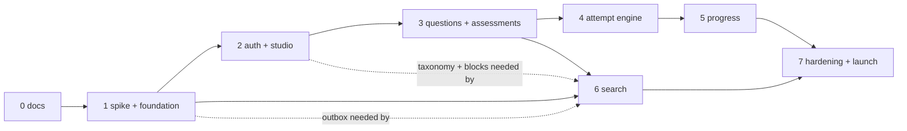

# MVP Roadmap — Exampify

| Field | Value |
|-------|-------|
| Version | 1.1 |
| Status | Proposed |
| Supersedes | Version 0.1 (Postgres/Drizzle sequence, 6 phases) |
| Depends on | [PRODUCT_REQUIREMENTS.md](./PRODUCT_REQUIREMENTS.md), [PRODUCT_ARCHITECTURE.md](./PRODUCT_ARCHITECTURE.md), [DEPLOYMENT_AND_ENVIRONMENTS.md](./DEPLOYMENT_AND_ENVIRONMENTS.md) |
| Referenced by | All delivery planning |

---

## 1. Purpose and scope

The implementation sequence with explicit dependencies, deliverables, acceptance criteria and exclusions. It is ordered so that **every phase ends with something demonstrable**, and no phase starts work whose inputs do not exist.

**Guiding rule:** a working end-to-end vertical slice beats a wide set of half-built features. If time is short, cut Phase 7 polish and Phase 6 extras — never Phases 1, 4 or 5, which together form the product loop.

**Out of scope:** staffing, budget, marketing calendar, content authoring schedule (content ops runs in parallel; only seed data is an engineering dependency).

---

## 2. Phase overview

| Phase | Name | Effort (eng-days) | Ends with | Status |
|---|---|---|---|---|
| 0 | Product discovery and documentation | 4 | Approved `/docs` set | Complete (v1.4) |
| 1 | Infrastructure spike, foundation and public site | 14–18 | Deployed, seeded, indexable public site on the real stack | In progress: scaffold, tokens, primitives, `lib/db` (migration runner + seed), the seeded public template set (8 of 10 block types render; `question_section` and `related_material` need Phase 3), metadata builders, OG card, sitemap index + segments, robots, the 404/error/loading screens and per-page JSON-LD (`BreadcrumbList`, `Course`, `LearningResource`, verified by `bun run seo:check`) are done, as are `/design`, `usage_events` ingestion, the email outbox and the generated `openapi.json` gate; `Quiz`/`ItemList` JSON-LD (Phase 3), the runbook/alert wiring, the Vercel environment rows and the §4.1 spike are outstanding |
| 2 | Auth and authoring studio | 16–19 | An author publishes a study resource and a lesson | Not started |
| 3 | Question bank and assessments | 9–11 | A lesson's practice section is live and a practice test is publishable | Not started |
| 4 | Attempt engine | 11–13 | A student practises, is graded, and resumes | Not started |
| 5 | Progress and dashboard | 5–7 | Students see accuracy and weak topics | Not started |
| 6 | Search (hybrid, suggest, fuzzy) and index sync | 9–12 | Natural-language and misspelled queries return the right page | Not started |
| 7 | Hardening, performance, launch | 8–10 | Production release | Not started |

Phase status is updated in this table whenever a phase changes state; `README.md` summarises it and is never the place to record progress first.

**Total: 76–94 engineering days** for one experienced full-stack engineer (≈ 11–14 weeks with two engineers in parallel where the dependency graph allows). The increase over the previous estimate is real and attributable: a Bun/libSQL spike, a block editor, presigned media, a derived search index, and an async job pipeline did not exist in the earlier plan.



---

## 3. Phase 0 — Product discovery and documentation

**Status:** complete (this document set).

**Objectives:** agree product shape, freeze URLs, hierarchy, content shapes, scoring semantics and MVP boundary before code exists.

**Deliverables:** the 19 documents in `/docs`; assumptions `A-01…A-18`; open questions; the revised ADR set with supersessions.

**Acceptance criteria:** every requirement has an ID and an owning document; no document contradicts another on entity names, enums, routes or scoring; outstanding decisions are listed, not silently resolved.

**Excluded:** code, schema, migrations, dependency installs.

---

## 4. Phase 1 — Infrastructure spike, foundation and public site

**Objectives:** prove the stack on a deployed preview **before** building features on it, then ship a seeded, indexable public site with the real visual identity.

**Dependencies:** ADR-016 sign-off (ADR-020 and ADR-025 are accepted; no sign-off gate); Turso, Tigris, Qdrant, Upstash, Vercel accounts, plus a dedicated Google account with 2-Step Verification and an app password as the sending identity (Workspace if `mail.<domain>` is wanted), and a Sentry account (ADR-037/032) so §4.6 can be wired rather than deferred.

### 4.1 The spike (days 1–2, blocking)

Each item is a yes/no gate. A failure is documented in `ARCHITECTURE_DECISIONS.md` before proceeding; it is never worked around silently.

1. `bun run --bun next build` on Vercel with `bunVersion: "1.x"`, ISR page served with correct cache headers.
2. `@libsql/client/web` + `LibsqlDialect` + Kysely: query, insert, transaction, `changes()`; `PRAGMA foreign_keys` verified on.
3. Better Auth: sign-up, sign-in, session read, sign-out, revocation — on Bun, against Turso.
4. Better Auth `LibsqlDialect` configuration accepted, CLI `generate`/`migrate` output reviewed.
5. Tigris: presigned PUT from a browser, `HEAD` verification, public URL rendered by `next/image`.
6. Qdrant: collection created at 384 dims, Cloud Inference embeds with `query:`/`passage:` prefixes, one search returns a sensible neighbour.
7. QStash: signed delivery to a preview route; invalid signature rejected; DLQ observed with a deliberately failing handler.
8. Region choice validated: p95 DB round trip from the function region < 40 ms.

**Spike exit:** a one-page note recording pass/fail per item, the measured latencies, and any route pinned to the Node runtime.

### 4.2 Foundation

- Project scaffold: Next.js App Router, TS strict flags, Tailwind, ESLint/Prettier, path aliases.
- `lib/env.ts` (Zod-validated, server/public split), `lib/db` (client, `DB` interface, enums, pragmas).
- Migration runner + first migration: taxonomy, resources, blocks, assessments, questions, attempts, media, search tables, auth tables.
- Idempotent seed (one curriculum, two levels, four subjects, two chapters each, three topics each).
- Design tokens, fonts, global styles, layout shell, skip link.
- Primitives: Button, Badge (incl. three format badges), Card, Callout, Input, FormField, Breadcrumbs, EmptyState, Skeleton, ProgressBar, Tabs.
- Public templates: home, directory, curriculum, level, subject, chapter, topic hub.
- Block renderer: 10 block types, sanitised Markdown, KaTeX, table wrapper, figure/caption, download/video/related/question-section.
- SEO: metadata builders, canonical URLs, JSON-LD (Breadcrumb, Course, LearningResource), sitemap index + segments, robots.
- Error/404/500, loading and empty states.
- CI: `bun install --frozen-lockfile`, typecheck, lint, unit, migrate against an ephemeral DB, build.

### 4.3 Deliverables

- Public site on a preview URL with seeded content, rendering all block types.
- `/design` internal page (dev-only, `noindex`) documenting the primitives.
- Spike note with measured latencies.
- Lighthouse ≥ 90 performance, ≥ 95 accessibility on a topic page.

### 4.4 Acceptance criteria

- `FR-DISC-01…09`, `FR-DISC-11`, `FR-DISC-14` satisfied for seeded content.
- Drafts are invisible to anonymous users (proven by test).
- Sitemap contains only published URLs; every published page is reachable by link.
- No raw hex in components; tokens only.
- 360 px and 1280 px both pass visual review.
- `bun run --bun next build` succeeds on a clean checkout.

### 4.5 Excluded

Studio, auth UI, attempts, dashboard, search, media upload (seed fixtures reference existing objects), i18n, dark mode, comments, user-facing analytics dashboards.

### 4.6 Operational baseline — wire it now, not in Phase 7

Auth is the first feature that sends mail, writes events inside business transactions and adds dozens of mutation routes. Each item below is cheap on top of Phase 1's foundation and expensive to retrofit once auth routes are live, so each is a Phase 1 exit criterion. The choices are named — `@sendust/ts` over Google SMTP (ADR-035, relay in ADR-037) and Sentry (ADR-032) — so nothing here waits on a decision.

- [x] **`usage_events` table and ingestion.** Create the table from `DATABASE_SCHEMA.md` §10.7 in the first migration (indexes and its row in the 90-day retention prune), add it to the generated `DB` types, and add the server-side `recordEvent()` helper with the closed name union from `OBSERVABILITY_AND_ANALYTICS.md` §6. Emit one real event (`resource_viewed`) from a seeded public page in this phase, so the path is proven before attempts and publishes depend on it. `POST /api/v1/events` exists with its allowlist, same-origin check, rate limit and `props_json` redaction.
- [ ] **Email transport and webhook.** `EmailProvider` interface plus the `stub` and `sendust` implementations, selected by `EMAIL_PROVIDER` (`EMAIL_AND_NOTIFICATIONS.md` §2.1); `@sendust/ts` pinned exactly and traced into the function bundle (`serverExternalPackages`), with one module-scope transport per instance and no `close()` inside a request (§2.5); enqueue via `job_runs` keyed `email:<template>:<id>` and the QStash send worker; the `accepted`/`rejected`/`unknown` mapping of §4.1; `email_suppressions` table (§10.8) fed by synchronous 5xx recipient rejections, plus the documented manual reconciliation of bounce mail for asynchronous bounces — **there is no webhook to build** (ADR-037). No auth email may be sent inline from a request handler. **Spike gates (ADR-037):** a real send on port 465 from the deployed runtime with an app password; `EMAIL_FROM` arriving unrewritten as the verified alias; SPF/DKIM/DMARC passing at Gmail and Outlook; the exact reply at the daily cap captured; and a later bounce confirmed to appear only as mail in the account inbox.
- [x] **Generated `openapi.json` gate.** The route→schema registry, the generate script, the committed output and the CI job that regenerates and fails on any diff (`API_CONTRACTS.md` §16). Seed the registry with Phase 1's read endpoints; adding a route without registering it is a review failure from the first phase onward.

  **Status:** done. `src/lib/openapi/registry.ts` is the registry, `bun run openapi:generate` rewrites `openapi.json`, `bun run openapi:check` is a CI step, and the unit suite covers the same diff locally plus route coverage in both directions (`tests/openapi.test.ts`). The document lists only routes that exist — five today: `GET /api/v1/health`, `GET /api/v1/openapi.json`, `POST /api/v1/events`, `POST /api/v1/internal/jobs/send-email`, `POST /api/v1/internal/cron/sweep-jobs`. `GET /api/v1/openapi.json` serves it outside production (`OQ-API2` untouched: production returns `404`).
- [ ] **Runbook and alert wiring.** The R1–R12 runbooks stubbed in `OPERATIONS_RUNBOOK.md` pointing at the real dashboards, Sentry wired with uploaded source maps (`D-09`/ADR-032), and the four alerts Phase 1 can already produce (error rate, job pending/DLQ, migration failure, DB latency) delivered to a channel that someone watches (`OBSERVABILITY_AND_ANALYTICS.md` §5).

  **Status:** the probe half is done — `GET /api/v1/health` reports database, Qdrant and index lag (null until Phase 6) with no configuration in the body, which is the first step of every runbook entry and of the post-deploy smoke check. The rest needs the Sentry project and the alert channel: `ERROR_TRACKING_DSN`, `SENTRY_AUTH_TOKEN`, `SENTRY_ORG` and `SENTRY_PROJECT` have no values yet, so `instrumentation.ts` still validates the environment only, and no dashboard URL exists to point R1–R12 at. Do not tick this bullet until one alert has been fired deliberately and observed.
- [ ] **Environment placeholders.** The email, QStash and analytics rows from `DEPLOYMENT_AND_ENVIRONMENTS.md` §4 present in `.env.example` and in both Vercel environments, so Phase 2 never ships a route whose key is missing.

  **Status:** `.env.example` is complete and now enforced — `tests/env-example.test.ts` fails when a name in `lib/env.ts` is missing from the file, when the file declares a name the schema does not validate, or when a placeholder looks like a live credential. The Vercel half needs the project: the rows must be added to Preview and Production by hand, since no deployment exists yet.

**Status of the email bullet:** the `job_runs` receipt (with `payload`, `uncertain` and `skipped`), `enqueueEmail()`, the `send-email` worker with the §4.1 mapping, synchronous-bounce suppression and the `@sendust/ts` tracing are in place, and the enqueue/worker path is proven with the stub transport. The delivery state machine is now a pure function with a truth-table test covering `accepted`, `rejected` (5xx suppresses, 4xx does not), `unknown` and a throw that runs out of retries; a stale-row sweeper (`POST /api/v1/internal/cron/sweep-jobs`, and `bun run jobs:drain` locally) repairs a row whose publish never happened. The five **spike gates** still need the dedicated Google account and a real send.

**Phase 1 exit checks for this list:** a seeded page view writes exactly one `usage_events` row; a stub email reaches `done` in `job_runs`; a webhook call with a bad signature returns `401` and writes nothing; changing a Zod schema without regenerating `openapi.json` fails CI; one alert is fired deliberately by a test threshold and observed in the channel.

---

## 5. Phase 2 — Authentication and authoring studio

**Objectives:** a real author creates, previews and publishes a **study resource** and a **lesson** through the UI; students can create accounts.

**Dependencies:** Phase 1 schema and primitives; the Phase 1 operational baseline (§4.6) — the `@sendust/ts` transport, the verified `From` alias on the sending Google account, the documented bounce-inbox reconciliation, `usage_events` ingestion, the error tracker and the OpenAPI gate must already exist, not be discovered here; ADR-017 verified in the spike.

### Features

- Auth UI + `lib/auth` (`getActor`, `requireActor`), verification, reset, Google OAuth (SHOULD), session management.
- **16+ age attestation** at sign-up (unticked checkbox, `age_gate_version` recorded) per `D-11`/ADR-034; confirm the launch market's consent age before enabling sign-ups there.
- RBAC capability matrix, guards in routes and services, role-aware UI.
- Studio shell, navigation, entity headers, status badges.
- Taxonomy CRUD with ordering (admin for curricula/levels/subjects).
- **Block editor:** insert/reorder/edit/delete 10 block types, Markdown source + preview, image picker, formula input with live render, table editor, assessment picker.
- Resource metadata editor with autosave (4 s idle) and conflict dialog.
- Assessment **link** UI on a resource (placement, ordering) — assessments themselves arrive in Phase 3, so the picker lists seeded drafts.
- Status lifecycle with publish gates, reviewer reasons, preview at the real URL.
- Slug generation, uniqueness, redirect writing on change.
- Media: presigned upload flow, confirm, alt text, library.
- Audit writes for every mutation.
- Draft preview: staff-only, `noindex`.
- Studio lists with filters, cursor pagination, TanStack Table.

### Technical tasks

1. Better Auth config (`database: { dialect, type: 'sqlite' }`), additional fields (`role`, `status`), auth table migration reviewed.
2. `lib/rbac/capabilities.ts` + `can()` + matrix tests.
3. Studio route handlers per `API_CONTRACTS.md` §7 with `.strict()` Zod.
4. Service functions with `expectedUpdatedAt` concurrency.
5. Block Zod union shared by editor, route and tests.
6. Publish-gate validators returning `details[]`.
7. Redirect writing + chain collapsing.
8. Presign/confirm/HEAD/magic-byte verification + SVG sanitisation.
9. `revalidateTag` on publish/unpublish, reporting `cacheInvalidated`.
10. Audit writer + `/studio/audit`.

### Deliverables

- An author publishes a **study material** (5+ block types incl. image and formula) and a **lesson** that links a seeded draft assessment, both live at their canonical URLs.
- A student signs up, verifies and signs in.

> **Sequencing note:** the lesson's practice section renders a staff-only placeholder until Phase 3 publishes a real assessment. The resource is still publishable — that is the point of the derived format (`study_material` while the assessment is a draft).

### Acceptance criteria

- `FR-CMS-01…06`, `FR-CMS-08…16`, `FR-AUTH-01…06`, `FR-AUTH-08` satisfied.
- Publish refused with field-level errors when gates fail (resource with no prose, image without alt, invalid formula, duplicate anchor).
- Autosave never overwrites a newer version (`409` path works).
- Unlinking the last assessment flips the badge back to "Study material" without a reload trick.
- Slug change produces a `301` resolving in one hop.
- A student hitting a studio route gets 403/404 with no data in the payload.

### Excluded

Question authoring (Phase 3), bulk actions, version history, comments, per-subject ownership, two-person review.

---

## 6. Phase 3 — Question bank and assessments

**Objectives:** authors author all four question types, compose assessments, and publish a practice test and a lesson-with-practice.

**Dependencies:** Phase 2 studio shell, RBAC, taxonomy, block editor (for `question_section`).

### Features

- Question editor: four types, options with per-option feedback, correctness derived from the key.
- Explanation field with length gate, difficulty, points, optional image.
- Primary + secondary topic cross-listing.
- Question library: TanStack Table with filters (subject, topic, type, difficulty, status, author), sorting, cursor pagination, bulk archive.
- Assessment composer: ordered items, points override, mode (`practice`/`test`/`mock`), duration rules, scope validation.
- Link a published assessment into a resource (`inline`/`end`/`optional`) and see the badge change.
- Publish gates for questions and assessments with dry-run validation endpoints.
- Difficulty distribution indicator per topic.
- Content-gap report (`/studio/overview`): topics with no resource, topics with no assessment, unindexed entities.

### Technical tasks

1. Question/assessment tables migrated in Phase 1 — add missing constraints additively.
2. `answerKey` Zod union + cross-field validators (server + form resolver).
3. `QuestionEditor` client component: type switch resets answer fields with a warning.
4. `question_topics` invariant service (one primary, matches `questions.topic_id`).
5. TanStack Table with server-driven state in the URL.
6. Dry-run validation reusing the publish-gate code path.
7. Seed expansion: 10 questions per seeded topic across types; one assessment per topic.
8. `deriveFormat` integration test across all three shapes.

### Deliverables

- A 10-question assessment published and linked to the lesson from Phase 2; the badge becomes "Lesson + practice".
- A standalone 15-question practice test published at a subject-scoped URL.
- 40+ seed questions used by Phase 4 tests.

### Acceptance criteria

- `FR-QB-01…10` satisfied.
- Every `QUESTION_ENGINE.md` §10 gate has a test with a failing fixture.
- Cross-listed questions appear under both topics without duplicate rows.
- A `question_section` block referencing a draft assessment blocks publish with the block path.
- No `answerKey` appears in any list response.

### Excluded

CSV import, duplicate detection, manual answer review, question analytics, revision history.

---

## 7. Phase 4 — Attempt engine

**Objectives:** the core loop works end-to-end for both practice and test modes: configure → attempt → submit → review.

**Dependencies:** Phase 3 question pool; Phase 2 auth; `QUESTION_ENGINE.md`.

### Features

- Attempt configuration (scope, count, difficulty, types) with live availability; assessment and inline-practice entry points.
- Server-side selection with snapshotted items and `random_key` sampling.
- Runner: one question at a time, palette, prev/next, per-answer autosave, resume.
- `practice` mode: immediate per-question reveal; `test`/`mock`: nothing until submit.
- Submit: server-side grading, idempotent, reviewed summary; duration enforcement for timed modes.
- Review: explanations, per-option feedback, partial credit, `contentUpdated` notice.
- Retry (fresh selection, same config), abandon, expiry (lazy + cron).
- Entry points from topic hub, resource page, assessment page and `/practice`.
- Signed-in accuracy per topic on the topic hub (SHOULD).

### Technical tasks

1. `selectQuestions()` pure module + seeded randomness + property tests.
2. `gradeItem()` / `gradeAttempt()` pure modules + truth-table tests.
3. Route handlers per `API_CONTRACTS.md` §5, including idempotency and the conditional-update submit.
4. `useAttemptRunner` hook over TanStack Query (mutations for save/submit, optimistic selection).
5. Offline queue for answer saves (localStorage + flush on reconnect).
6. Expiry cron + lazy check in the read path.
7. Leak tests across all attempt endpoints, both modes.
8. `random_key` backfill migration for existing questions.

### Deliverables

- A student completes a 10-question attempt on two seeded topics (short answer + multi-select included) with correct scoring.
- Resume verified across two browsers.
- A timed test rejects nothing late but reports `overTimeSeconds`.

### Acceptance criteria

- `FR-PRAC-01…13` satisfied.
- Score equals an independently computed sum of awarded units (property test).
- No correctness information appears before submit in `test` mode; `reveal` appears only in `practice` mode `(ADR-024, API_CONTRACTS §5.3)`.
- Submitting twice returns identical results.
- Expired attempts are read-only and cannot be graded.
- The runner is keyboard-complete and passes an axe scan for critical issues.

### Excluded

Hints, flagging, adaptive difficulty, spaced repetition, question-level analytics, proctoring.

---

## 8. Phase 5 — Progress and dashboard

**Objectives:** students see whether they are improving and what to work on next; study progress is visible separately from accuracy.

**Dependencies:** Phase 4 attempts.

### Features

- Summary: attempts, questions answered, accuracy, study time, resources read, 30-day window.
- Topic performance table: attempts, accuracy, last practised; filter by subject; sortable.
- Focus topics: ≤ 5 weakest with ≥ 5 answers and < 60 % accuracy.
- Study progress: resources opened vs practised (Phase 5 SHOULD).
- Attempt history with filters and review links.
- Activity strip (30 daily buckets).
- Per-subject detail (SHOULD).

### Technical tasks

1. Aggregation queries with keyset pagination; verify with `EXPLAIN QUERY PLAN`.
2. `user_topic_stats` decision point (`OQ-DB3`): measure first, add the table + job only if needed.
3. `useProgress` hooks with tuned `staleTime`.
4. Empty-state onboarding with three suggested topics.
5. CSS-bar chart with an accessible table alternative (no chart library).

### Deliverables

- Dashboard shows correct numbers for seeded + newly created attempts.
- Focus topics change correctly after a weak attempt.

### Acceptance criteria

- `FR-PROG-01…05` satisfied.
- Accuracy equals `correct/answered`, `null` when no data (not `0`).
- Abandoned/expired attempts are excluded from accuracy but visible in history.
- Numbers reconcile with the review screens that produced them.
- A sustained read of the dashboard does not exceed 4 SQL statements.

### Excluded

Recommendations, spaced repetition, streaks, badges, exports, teacher views.

---

## 9. Phase 6 — Search: hybrid, suggest, fuzzy, index sync

**Objectives:** a student finds the right page with a natural-language question or a misspelling, and the index stays consistent with content.

**Dependencies:** Phase 1 outbox + QStash spike; Phase 2/3 published content; `SEARCH_ARCHITECTURE.md`.

### Features

- `search_documents` FTS5 population + `bm25()` lexical query.
- `search_terms` vocabulary + prefix autocomplete endpoint.
- Qdrant collection (`content_v1`, 384 dims), Cloud Inference embeddings, chunking, deterministic point ids.
- Query embedding, payload filters (`status`, subject, level, type), top-50 candidate retrieval.
- RRF fusion + documented boosts + exact-title pinning; group ordering.
- Typo correction (normalise → bounded Levenshtein → offer, don't silently replace).
- Search UI: result groups, format badges, keyboard navigation, "did you mean", degraded notice.
- Index worker: claim → re-read → upsert/delete → mark done; sweeper; nightly reconciler.
- `/studio/overview` shows unindexed/failed entities.

### Technical tasks

1. Wire `search_events` into every publish/unpublish transaction.
2. `lib/search/qdrant.ts` (one query builder that always adds `status='published'`).
3. `lib/search/fusion.ts` + unit tests for RRF and boosts.
4. `lib/search/fuzzy.ts` + candidate caps.
5. Tokenised MATCH builder (no operator passthrough, bound parameters).
6. Worker endpoint with QStash signature verification and atomic claim.
7. Sweeper + reconciler + `failed` surfacing.
8. Golden-set evaluation: 60 queries (30 id, 30 en), Recall@5 / MRR@10 recorded.
9. Latency measurement on the deployed region; suggest LRU/edge cache.

### Deliverables

- "How do plants make food?" returns photosynthesis; `mitocondria` returns Mitochondria; `sel` suggests Cell Biology by prefix.
- Unpublishing removes a result within 60 s.
- A dropped QStash delivery is repaired within 15 minutes (simulated).
- Evaluation report committed with numbers.

### Acceptance criteria

- `FR-SEARCH-01…08`, `FR-OPS-01…04` satisfied.
- Recall@5 ≥ 0.85 exact/prefix, ≥ 0.70 semantic paraphrases.
- Suggest p95 < 120 ms; full search p95 < 600 ms on preview.
- No draft, archived item or question appears in any search surface (test publishes → searches → unpublishes → searches).
- Duplicate event delivery creates one point set and one FTS row.
- With Qdrant blocked, results are lexical with `degraded: true`.

### Excluded

Reranking, sparse/BM25-in-Qdrant, query rewriting by an LLM, generated answers, personalised ranking, cross-lingual UI.

---

## 10. Phase 7 — Hardening, performance, launch

**Objectives:** ship safely.

**Dependencies:** Phases 1–6; production infrastructure and backups.

### Features and tasks

- Test suite completion to `TESTING_STRATEGY.md` targets: unit (scoring, blocks, validation, RBAC, fusion, fuzzy), integration (publish gates, attempt lifecycle, index sync), E2E (5 critical journeys).
- Security pass: headers, CSP nonces, CSRF, rate limits, upload hardening, leak tests, dependency audit, token-permission review.
- Performance: `EXPLAIN QUERY PLAN` review for every hot query, image optimisation, cache headers, Lighthouse budgets in CI, region latency confirmation.
- Observability: error tracking with source maps, structured logs, alerts (error rate, search p95, pending events, DLQ).
- Backup/restore rehearsal: restore the nightly dump into a scratch DB, render a topic, review an attempt.
- Accessibility: axe in CI + manual keyboard/screen-reader pass on 7 key screens.
- SEO: sitemap validity, canonical correctness, structured-data validation, 404/redirect behaviour.
- Production checklist: env vars, secrets, migrations, domain, TLS, privacy policy, cookie notice, `entitlements` inert.
- Launch smoke script: health, one topic, one resource, one attempt, one search, one suggest.
- Content QA: format badges correct on every seeded page; no orphan pages.

### Deliverables

- Production deployment with real content and working auth/attempts/search.
- A launch runbook and rollback procedure.

### Acceptance criteria

- All 16 acceptance criteria in `PRODUCT_REQUIREMENTS.md` §11 pass in production-like conditions.
- CI is green and blocks merges on typecheck/lint/test failures.
- No high/critical dependency vulnerabilities.
- Restore rehearsal within RTO 4 h.
- Error rate < 0.5 % in the first 24 h; no unhandled exceptions.
- Search index lag p95 < 60 s.

### Excluded

Load testing beyond a k6 smoke, pen test, SOC2, multi-region, paid-tier migration rehearsal.

---

## 11. Critical path and parallelisation

```
Spike (P1) ─┬─→ Schema + tokens (P1) ─→ Public templates (P1)
            ├─→ Auth (P2) ─→ Studio shell (P2) ─→ Block editor (P2)
            └─→ Outbox + jobs (P1/P6) ─→ Search worker (P6)
Taxonomy (P2) → Questions (P3) → Assessments (P3) → Selection (P4) → Grading (P4) → Progress (P5)
Blocks + images (P2) ─────────────────────────────→ Index content (P6) → Fusion (P6)
```

With two engineers: split **content/public** from **attempts/search** after Phase 1, joining on the shared validation and DTO contracts. With one engineer, follow the order exactly; do not start Phase 6 before Phase 3 has published content, or there is nothing to index.

---

## 12. Cut list (if the schedule slips)

In priority order — cut from the bottom first:

1. Google OAuth (`FR-AUTH-04`).
2. Study-progress breakdown (`FR-PROG-07`).
3. Related-material blocks and `FR-DISC-13`.
4. Recent/popular searches (`FR-SEARCH-09`).
5. Video and download block types (keep the other eight).
6. Offline queue for answer saves (keep inline retry).
7. Activity chart (keep the table).
8. Per-subject detail (`FR-PROG-05`).
9. Typed test mode (`test`/`mock`) — keep `practice` and standalone assessment pages, ship timed modes in Phase 8.

**Never cut:** publish gates, answer-key protection, scoring correctness, attempt persistence, RBAC, semantic search (it is a stated product requirement), sitemap/metadata, index sync.

---

## 13. Definition of done (per phase)

1. Features are merged behind no flag and demonstrable on a preview URL.
2. Acceptance criteria have automated tests where testable, and a written manual note where not.
3. Typecheck, lint, unit tests and build pass in CI.
4. Documentation is updated in the same change set (schema, API, tokens, flows).
5. No known security gap from `SECURITY_AND_PERMISSIONS.md` is introduced.
6. A designer has reviewed the screens at 360 px and 1280 px.
7. Any new table is added to the runtime token's grant list.

---

## 14. Risks and mitigations

| Risk | Likelihood | Impact | Mitigation |
|---|---|---|---|
| Bun incompatibility on Vercel | Medium | High | Spike gates Phase 1; Node fallback is one config line; per-route Node pin documented |
| Better Auth + libSQL friction | Low–medium | High | Confirmed supported dialect; spike proves sign-in; fallback is Node runtime on auth routes, not a new DB |
| SQLite write contention at submit peaks | Medium | Medium | Short transactions, `busy_timeout`, conditional updates; MVCC evaluated in Phase 4 |
| Block editor scope creep into a page builder | High | Medium | Ten closed block types; no free-form layout, no nested blocks |
| Search quality below expectations | Medium | High | Golden set from Phase 1 seed; model upgrade path documented; lexical fallback always works |
| Index drift / lost events | Medium | Medium | Outbox + sweeper + reconciler + studio visibility |
| Qdrant free tier throttles at launch | Medium | Medium | Upgrade order; degraded mode |
| Content not ready for launch | High | High | Seed content is engineering-owned; launch can ship with one complete subject |
| Cost surprise from search traffic | Medium | Medium | Suggest cache, CDN TTL, per-route limits, budget alert |
| Scope creep from "just one more block type" | High | Medium | New types need an ADR and a renderer + validator |
| Single-engineer bus factor | Medium | High | `/docs` is the contract and is updated with every change |

---

## 15. Dependencies between modules

| Module | Cannot start until | Blocks |
|---|---|---|
| Spike | Accounts on all five providers | Everything |
| Schema + migrations | ADR-016 sign-off | Everything with persistence |
| Design tokens + primitives | Phase 0 approval | Every UI phase |
| Public templates | Seed data + read services | SEO, search UI |
| Auth | SMTP transport + relay, session strategy | Studio, attempts, dashboard |
| Studio CRUD | RBAC + validation | Question bank |
| Block editor | Content schemas + media | Resources, lessons, indexing |
| Question editor | Studio shell + answer-key schemas | Attempts |
| Assessments | Questions + scope rules | Practice tests, lessons |
| Attempt API | Question pool + attempt schema | Progress |
| Search | Published content + outbox | Launch quality |
| Dashboard | Submitted attempts | Focus topics |
| Launch | All of the above + content | — |

---

## 16. Acceptance criteria for the roadmap itself

1. Every MUST requirement appears in exactly one phase.
2. Every phase states its dependencies and exclusions.
3. Each phase ends with a demonstrable artifact, not merely "code merged".
4. The critical path has no cycle.
5. Removing a phase visibly breaks a later phase (no decorative phases).
6. The spike's exit criteria are pass/fail and block Phase 1's feature work.

---

## 17. Open questions

| # | Question | Blocking |
|---|---|---|
| OQ-R1 | Is the launch date fixed against the content plan? | Phase 1 start / seeding — **Open — needs:** fix the launch date against the content plan; **blocks Phase 1**. |
| OQ-R2 | One or two engineers, and is a designer available for Phase 1? | Estimates and parallelisation — **Open — needs:** confirm team size and designer availability; **blocks Phase 1**. |
| OQ-R3 | ~~Do Vercel Cron's limits constrain the launch schedule?~~ **Resolved: no** — QStash carries the frequent sweeps and Vercel Cron is only a daily backstop, which Hobby and Pro both allow; the plan tier itself is not decided here (`OQ-D2`) | Cron limits are settled; the tier changes the bill, not the schedule |
| OQ-R4 | Beta cohort before public launch? | Phase 7 scope — **Open — needs:** decide whether a beta cohort precedes public launch; **blocks Phase 7**. |
| OQ-R5 | Budget for a paid Qdrant cluster at launch? | Phase 6 quality and stability — **Open — needs:** decide whether Qdrant is paid at launch (quality/stability); **blocks Phase 6**. |
| OQ-R6 | Is Indonesian content part of the launch corpus? | Phase 6 evaluation and content ops — **Open — needs:** decide whether Indonesian content is in the launch corpus; **blocks Phase 6**. |
