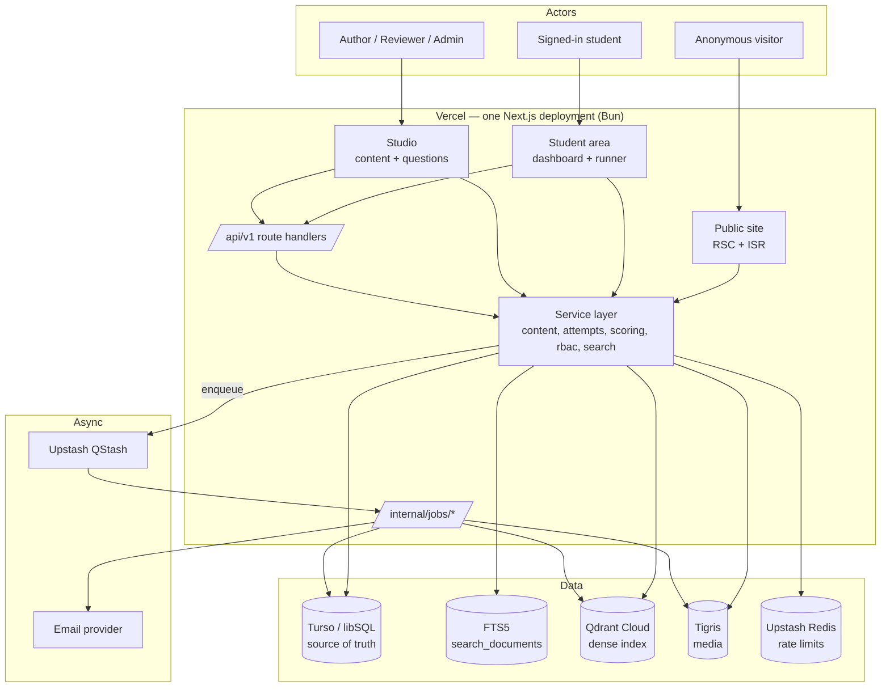
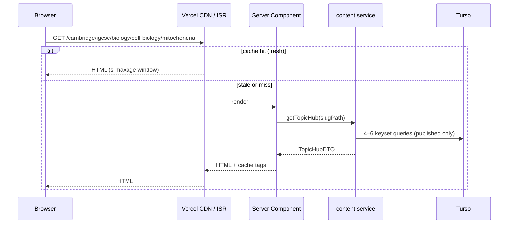
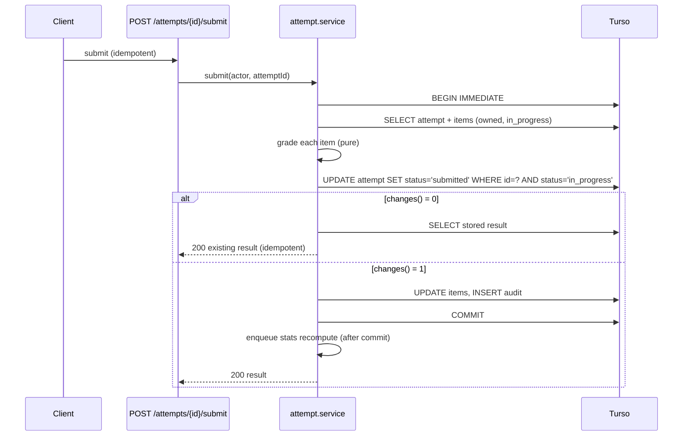

# Product Architecture — Exampify

| Field | Value |
|-------|-------|
| Version | 1.0 |
| Status | Proposed — supersedes 0.1 (PostgreSQL + Drizzle) |
| Depends on | [PRODUCT_REQUIREMENTS.md](./PRODUCT_REQUIREMENTS.md), [ARCHITECTURE_DECISIONS.md](./ARCHITECTURE_DECISIONS.md) |
| Referenced by | [DATABASE_SCHEMA.md](./DATABASE_SCHEMA.md), [SEARCH_ARCHITECTURE.md](./SEARCH_ARCHITECTURE.md), [BACKGROUND_JOBS.md](./BACKGROUND_JOBS.md), [DEPLOYMENT_AND_ENVIRONMENTS.md](./DEPLOYMENT_AND_ENVIRONMENTS.md) |

---

## 1. Purpose and scope

How the running system is composed: services, data flow, module boundaries, caching, failure behaviour and scaling. It answers "what talks to what, and why".

**In scope:** architecture principles, infrastructure choices and rejected alternatives, context/container diagrams, module map, request lifecycles, caching, consistency, failure modes, scaling triggers.

**Out of scope:** table definitions ([DATABASE_SCHEMA.md](./DATABASE_SCHEMA.md)), endpoint shapes ([API_CONTRACTS.md](./API_CONTRACTS.md)), search internals ([SEARCH_ARCHITECTURE.md](./SEARCH_ARCHITECTURE.md)), job mechanics ([BACKGROUND_JOBS.md](./BACKGROUND_JOBS.md)), deployment steps ([DEPLOYMENT_AND_ENVIRONMENTS.md](./DEPLOYMENT_AND_ENVIRONMENTS.md)).

---

## 2. Principles

1. **One deployable.** One Next.js application on Vercel. No BFF, no microservice, no separate CMS. Every split must be justified by a requirement that exists today.
2. **One source of truth.** Turso owns content, identity and attempts. Qdrant and the FTS5 table are derived indexes that can be rebuilt from scratch at any time.
3. **Server components by default.** The database is never reachable from the browser; reads happen in services called by RSC, mutations go through `/api/v1`.
4. **The database is a detail behind a seam.** All SQL lives in `lib/db` and `lib/services`. Swapping libSQL for Postgres would touch the driver, the migrations and the FTS adapter — not the pages.
5. **Content is public and cacheable; attempts are private and never cached.** Mixing those two is the most likely source of a data-leak bug.
6. **Derived state is disposable.** Search index, topic stats, sitemap: all rebuildable, all reconciled on a schedule.
7. **Boring where possible.** No Redis cache, no event bus, no workflow engine, no service mesh.
8. **Every external call has a timeout, a fallback and a log line.**
9. **No premature abstraction.** A shared helper appears after the second real use; a service function exists per use case, not per table.

---

## 3. Infrastructure evaluation

The brief fixed most of the stack. This section records *why* the fixed choices are coherent, and what was rejected, so a future change has a baseline to argue against.

### 3.1 Options considered

| Option | Shape | Ops cost | Fit for this product | Main risk |
|---|---|---|---|---|
| **A. Next.js (Vercel, Bun) + Turso + Kysely** | One app, one libSQL database, S3 object storage, Qdrant, QStash | **Low** | **Chosen.** SQL with real FKs and transactions; 5 GB free; branching for previews; per-table tokens; FTS5 for lexical search | SQLite feature ceiling; single-writer contention; vendor is mid-rewrite (libSQL → Turso Database) |
| B. Next.js + managed PostgreSQL (Neon) + Kysely/Drizzle | Same app, Postgres | Low | Strongest SQL feature set (`tsvector`, JSONB, RLS, window functions); excellent for analytics | Not the requested direction; a second vendor; no free branching at scale |
| C. Next.js on Cloudflare Workers + D1 | Edge app, SQLite at the edge | Low | Cheapest reads; global latency | No Node APIs (Better Auth scrypt, AWS SDK); Next.js support lags; would force Edge runtime |
| D. Supabase (Postgres + auth + storage) | Batteries included | Low–medium | Fastest to a working app | Couples auth and authorization to the vendor; the stack explicitly chooses Better Auth |
| E. Turso + a separate vector DB **and** a separate search engine | Three derived services | High | Over-engineered | Three sync paths, three failure modes |
| F. MongoDB | Document store | Low | Poor fit: deep hierarchy, joins, transactional grading | Hand-rolled integrity |
| G. NestJS/Fastify API + SPA | Two deployables | High | Only justified by multiple clients that do not exist | CORS, duplicated validation, two auth surfaces |

### 3.2 Why the chosen combination holds together

- **Turso is genuinely SQL.** Foreign keys, transactions, partial indexes, JSON functions, FTS5 and a real query planner. The previous "SQLite cannot do this" objections were about *Postgres-specific* features, and each has a documented replacement (§3.3).
- **Kysely gives typed SQL without hiding it.** The queries this product needs (keyset pagination, partial-index-friendly filters, `changes()` semantics) are easier to express and review than in an ORM that owns the schema.
- **Qdrant earns its place by doing only what Turso cannot.** Semantic retrieval over multilingual text. It is not asked to autocomplete, spell-check or own content.
- **QStash removes the need for a worker.** The only async work is derived indexing, email and scheduled sweeps.
- **Tigris keeps media out of the database and out of the function.** Presigned uploads mean a 20 MB PDF never touches a serverless request body.
- **Vercel + Bun is a deployment choice, not an architectural one.** The Node fallback is a config change, which is why the risk is acceptable.

### 3.3 Replacing PostgreSQL-specific features

| PostgreSQL feature | Replacement | Cost |
|---|---|---|
| Native enums | `TEXT` + `CHECK` | A constraint change requires a table rebuild |
| `jsonb` + operators | `TEXT` + `json_valid`, parsed in the service | No server-side JSON path queries; nothing in the product needs them |
| `text[]` | JSON text, or a child table when joined | Slightly more mapping code |
| `timestamptz` | `INTEGER` epoch ms | One conversion at the DTO boundary |
| `numeric` | `INTEGER` hundredths | Must be applied consistently in scoring |
| `tsvector` + GIN | FTS5 + `bm25()` | No stemming control beyond the tokenizer; no snippets |
| `uuid`/`uuidv7()` | App-generated UUID v7 `TEXT` | Client-side id generation (already the plan) |
| Row-level security | App-layer checks + scoped tokens | No database-enforced isolation ([ADR-008](./ARCHITECTURE_DECISIONS.md#adr-008--app-layer-authorization-no-rls), retained with a caveat) |
| `SELECT … FOR UPDATE` | `BEGIN IMMEDIATE` + conditional update | Single-writer contention; bounded by `busy_timeout` |
| Materialised views | Derived tables refreshed by jobs | Reconciler required (`user_topic_stats`) |
| `LISTEN/NOTIFY` | None needed | Polling sweeper |

### 3.4 What would change this architecture

| Trigger | Response |
|---|---|
| Sustained write contention on submit bursts | Enable Turso MVCC (verify first), or shard attempts per time window |
| Analytics queries that scan millions of attempt rows | Add a nightly rollup table, not a second database |
| > 100k indexed documents and FTS5 becomes the bottleneck | Move lexical retrieval into Qdrant (BM25 sparse) and keep Turso as the store |
| Multi-tenant schools with SSO and isolation guarantees | Introduce tenant ids + database-per-tenant (Turso's model favours this); revisit ADR-008 |
| Paywall with per-user entitlement | Read `entitlements` in the existing content-read choke point; no architectural change |
| Bun proves unstable in production | Drop `bunVersion`; nothing else changes |
| Turso Database becomes the supported target | Driver swap behind `lib/db`; SQL is compatible for everything this schema uses |

---

## 4. System context



---

## 5. Containers and responsibilities

| Container | Technology | Owns | Must never |
|---|---|---|---|
| Public site | RSC + ISR | Published content pages, metadata, sitemap | Touch attempt data or user sessions in a cached shell |
| Student area | RSC + client islands | Dashboard, runner, review | Render another user's attempt |
| Studio | RSC + TanStack Table/Form | Authoring, publish transitions, media | Serialise `answer_key` to a non-studio response |
| API | Route handlers | Validation, authorisation, error mapping | Contain business rules that belong in a service |
| Job endpoints | Route handlers + signature check | Index sync, email, sweeps | Return row contents |
| Service layer | TypeScript modules | Domain rules, transactions, DTO mapping | Import from `app/` or `features/` |
| DB module | Kysely + libSQL web client | Query construction, migrations, projections | Be imported by a client component |

---

## 6. Module map

```
src/
  app/                 routing + composition only
    (public)/          curricula, subjects, chapters, topics, learn, assessments
    (student)/         dashboard, attempts, progress
    (studio)/          studio/**
    api/v1/            route handlers (REST contract)
    api/v1/internal/   jobs + cron (signature/auth guarded)
  components/          UI primitives + composed patterns (no data fetching)
  features/            feature UI + hooks (content, search, runner, studio, progress)
  lib/
    db/                client, schema types, enums, projections, migrations runner
    services/          content, attempts, scoring, search, media, progress, stats
    auth/              Better Auth instance, getActor/requireActor
    rbac/              capabilities, can(), guards
    validation/        Zod schemas (shared client/server)
    search/            fts, fuzzy, fusion, vocabulary
    jobs/              outbox, qstash client, handlers
    storage/           Tigris adapter (put/get/presign/delete)
    seo/               metadata, JSON-LD, sitemap
    markdown/          parse, sanitise, render, KaTeX
    env.ts             validated environment
```

**Forbidden imports (review-blocking):**

- `lib/**` importing from `app/**` or `features/**`.
- `components/**` importing a service or the DB client.
- `features/a/**` importing `features/b/**` internals.
- Any client component importing `lib/db`, `lib/services`, `lib/auth` or `server-only`.

`import 'server-only'` sits at the top of `lib/db`, `lib/services`, `lib/auth`, `lib/storage` and `lib/jobs`. The bundler enforces the boundary that review would otherwise have to.

---

## 7. Request lifecycles

### 7.1 Public content page (anonymous, cached)



- Tags: `topic:<id>`, `subject:<id>`, `curriculum:<id>`, `sitemap`.
- Publish/unpublish calls `revalidateTag` for the affected tags ([ADR-019](./ARCHITECTURE_DECISIONS.md#adr-019--isr-with-tag-invalidation)).
- 60 s `revalidate` is the safety net when a tag call is lost.

### 7.2 Search request

Browser → `/api/v1/search` → `search.service` → (Turso FTS5 ‖ Qdrant) → RRF → DTO. No server-render dependency; results hydrate the page. Details in `SEARCH_ARCHITECTURE.md` §9.

### 7.3 Attempt submit (the only write that must be exactly-once)



Grading is a pure function; the transaction only persists its output. This keeps the one place where money-like correctness matters testable without a database.

### 7.4 Publish transition

1. Validate the gate (service).
2. `BEGIN IMMEDIATE` → update status + `published_at` + `version`, insert `audit_logs`, insert `search_events` → commit.
3. After commit: `revalidateTag`, publish to QStash.
4. Worker re-reads the row and updates FTS5 + Qdrant.

A publish is successful when step 2 commits. Steps 3–4 are convergence, not correctness.

---

## 8. Caching

| Route class | Strategy | Invalidation |
|---|---|---|
| Public content pages | ISR, `revalidate = 60`, tag per entity | `revalidateTag` on publish/unpublish/move |
| Taxonomy index pages | ISR 300 s | Tag on subject/chapter change |
| Search results | CDN `s-maxage=60`, SWR 300 | TTL only |
| Suggest | CDN 60 s + LRU per instance | TTL only |
| Sitemap | ISR 3600 s + hourly warm job | Tag on publish |
| Student dashboard | Dynamic, `private, no-store` | Never cached |
| Attempt runner | Dynamic, `private, no-store` | Never cached |
| Studio | Dynamic, `no-store` | Never cached |

**Rules**

- A cached response may never contain user-specific data. Personalised fragments are client components reading from TanStack Query.
- Every `fetch`/query that is cacheable declares its tags explicitly; there is no "cache everything" default.
- TanStack Query `staleTime`: content 5 min, dashboard 30 s, attempt 0, studio lists 0.
- No Redis content cache. The CDN and ISR already do this; adding Redis would create a second stale copy.

---

## 9. Consistency model

| Data | Consistency | Mechanism |
|---|---|---|
| Content pages | Eventual (≤ 60 s, usually instant) | ISR + tags |
| Search index | Eventual (seconds to 10 min) | Outbox + QStash + reconciler |
| Attempt answers | Strong within a session | Read-your-write through the API; optimistic UI reconciled on response |
| Attempt totals | Strong | Single transaction at submit |
| Dashboard stats | Eventual (job-recomputed) | `user_topic_stats` + nightly reconcile |
| Sitemap | Eventual (hourly) | Warm job |
| Media metadata | Strong row, eventual bytes | `pending → ready` after HEAD verification |

**Explicit non-goal:** cross-device real-time sync of an in-progress attempt. Two tabs can diverge; the last write wins per answer, and the runner refetches on focus.

---

## 10. Failure modes

| Failure | User impact | Mitigation |
|---|---|---|
| Turso unavailable | Site errors (503) | Health check, retry once with jitter, status page; no cache of private data to fall back on |
| Turso slow | Slow pages | Query budget (≤ 6 per page), region co-location, index review |
| Qdrant unavailable | Search loses semantic results | Lexical-only with `degraded: true` |
| QStash unavailable | Index lags | Outbox + sweeper; pages unaffected |
| Tigris unavailable | Images missing, uploads fail | Public CDN cache absorbs reads; upload returns a retryable error |
| Redis unavailable | Rate limits fail open | Logged; DB claim still prevents duplicate jobs |
| Email provider down | Verification/reset delayed | Job retries; user sees "check your inbox in a few minutes" |
| Vercel build fails | No deploy | CI gates; previous deployment keeps serving |
| Migration fails | Deploy blocked | Additive-first policy; rollback = previous deployment |
| Cache invalidation lost | Stale page ≤ 60 s | TTL safety net |

---

## 11. Scaling

| Dimension | MVP assumption | First bottleneck | Response |
|---|---|---|---|
| Page views | 1 M/month | CDN hit ratio | Increase ISR window, pre-warm top pages |
| DB reads | 500 M rows/month free | Row reads from search/sitemap | Suggest cache, sitemap cache, narrower projections |
| DB writes | 10 M rows/month free | Answer autosave | Batch answers (already ≤ 4 per call), raise plan |
| Concurrent attempts | < 500 | Single-writer contention on submit | `busy_timeout`, short transactions, Turso MVCC |
| Indexed documents | < 100k | Qdrant cluster size | Paid cluster; chunk pruning |
| Media | < 50 GB | Tigris plan | Tiered storage, image compression |
| Functions | Bursts at exam season | Cold starts on Bun | Fluid compute, smaller bundles |

**Do not pre-build:** read replicas, sharding, queues for page rendering, a second database for analytics. Each has a trigger in §3.4.

---

## 12. Security posture (architecture level)

- Session cookies are `HttpOnly`, `Secure`, `SameSite=Lax`; the database never sees a raw token (Better Auth stores a hash).
- All mutations are same-origin checked; no CORS surface in MVP.
- `answer_key` is fetched only by the grader and studio projections; every student-facing DTO is explicit, never a row spread.
- Service credentials live only in server env; presigned URLs are short-lived and scoped.
- The Qdrant key can read the index but the index contains only public text; deleting the collection is not a data-loss event.
- Audit logs are append-only at the token level.

Details and the threat model: [SECURITY_AND_PERMISSIONS.md](./SECURITY_AND_PERMISSIONS.md).

---

## 13. Dependencies

| Consumer | Needs from this document |
|---|---|
| Schema | Engine constraints and the consistency model |
| Search | The derived-index rule and degradation behaviour |
| Jobs | The outbox decision and failure semantics |
| Deployment | Runtime, regions, env matrix |
| Roadmap | Phase ordering and the spike list |

---

## 14. Edge cases

| # | Case | Behaviour |
|---|---|---|
| PA-01 | Publish commits, `revalidateTag` throws | Page updates within 60 s; the failure is logged, not surfaced to the author as a publish failure |
| PA-02 | Two authors publish the same topic concurrently | Both transitions validate; the second is a no-op if already published (`409 INVALID_TRANSITION`) |
| PA-03 | Search index is empty after a fresh deploy | Search returns lexical-less empty results; the reindex job is run as part of the release checklist for a new environment |
| PA-04 | Preview deployment points at production Turso | Startup assertion compares `VERCEL_ENV` with the database host; refuses to boot |
| PA-05 | A job endpoint is called by a crawler | Signature check rejects it before reading the body |
| PA-06 | CDN serves a page for an unpublished topic | ≤ 60 s window; the page's data layer re-checks status and renders 404 on the next revalidation |
| PA-07 | Region misconfiguration doubles DB latency | p95 DB-time alert; region is pinned in config |
| PA-08 | A new table is added without updating the token grant list | The runtime token fails at query time in tests; the migration checklist requires the grant update |

---

## 15. Acceptance criteria

1. Exactly one deployable exists; no service in the diagram is optional at runtime except Qdrant (degradable) and Redis (fails open).
2. No browser bundle contains a database driver, a storage secret or `answer_key`.
3. A topic hub renders with ≤ 6 SQL statements and no N+1 (instrumented test).
4. With Qdrant blocked, search returns lexical results and marks itself degraded.
5. With QStash blocked, publish still succeeds and search converges within 15 minutes.
6. A cached page never varies by user (test: two sessions, identical HTML for the same URL).
7. The module graph has no forbidden import (lint + dependency-cruiser check).
8. Every external integration is behind one module (`lib/storage`, `lib/search/qdrant`, `lib/jobs/qstash`, `lib/db`).
9. Region configuration is asserted at startup.

---

## 16. Open questions

| # | Question | Impact |
|---|---|---|
| OQ-PA1 | ~~Enable Turso MVCC before launch?~~ **Resolved for MVP: no** — same decision as `OQ-DB1` (§2 of `DATABASE_SCHEMA.md`) | Benchmark before any change; nothing before Phase 4 is affected |
| OQ-PA2 | Is a second region needed for Indonesian users? | Latency vs single-writer simplicity — **Open — needs:** decide whether a second region is needed for Indonesian users (`D-07`); **blocks Phase 1**. |
| OQ-PA3 | Do we need an analytics pipeline separate from operational data? | Adds a vendor; deferred — **Open — needs:** decide whether analytics needs a pipeline separate from operational data; **blocks Phase 7**. |
| OQ-PA4 | Is `s-maxage=60` on search acceptable, or should it be 10 s for freshness? | Load vs freshness — **Open — needs:** decide search `s-maxage` (60 s vs 10 s); **blocks Phase 6**. |
| OQ-PA5 | Do we keep the FTS5 table once Qdrant has BM25? | One fewer derived store, but loses a proven fallback — **Open — needs:** decide whether FTS5 stays once Qdrant's BM25 list is evaluated; **blocks Phase 6**. |
