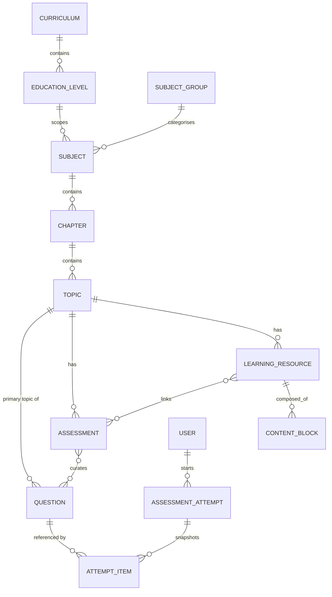

# Product Requirements — Exampify

| Field | Value |
|-------|-------|
| Version | 1.0 |
| Status | Draft for approval — no code exists |
| Owner | Product |
| Supersedes | Version 0.1 (exam-first framing, Postgres/Drizzle stack) |
| Depends on | [ARCHITECTURE_DECISIONS.md](./ARCHITECTURE_DECISIONS.md), [MVP_ROADMAP.md](./MVP_ROADMAP.md) |
| Referenced by | All other documents |

---

## 1. Purpose and scope

Defines **what Exampify is**, **who it serves**, and **exactly what the first release must do**. It is the source of truth for scope disputes; every other document elaborates one slice of it.

**In scope:** vision, positioning, segments, functional and non-functional requirements, MVP boundary, success measures, assumptions, open questions.

**Out of scope:** data models ([DATABASE_SCHEMA.md](./DATABASE_SCHEMA.md)), endpoint shapes ([API_CONTRACTS.md](./API_CONTRACTS.md)), visual specification ([DESIGN_SYSTEM.md](./DESIGN_SYSTEM.md)), delivery sequencing ([MVP_ROADMAP.md](./MVP_ROADMAP.md)), search internals ([SEARCH_ARCHITECTURE.md](./SEARCH_ARCHITECTURE.md)).

**Not in scope of the project at all (this phase):** writing product code, migrations, dependency installation, or content authoring.

---

## 2. Product vision

Exampify is a **learning platform for exam preparation**. The distinction matters: the product must be useful to a student who wants to *understand* something, not only to one who wants to be *tested*.

> **Find your subject → understand the topic → (when you are ready) practise it → see what to work on next.**

Four commitments define the product against a notes site and against a quiz site:

1. **Learning first.** Every topic must be readable end to end with no assessment required. A resource that exists only to unlock questions is a product defect (`FR-CMS-06`, `FR-DISC-06`).
2. **Practice is an option, not a toll gate.** Lessons may include practice; standalone tests exist for exam rehearsal. The student chooses.
3. **Syllabus-shaped, not blog-shaped.** Content is organised as `Curriculum → Level → Subject → Chapter → Topic`, so coverage is verifiable and gaps are visible.
4. **Search understands the question.** "How do plants make food?" must find photosynthesis; "mitocondria" must still find mitochondria. Keyword-only search is not acceptable.

### 2.1 Reference platform analysis

The brief points at [Save My Exams](https://www.savemyexams.com/) as a structural reference. Analysis of its public pages (October–November 2026):

| Observed capability | Why it works | Exampify decision |
|---|---|---|
| Content organised by exam board + qualification + subject | Matches how students think; produces high-intent long-tail search traffic | Adopt the shape: curriculum + level scoping |
| Revision notes split into small syllabus-aligned sections | Readable on a phone; reduces content anxiety | Adopt: topics contain ordered, individually addressable resources |
| Exam questions grouped by topic with difficulty bands and model answers | Builds confidence; explanations teach | Adopt four difficulty levels and mandatory explanations |
| Past papers and mark schemes | Authentic exam format | **Defer** — licensing and content-ops cost (`A-07`) |
| Strengths/weaknesses analytics, planner, flashcards, AI marking | Retention and conversion | **Defer**; MVP ships accuracy-per-topic and a weak-topic list |
| Gated premium content | Monetisation | **Defer**; no payments in MVP, `entitlements` table inert (`A-04`) |

**Where we deliberately differ:** an original visual language (soft neo-brutalism), a **learning-first content model** (explanation-only resources are first-class, not a funnel to a quiz), semantic + fuzzy search, and a first-party studio. We do not copy copy, layout, illustrations, branding or content.

**Legal note:** the reference's content is proprietary. Structure is fair game; scraped text, diagrams or question banks are not (`A-08`).

---

## 3. Users and jobs to be done

### 3.1 Personas

| Persona | Context | Job to be done | Success feeling |
|---|---|---|---|
| **Amara — exam-focused student** (16–18) | Two months to exams, revising on a phone | "Tell me what to study and let me check whether I know it" | "I found my weak topic in 5 minutes." |
| **Budi — concept-first learner** | Wants to understand, not to be quizzed | "Explain this clearly, with a diagram, and let me stop there" | "I finally get it, and nobody forced a test on me." |
| **Daniel — returning student** | Short bursts, 3–4 sessions a week | "Show me where I left off and whether I'm improving" | "My accuracy is going up." |
| **Priya — author** (teacher/examiner, part-time) | Writes 4–8 topics a week | "Let me build a lesson with text, images, a formula and 15 questions in one sitting" | "I published a whole topic without fighting the tool." |
| **Marcus — reviewer** | Quality gate | "Show me what changed; approve or send back" | "Nothing wrong ships." |
| **Sam — admin** | Owns taxonomy and access | "Restructure subjects and grant access safely" | "I fixed structure without a migration." |

Not personas in MVP: teachers with classes, parents, institutional buyers (`A-05`).

### 3.2 Primary jobs and their answers

| Job | MVP answer |
|---|---|
| "Where do I start?" | Curriculum/level/subject directory with visible coverage |
| "Explain this topic" | Topic hub → study material / lesson, with blocks, formulas, diagrams |
| "I don't know the exact word" | Semantic search + typo tolerance + autocomplete |
| "Test me" | Lesson practice or a standalone practice test → graded review with explanations |
| "What am I bad at?" | Per-topic accuracy, weakest first |
| "Write and publish" | Studio: hierarchy, block editor, question authoring, assessments, publish gates |

---

## 4. Goals and non-goals

### 4.1 Goals (MVP)

- G1. A stranger reaches a real topic page in ≤ 3 clicks and reads it without an account.
- G2. A student can study a resource with **zero** assessment involved, and a lesson can include practice without forcing it.
- G3. A signed-in student completes a 10-question practice set and sees, per question, correctness, the correct answer and the explanation.
- G4. An author can create a subject, chapter, topic, a study resource with mixed blocks, a lesson with an assessment, and publish them without engineering help.
- G5. Search returns the right page for a natural-language question and for a misspelling.
- G6. Public pages are indexable, server-rendered and fast (LCP < 2.5 s p75 on mid-range mobile).
- G7. The data model accepts a second curriculum, a new block type and a new question type without a destructive migration.

### 4.2 Non-goals (MVP)

- Payments, subscriptions, trials, invoices (metadata table only, inert).
- Past papers, PDF libraries, flashcards, study planner.
- AI generation, AI marking, chat tutors.
- Classes, cohorts, teacher dashboards, assignments, SSO/SCIM.
- Native apps, offline mode, push notifications.
- Multi-language **UI** (content may be Indonesian or English; the interface is English in MVP).
- Real-time collaboration, comments.
- Public partner API keys, webhooks.
- Gamification beyond accuracy numbers.

---

## 5. Functional requirements

**MUST** = MVP required; **SHOULD** = MVP if it does not risk G1–G4; **LATER** = deferred.

### 5.1 Discovery and public content (`FR-DISC`)

| ID | Requirement | Priority |
|---|---|---|
| FR-DISC-01 | The homepage MUST present the value proposition, a curriculum/level selector, popular subjects and a search entry point. | MUST |
| FR-DISC-02 | A subject directory MUST list subjects grouped by subject group, filterable by curriculum and level. | MUST |
| FR-DISC-03 | A subject page MUST list chapters in order with topic counts and summaries. | MUST |
| FR-DISC-04 | A chapter page MUST list topics in order with estimated study time and availability badges (study material / lesson + practice / practice test). | MUST |
| FR-DISC-05 | A topic hub MUST show objectives and every published resource and assessment, each labelled with its derived format. | MUST |
| FR-DISC-06 | A study material page MUST render all block types (prose, headings, images, formulas, tables, callouts, downloads, video, related material) with previous/next navigation. | MUST |
| FR-DISC-07 | A lesson page MUST render its blocks **and** its linked assessment section inline or at the end, without forcing the student to start it. | MUST |
| FR-DISC-08 | A practice test page MUST present scope, question count and duration before starting. | MUST |
| FR-DISC-09 | Only `published` content MUST be reachable by anonymous visitors; drafts MUST 404 for them. | MUST |
| FR-DISC-10 | Breadcrumbs MUST reflect the full hierarchy and be machine-readable (`BreadcrumbList`). | MUST |
| FR-DISC-11 | Empty states MUST suggest adjacent content instead of a dead end. | MUST |
| FR-DISC-12 | "Continue where you left off" SHOULD appear for signed-in users with a resumable attempt. | SHOULD |
| FR-DISC-13 | A topic SHOULD show related resources from the same subject. | SHOULD |
| FR-DISC-14 | Every indexable page MUST emit unique title and description metadata, an absolute canonical URL, Open Graph tags and server-rendered JSON-LD; `/sitemap.xml` (index plus segments) and `/robots.txt` MUST list exactly the published, indexable URLs and exclude drafts, `/studio`, `/dashboard`, `/practice`, `/api` and `/search`. | MUST |

### 5.2 Search (`FR-SEARCH`)

| ID | Requirement | Priority |
|---|---|---|
| FR-SEARCH-01 | Search MUST return subjects, chapters, topics, study materials, lessons and assessments, grouped by type. | MUST |
| FR-SEARCH-02 | Search MUST understand natural-language queries that do not contain the content's exact wording (semantic retrieval). | MUST |
| FR-SEARCH-03 | Search MUST tolerate common misspellings and return the intended entity. | MUST |
| FR-SEARCH-04 | Autocomplete MUST respond while typing with prefix matches, subject-aware suggestions, and keyboard navigation. | MUST |
| FR-SEARCH-05 | Search MUST support filters for curriculum, level, subject and content type. | MUST |
| FR-SEARCH-06 | Exact title matches MUST rank first for their entity type. | MUST |
| FR-SEARCH-07 | Search MUST NEVER return drafts, archived content, questions, or answer material. | MUST |
| FR-SEARCH-08 | Search MUST degrade to keyword results (not an error) when the semantic index is unavailable. | MUST |
| FR-SEARCH-09 | Recent and popular searches SHOULD be offered. | SHOULD |
| FR-SEARCH-10 | Content SHOULD become searchable within 60 s of publication. | SHOULD |
| FR-SEARCH-11 | Search results SHOULD show why a result matched (matched section, not just title). | LATER |

### 5.3 Authentication (`FR-AUTH`)

| ID | Requirement | Priority |
|---|---|---|
| FR-AUTH-01 | Students MUST sign up and sign in with email + password. | MUST |
| FR-AUTH-02 | Email verification MUST be required before the first attempt is created. | MUST |
| FR-AUTH-03 | Password reset via emailed token MUST work. | MUST |
| FR-AUTH-04 | Google OAuth SHOULD be available as an alternative. | SHOULD |
| FR-AUTH-05 | Sessions MUST be cookie-based, `HttpOnly`, `Secure`, `SameSite=Lax`, revocable server-side. | MUST |
| FR-AUTH-06 | Users MUST be able to sign out and revoke all other sessions. | MUST |
| FR-AUTH-07 | Account deletion SHOULD remove personal data and anonymise attempts. | SHOULD |
| FR-AUTH-08 | Staff MUST reach `/studio` with role-gated access and no data leak in the RSC payload. | MUST |

### 5.4 Content management (`FR-CMS`)

| ID | Requirement | Priority |
|---|---|---|
| FR-CMS-01 | Authors MUST create, edit, reorder and archive curricula, levels, subject groups and subjects (taxonomy writes require `admin` where specified). | MUST |
| FR-CMS-02 | Authors MUST create, edit, reorder, archive and publish chapters and topics. | MUST |
| FR-CMS-03 | Authors MUST compose a learning resource from ordered blocks: rich text, heading, image, formula, table, callout, video, download, question section, related material. | MUST |
| FR-CMS-04 | The block editor MUST validate each block with a shared Zod schema and allow reordering without data loss. | MUST |
| FR-CMS-05 | Authors MUST create assessments with ordered questions, mode (`practice`/`test`/`mock`), optional duration, and link them to a resource with a placement. | MUST |
| FR-CMS-06 | A resource MUST be able to exist with **no** assessment, and an assessment with **no** resource. | MUST |
| FR-CMS-07 | The studio MUST show the derived format (study material / lesson + practice / practice test) and recompute it on link changes. | MUST |
| FR-CMS-08 | Content MUST support `draft → in_review → published → archived` transitions with per-entity validation gates. | MUST |
| FR-CMS-09 | Publication MUST be blocked when required fields are missing (gates in [CONTENT_MODEL.md](./CONTENT_MODEL.md) §4). | MUST |
| FR-CMS-10 | A preview MUST render draft content at the real public URL shape, staff-only and `noindex`. | MUST |
| FR-CMS-11 | Every content mutation MUST write an audit entry with actor, entity, timestamp and changed field names. | MUST |
| FR-CMS-12 | Slugs MUST be generated from titles, unique per parent, and a change MUST write a 301 redirect. | MUST |
| FR-CMS-13 | Studio lists MUST support search, status filtering, sorting and cursor pagination (TanStack Table). | MUST |
| FR-CMS-14 | Media upload MUST use presigned direct-to-storage uploads, validate type and size server-side, and require alt text before publish. | MUST |
| FR-CMS-15 | Editors MUST protect unsaved changes and enforce optimistic concurrency (`expectedUpdatedAt`). | MUST |
| FR-CMS-16 | A reviewer MUST be able to return content to `draft` with a reason. | SHOULD |
| FR-CMS-17 | Bulk actions (archive N, move N) MUST exist. | LATER |
| FR-CMS-18 | Content revision history with diff and rollback MUST exist. | LATER |

### 5.5 Question bank (`FR-QB`)

| ID | Requirement | Priority |
|---|---|---|
| FR-QB-01 | Authors MUST create `multiple_choice`, `multiple_select`, `true_false` and `short_answer` questions. | MUST |
| FR-QB-02 | Every question MUST have a stem, topic, difficulty, answer key, and a non-empty explanation to publish. | MUST |
| FR-QB-03 | Choice questions MUST support 2–8 options; `multiple_choice` exactly one correct, `multiple_select` two or more, `true_false` two fixed options. | MUST |
| FR-QB-04 | Options SHOULD support per-option feedback. | SHOULD |
| FR-QB-05 | Short answer MUST support a list of accepted answers plus normalisation rules. | MUST |
| FR-QB-06 | A question MUST support one optional image with alt text. | MUST |
| FR-QB-07 | A question MUST be able to belong to multiple topics: one primary plus secondary, without duplication. | MUST |
| FR-QB-08 | Assessments MUST be curated ordered collections, reusable across resources, with optional per-item points override. | MUST |
| FR-QB-09 | Question and assessment status transitions MUST match `FR-CMS-08`. | MUST |
| FR-QB-10 | A question library MUST filter by subject, topic, type, difficulty, status and author. | MUST |
| FR-QB-11 | CSV import with row-level validation errors SHOULD exist. | LATER |
| FR-QB-12 | Near-duplicate detection SHOULD warn the author. | LATER |
| FR-QB-13 | New types (`matching`, `fill_in_the_blank`, `essay`) MUST be addable without changing the attempt schema. | MUST (design constraint) |

### 5.6 Student practice (`FR-PRAC`)

| ID | Requirement | Priority |
|---|---|---|
| FR-PRAC-01 | A student MUST start practice from a topic, chapter, subject, a resource's inline section, or a published assessment. | MUST |
| FR-PRAC-02 | The server MUST select and snapshot questions; the client never chooses them. | MUST |
| FR-PRAC-03 | The runner MUST show one question at a time with a position indicator, forward/back navigation and a palette. | MUST |
| FR-PRAC-04 | Answers MUST save as the student navigates, so a refresh does not lose work. | MUST |
| FR-PRAC-05 | The student MUST be able to review and change answers before submit. | MUST |
| FR-PRAC-06 | Submission MUST grade server-side; the answer key MUST never be sent before submit. | MUST |
| FR-PRAC-07 | Review MUST show the student's answer, the correct answer, points, and the explanation; per-option feedback where present. | MUST |
| FR-PRAC-08 | Abandoning MUST mark the attempt `abandoned`, keep answers, count in history but not in accuracy. | MUST |
| FR-PRAC-09 | Attempts MUST expire after 24 h of inactivity with no score. | MUST |
| FR-PRAC-10 | The runner MUST be keyboard-complete and announce state to screen readers. | MUST |
| FR-PRAC-11 | The student MUST be able to retry with a fresh selection using the same configuration. | MUST |
| FR-PRAC-12 | `practice` mode MUST reveal per-question correctness immediately; `test`/`mock` MUST withhold it until submit. | MUST |
| FR-PRAC-13 | `test`/`mock` sessions MUST enforce their duration server-side at submit. | MUST |
| FR-PRAC-14 | Hints and per-question flagging MUST exist. | LATER |

### 5.7 Progress (`FR-PROG`)

| ID | Requirement | Priority |
|---|---|---|
| FR-PROG-01 | A dashboard MUST show attempts, questions answered, overall accuracy and 30-day activity. | MUST |
| FR-PROG-02 | A topic performance table MUST show attempts, accuracy and last-practised date, sortable/filterable by subject. | MUST |
| FR-PROG-03 | Up to 5 "focus topics" (≥ 5 answers, accuracy < 60 %) MUST be highlighted, weakest first. | MUST |
| FR-PROG-04 | Attempt history MUST be paginated, filterable and link into read-only review. | MUST |
| FR-PROG-05 | Topic pages SHOULD show the signed-in student's own accuracy for that topic. | SHOULD |
| FR-PROG-06 | Progress MUST recompute from attempts (source of truth) and survive re-grading. | SHOULD |
| FR-PROG-07 | Study progress (resources read vs practised) SHOULD be tracked separately from accuracy. | SHOULD |
| FR-PROG-08 | Recommendations and spaced repetition MUST exist. | LATER |
| FR-PROG-09 | CSV/account data export MUST exist. | LATER |

### 5.8 Platform and operations (`FR-OPS`)

| ID | Requirement | Priority |
|---|---|---|
| FR-OPS-01 | Publishing MUST enqueue search indexing without blocking the publish response. | MUST |
| FR-OPS-02 | Search indexing MUST converge after a failed delivery (outbox + sweeper). | MUST |
| FR-OPS-03 | Unpublished/deleted content MUST be removed from search within 60 s. | MUST |
| FR-OPS-04 | A reconciliation job MUST report and repair index drift. | MUST |
| FR-OPS-05 | Media deletion MUST purge blobs only after references are gone. | MUST |
| FR-OPS-06 | `/api/v1/health` MUST report dependencies without leaking configuration. | MUST |
| FR-OPS-07 | Expired attempts, tokens and audit rows MUST be pruned on a schedule. | MUST |

### 5.9 Non-functional requirements (`NFR`)

| ID | Requirement | Target |
|---|---|---|
| NFR-01 | Public page performance | LCP < 2.5 s p75 mobile, INP < 200 ms, CLS < 0.1 |
| NFR-02 | API latency | p95 < 300 ms reads, < 500 ms submit (10 questions) |
| NFR-03 | Search latency | p95 < 600 ms full search, < 120 ms suggest |
| NFR-04 | Availability | 99.5 % monthly for public pages; search may degrade |
| NFR-05 | Accessibility | WCAG 2.2 AA, contrast ≥ 4.5:1, visible focus, keyboard paths |
| NFR-06 | Responsive | 360 px → 1920 px, no horizontal scroll, targets ≥ 44 px |
| NFR-07 | Type safety | `strict` + `noUncheckedIndexedAccess` + `exactOptionalPropertyTypes`, no `any` |
| NFR-08 | Durability | Nightly logical dump + PITR where available; RPO ≤ 24 h, RTO ≤ 4 h |
| NFR-09 | Security | OWASP Top 10 mitigations; answer keys never leak pre-submit |
| NFR-10 | Observability | Structured logs, error tracking, request ids, slow-query log |
| NFR-11 | Test coverage | ≥ 80 % on scoring, validation, permissions and index sync |
| NFR-12 | Content scale | 20 curricula × 40 subjects × 15 chapters × 12 topics ≈ 144k topics; page queries O(1) in depth |
| NFR-13 | Question volume | 500k questions; selection < 150 ms |
| NFR-14 | Search corpus | 100k documents without re-architecture; 5 M vectors as the Qdrant ceiling |
| NFR-15 | Browser support | Last 2 versions of Chrome, Safari, Firefox, Edge; iOS Safari 16+ |
| NFR-16 | Privacy | GDPR-ready posture: minimal PII, documented retention, deletion path |
| NFR-17 | Portability | Swapping the DB driver, the object store or the vector store touches one module each |
| NFR-18 | Transactional email | Every auth email is queued, idempotent and retried; no send is inline in a user request; no marketing mail in MVP |
| NFR-19 | Product analytics | First-party, server-authoritative, pseudonymous, 90-day retention, no third-party script or pixel |

---

## 6. MVP boundary

### 6.1 In the MVP

- **Public:** homepage, subject directory, subject, chapter, topic hub, study material, lesson, practice test page, search + autocomplete, 404/500, sitemap, robots.
- **Auth:** email/password, verification, sign-in/out, reset, roles.
- **Studio:** hierarchical CRUD, block editor (10 types), assessment composer, question authoring (4 types), media (presigned), audit, publish gates, preview, redirects.
- **Practice:** config → attempt → autosave → submit → graded review; retry; expiry; practice vs test reveal policy.
- **Progress:** summary, topic performance, focus topics, history + review.
- **Platform:** outbox + index sync, search (hybrid + suggest + fuzzy), reconciliation, pruning, health.
- **Cross-cutting:** SEO metadata + JSON-LD, accessibility baseline, rate limiting, error tracking.

### 6.2 Excluded from MVP

Payments; past papers; flashcards; planner; AI features; classes/assignments; notifications; i18n UI; native apps; revision history; bulk import; recommendations; public API.

### 6.3 Scope discipline

A feature ships only if the whole path works: authored → published → discoverable (nav **and** search) → read or practised → graded → visible in progress. A partially wired feature is worse than an absent one.

---

## 7. Assumptions

Documented guesses, not established requirements. Each has an impact if wrong.

| ID | Assumption | Impact if wrong | Mitigation |
|---|---|---|---|
| A-01 | Audience is secondary/early-university students (15–19), reading **English and/or Indonesian**. | Model choice, copy tone, taxonomy | Multilingual embedding; content locale is editorial, not schema |
| A-02 | First catalogue is **one curriculum** with 3–5 subjects. | Multi-curriculum multiplies content-ops cost | Hierarchy supports many; seeding is a content decision |
| A-03 | Content is authored by a small in-house/contract team (2–5), not UGC. | UGC needs moderation and abuse controls | `author` is invite-only |
| A-04 | MVP monetisation is **none**; all published content is free. | A paywall later needs entitlement checks | One content-read choke point + inert `entitlements` table |
| A-05 | No institutional accounts, no teacher role. | B2B needs orgs, seats, SSO, assignments | `role` enum is extensible; no org tables until needed |
| A-06 | Practice is self-directed; no deadlines that matter institutionally. | Assignments add cohort + due-date entities | Attempts already have `user_id`; `assignment_id` is additive |
| A-07 | Past papers are excluded for licensing and cost. | Licensed papers need a document entity + file storage | `media_assets` + a future `past_papers` table |
| A-08 | All brand, copy, illustration and question content is original. | Copyright exposure | Authoring checklist records provenance |
| A-09 | Formulas are needed in MVP (science/maths), rendered with KaTeX. | A deferred renderer blocks science topics | `formula` is a first-class block type from day one |
| A-10 | Preview + production + local is sufficient isolation. | Enterprise tenants need isolation | Turso branching per PR; tenant column deferred |
| A-11 | Traffic stays under ~1 M page views/month and < 2k concurrent students in year one. | Scale-out changes caching and plans | Stateless tier, ISR, documented upgrade order |
| A-12 | Content edits are infrequent (tens per day). | Real-time invalidation needs a different strategy | Tag invalidation + 60 s TTL |
| A-13 | Mobile is ~70 % of study sessions. | Desktop-first design wasted | Mobile-first layout; one-hand runner |
| A-14 | The UI is English-only even when content is Indonesian. | Full i18n needs a locale prefix + message catalogue | Language-neutral components; `/{locale}` reserved |
| A-15 | Short-answer grading is deterministic; no human marking. | Essay quality suffers | Manual review designed, not implemented |
| A-16 | A single Turso database handles content + attempts at MVP scale. | Write contention forces sharding or MVCC | Short transactions; MVCC documented as the lever |
| A-17 | Qdrant Cloud's free tier is enough for development, not launch. | Launch on free tier risks throttling | Paid cluster budgeted in `DEPLOYMENT_AND_ENVIRONMENTS.md` §8 |
| A-18 | Semantic search quality with `e5-small` is sufficient for Indonesian + English. | Poor recall forces a larger paid model + full reindex | Golden-set evaluation before launch (`SEARCH_ARCHITECTURE.md` §11.4) |

Assumptions are re-validated at the end of Phase 1. An invalidated assumption updates this table and the affected documents in the same change.

---

## 8. Data relationships at a glance

Full cardinalities: [DATABASE_SCHEMA.md](./DATABASE_SCHEMA.md). Semantics: [CONTENT_MODEL.md](./CONTENT_MODEL.md).

---

## 9. Dependencies between modules

| Module | Depends on | Blocks |
|---|---|---|
| Design system | This doc, [DESIGN_SYSTEM.md](./DESIGN_SYSTEM.md) | All UI |
| Schema + migrations | ADR-016 sign-off | Everything with persistence |
| Public site | Taxonomy, published-content queries, SEO rules | Search, discovery analytics |
| Auth | Better Auth tables, session strategy, email | Practice, dashboard, studio |
| Studio | Auth roles, taxonomy, storage, validation | Any non-seed content |
| Question bank | Studio shell, scoring schemas | Practice |
| Search | Schema, outbox, Qdrant, embeddings | Discovery quality |
| Practice engine | Question bank, auth, attempts schema | Progress |
| Progress | Attempts | Focus topics |

No module ships before the taxonomy schema is stable — that is why Phase 1 freezes URLs and hierarchy before the authoring UI exists.

---

## 10. Edge cases and product rules

| # | Situation | Required behaviour |
|---|---|---|
| E-01 | Topic has study material but no questions | Topic is fully valid and indexable; no disabled "practice" CTA is shown at all — practice simply does not appear. |
| E-02 | Topic has only an assessment | Hub shows the practice test; the reading section is omitted, not an empty placeholder. |
| E-03 | Requested question count exceeds the pool | Server caps and returns the actual count; UI shows "8 of 10 available". Never an error. |
| E-04 | Filters match zero questions | `422 NO_QUESTIONS_MATCH`; UI offers to relax difficulty first. |
| E-05 | Student abandons | `abandoned`, excluded from accuracy, visible in history. |
| E-06 | Question edited after an attempt | Item keeps `question_version`; review shows current content with a "content updated" notice. |
| E-07 | Question archived after an attempt | Attempt and review stay readable; question is not selectable again. |
| E-08 | Topic unpublished after study | Public page 404s; history and review keep working. |
| E-09 | Two authors edit one resource | `expectedUpdatedAt` mismatch → `409 CONTENT_CONFLICT` with changed fields. |
| E-10 | Slug collision | Server appends `-2`; author may override pre-publish; uniqueness enforced by constraint. |
| E-11 | Duplicate submit | Idempotent: `200` with the stored result. |
| E-12 | Long session across midnight | Expiry computed server-side from `started_at`; no client clock trust. |
| E-13 | Deleted user with history | PII scrubbed; attempts retained opaquely (pending `OQ-06`). |
| E-14 | JavaScript disabled | Public content renders server-side; practice shows a `<noscript>` explanation. |
| E-15 | Slow network on submit | Button locks; retried once with the same idempotency key. |
| E-16 | Reviewer rejects twice | Allowed; each transition logged. |
| E-17 | Short answer differs only by case/whitespace | Normalised; counts correct. |
| E-18 | Question with one option | Publish blocked; draft save allowed. |
| E-19 | Misspelled search query | Fuzzy correction offered; intended entity in top 3. |
| E-20 | Search engine unavailable | Keyword results with a "limited results" note, never an error page. |
| E-21 | Assessment linked to a resource in another topic | Save rejected unless cross-listed (`ASSESSMENT_SCOPE_MISMATCH`). |
| E-22 | Resource with an unparseable formula | Publish blocked with the block path highlighted. |

---

## 11. Acceptance criteria

The MVP is accepted when all of the following are demonstrably true in a production-like environment:

1. An anonymous visitor can go homepage → subject → chapter → topic → study material and read it with correct breadcrumbs, metadata and structured data at 360 px.
2. A topic with **no assessment** is published, indexed, and fully readable; no practice UI appears.
3. A lesson shows its inline practice section, and a student can read the whole lesson without starting it.
4. A standalone practice test is reachable at its own URL and runs with its duration enforced.
5. `/studio` is inaccessible to `student` (403, no data in the RSC payload).
6. An author publishes a topic with a study resource (5 block types incl. formula + image), a lesson with a 10-question assessment, and a standalone test, in one sitting.
7. Publish is refused with field-level errors when an explanation is short, a choice question lacks a correct option, an image lacks alt text, or a formula is invalid.
8. A student completes a 10-question attempt, leaves mid-way, resumes on another device with answers intact.
9. Submitted score equals an independently computed sum of awarded units.
10. No correct answer appears in any payload before submit (automated contract + payload scan).
11. "How do plants make food?" returns the photosynthesis resource in the top 3, and `mitocondria` returns Mitochondria.
12. Unpublishing a resource removes it from search within 60 s.
13. Dashboard accuracy equals `correct / graded`, and focus topics list the weakest ≤ 5 with ≥ 5 answers and < 60 %.
14. All four question types grade correctly, including partial short answers and multi-select.
15. Lighthouse mobile on a topic page: performance ≥ 90, accessibility ≥ 95, SEO ≥ 95.
16. Automated tests cover scoring, publish gates, permission matrix, attempt lifecycle and index sync in CI.

---

## 12. Open questions

| # | Question | Owner | Blocks | Default if unanswered |
|---|---|---|---|---|
| OQ-01 | Launch curriculum and subject list? (`A-02` is a placeholder) | Product + Content | Phase 1 seeding | One curriculum, 3 subjects — **Open — needs:** decide the launch curriculum and subject list with content ops; **blocks Phase 1**. |
| OQ-02 | Is "Exampify" the brand, and what domain? | Brand/Founder | Metadata, emails | Keep working name in one config constant — **Open — needs:** decide brand and domain; URLs, metadata and mail all depend on it; **blocks Phase 1**. |
| OQ-03 | Free forever, or a paywall within 12 months? | Business | Entitlement work | One read choke point + inert table — **Open — needs:** decide free-forever vs a paywall (ADR-012 revisit); **blocks post-MVP**. |
| OQ-04 | Is Indonesian content at launch, or English only? | Product | Embedding evaluation, copy | Multilingual model, English corpus first — **Open — needs:** decide whether Indonesian content is in the launch corpus; **blocks Phase 1**. |
| OQ-05 | ~~Email transport, relay and sender domain?~~ **Resolved:** `@sendust/ts` over Google SMTP (`smtp.gmail.com`, app password) sending as a verified alias on a dedicated Google account (`ADR-035`, `ADR-037`); Google-only, so there is no fallback relay | Ops | Verification/reset | Alias verification is ADR-037 spike gate 3; the domain is still `OQ-02` |
| OQ-06 | Account export/deletion at launch (jurisdiction)? | Legal | `FR-AUTH-07` | Implement deletion, defer export — **Open — needs:** decide export/deletion scope with counsel (ties `D-05`); **blocks Phase 2**. |
| OQ-07 | Single reviewer or two-person review for publish? | Content | Reviewer workflow | Single reviewer — **Open — needs:** decide one- vs two-person publish review; **blocks post-MVP**. Phase 2 ships the single-reviewer publish gate and lists two-person review as excluded, so no MVP phase waits on it. |
| OQ-08 | Right-to-left or non-Latin script support in 12 months? | Product | Nothing in MVP — **no blocking phase:** layouts already use logical CSS properties and `IA-12` transliterates non-Latin titles, so no phase waits on this; it only sizes a later typography effort | No; logical CSS properties anyway — **Open — needs:** decide whether RTL or non-Latin scripts are needed within 12 months. |
| OQ-09 | Monthly infrastructure budget? | Business | Provider tiers | Free tiers for dev, ~$50–90/mo at launch on the cost envelope's Pro assumption — **Open — needs:** set the monthly infrastructure budget, which also settles the Vercel tier (`OQ-D2`); **blocks Phase 7**. |
| OQ-10 | Anonymous (guest) practice? | Product | Attempt ownership | No; account required — **Open — needs:** decide whether guest practice is allowed; **blocks Phase 4**. |
| OQ-11 | Do downloads require an account? | Product | `download` block gating | Public — **Open — needs:** decide whether downloads require an account; **blocks Phase 2**. |
| OQ-12 | Is search expected to answer questions, or only retrieve pages? | Product | Scope; no AI answers in MVP | Retrieve pages only — **Open — needs:** decide whether search answers questions or only retrieves pages; **blocks Phase 6**. |

The phase suffix is the earliest phase whose work consumes the answer, not a deadline, and it is not an approval gate — the sign-off gates stay in `ARCHITECTURE_DECISIONS.md` §5. Rows that restate a controlling question land in the same phase as it (`OQ-SEO1`, `OQ-UX1` and `OQ-ED1` follow `OQ-01`; `OQ-I18N2` follows `OQ-04`). A row without a phase records in its `Blocks` cell why nothing in the plan waits on it.

Unresolved items are never silently decided in code. If a decision is needed to proceed, add an ADR first.
