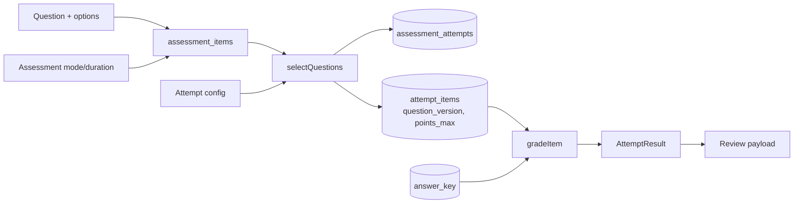
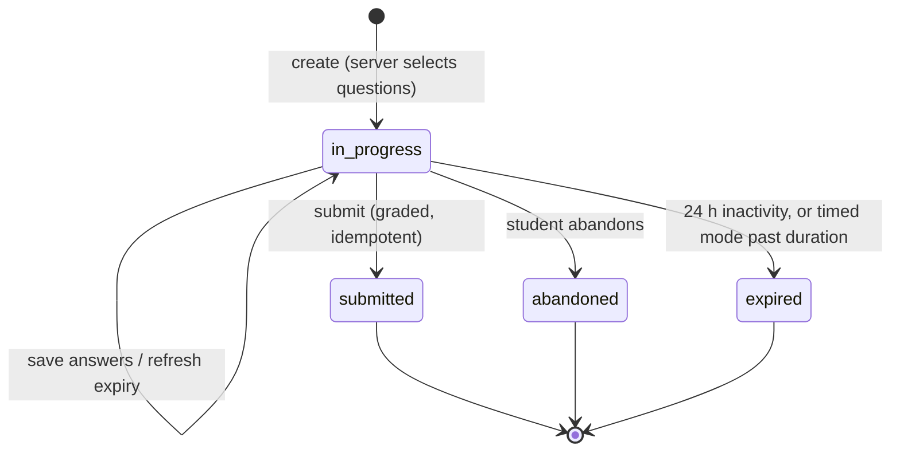

# Question Engine — Exampify

| Field | Value |
|-------|-------|
| Version | 1.0 |
| Status | Proposed |
| Supersedes | Version 0.1 (sessions, question sets, Postgres JSONB) |
| Depends on | [DATABASE_SCHEMA.md](./DATABASE_SCHEMA.md), [CONTENT_MODEL.md](./CONTENT_MODEL.md) |
| Referenced by | [API_CONTRACTS.md](./API_CONTRACTS.md), [TESTING_STRATEGY.md](./TESTING_STRATEGY.md), [SECURITY_AND_PERMISSIONS.md](./SECURITY_AND_PERMISSIONS.md) |

---

## 1. Purpose and scope

How questions are authored, selected, served, graded and reviewed — including the invariants that keep answer keys away from students and the arithmetic that makes partial credit exact.

**In scope:** answer-key format, normalisation, selection, attempt lifecycle, grading, review payloads, reveal policy, leak prevention, publish gates, extension path.

**Out of scope:** field limits for non-answer content ([CONTENT_MODEL.md](./CONTENT_MODEL.md)), HTTP shapes ([API_CONTRACTS.md](./API_CONTRACTS.md)), tables and indexes ([DATABASE_SCHEMA.md](./DATABASE_SCHEMA.md)).

---

## 2. Model at a glance



Three separations make the engine testable:

1. **Content vs attempt.** Questions are reusable; an attempt owns a snapshot of *which* question at *which* version for *how many* points.
2. **Scoring vs persistence.** `gradeItem` is a pure function; the transaction only writes its output.
3. **Reveal vs grade.** Grading always happens on submit; *when* correctness is shown depends on `assessment.mode` (`practice` reveals per answer, `test`/`mock` never before submit).

---

## 3. Question types and answer keys

```ts
type OptionLabel = 'A' | 'B' | 'C' | 'D' | 'E' | 'F' | 'G' | 'H';

type AnswerKey =
  | { v: 1; type: 'multiple_choice'; correct: OptionLabel }
  | { v: 1; type: 'multiple_select'; correct: OptionLabel[]; scoring: 'all_or_nothing' | 'partial' }
  | { v: 1; type: 'true_false'; correct: boolean }
  | { v: 1; type: 'short_answer'; accepted: string[]; keywords?: { all: string[] } };

type StudentAnswer =
  | { v: 1; type: 'multiple_choice'; option: OptionLabel | null }
  | { v: 1; type: 'multiple_select'; options: OptionLabel[] }
  | { v: 1; type: 'true_false'; value: boolean | null }
  | { v: 1; type: 'short_answer'; text: string };
```

| Type | Options | Correct data | Grading |
|---|---|---|---|
| `multiple_choice` | 2–8 | one label | exact label match |
| `multiple_select` | 2–8 | ≥ 2 labels | all-or-nothing or partial (below) |
| `true_false` | exactly 2, generated (`A` = True, `B` = False) | boolean | exact |
| `short_answer` | none | 1–20 accepted strings, optional required keywords | normalised match, then keyword rule |

**Correctness is stored only in `answer_key`** (TEXT JSON, `json_valid` guarded). `question_options` has no `is_correct`; the review UI derives highlighting by comparing labels with the key *after* grading ([ADR-004](./ARCHITECTURE_DECISIONS.md#adr-004--one-json-scoring-payload)).

**Storage:** `answer_key` is TEXT containing JSON. Every read parses with `AnswerKeySchema`; a parse failure fails closed — the question is treated as unavailable, the error is logged, and the attempt continues without it (never "marked wrong").

---

## 4. Integer scoring

All points are integers in hundredths (`points_x100`); 1 point = 100.

| Quantity | Column | Example |
|---|---|---|
| Question default | `questions.points_x100` | 100 (1 pt), 200 (2 pts) |
| Per-assessment override | `assessment_items.points_x100_override` | nullable |
| Attempt snapshot | `attempt_items.points_x100_max` | copied at selection |
| Awarded | `attempt_items.points_x100_awarded` | 0…max |
| Attempt total | `assessment_attempts.score_x100`, `max_score_x100` | sums |
| Percent | `score_percent_x100` | 0…10000 |

**Why integers:** partial credit produces thirds and sevenths; floating point would make `scorePoints` disagree with the sum of displayed item scores. One rounding happens at the leaf, never at the total.

```ts
function awarded(hits: number, misses: number, correctCount: number, max: number): number {
  const raw = Math.round((max * (hits - misses)) / correctCount);
  return Math.min(max, Math.max(0, raw));
}
```

---

## 5. Normalisation (short answer)

Deterministic, documented, and applied identically at grading and at authoring preview.

1. Unicode `NFKC`, trim, collapse internal whitespace.
2. Lowercase (locale-independent, `toLowerCase`).
3. Strip diacritics (`NFD`, remove combining marks).
4. Normalise typographic punctuation: `’`→`'`, `“”`→`"`, en/em dash → `-`, non-breaking space → space.
5. Strip trailing sentence punctuation (`.`, `!`, `?`) and surrounding quotes.
6. Collapse spaces around `=`, `+`, `-`, `/`, `<`, `>`, `^`.
7. **Not** done: stemming, synonym expansion, unit conversion, number-word conversion. A question needing those must list the accepted forms explicitly.

**Matching:** exact normalised equality against any accepted answer. If `keywords.all` is present, all listed keywords must appear as whole tokens in the normalised answer; this is a *requirement in addition to* the accepted list only when the author marks the question `keywordsOnly` (default: accepted list OR keyword rule).

```ts
export function normaliseAnswer(input: string): string { … }
export function gradeShortAnswer(key: ShortAnswerKey, text: string, max: number): number { … }
```

---

## 6. Grading

### 6.1 Per item

```ts
export function gradeItem(q: GradableQuestion, answer: StudentAnswer | null): ItemResult {
  if (answer === null) return { isCorrect: null, points: 0, feedback: { state: 'unanswered' } };
  if (answer.type !== q.answerKey.type) throw new AnswerTypeMismatch(q.id);

  switch (q.answerKey.type) {
    case 'multiple_choice': {
      const ok = answer.option === q.answerKey.correct;
      return { isCorrect: ok, points: ok ? q.pointsMax : 0, feedback: { state: 'graded' } };
    }
    case 'true_false': {
      const ok = answer.value === q.answerKey.correct;
      return { isCorrect: ok, points: ok ? q.pointsMax : 0, feedback: { state: 'graded' } };
    }
    case 'multiple_select': {
      const correct = new Set(q.answerKey.correct);
      const chosen = new Set(answer.options);
      const hits = [...chosen].filter((l) => correct.has(l)).length;
      const misses = [...chosen].filter((l) => !correct.has(l)).length;
      if (q.answerKey.scoring === 'all_or_nothing') {
        const ok = hits === correct.size && misses === 0;
        return { isCorrect: ok, points: ok ? q.pointsMax : 0,
                 feedback: { state: 'graded', hits, misses, correctCount: correct.size } };
      }
      const points = awarded(hits, misses, correct.size, q.pointsMax);
      return { isCorrect: hits === correct.size && misses === 0, points,
               feedback: { state: 'graded', hits, misses, correctCount: correct.size, partial: true } };
    }
    case 'short_answer': {
      const points = gradeShortAnswer(q.answerKey, answer.text, q.pointsMax);
      return { isCorrect: points === q.pointsMax, points,
               feedback: { state: 'graded', normalised: normaliseAnswer(answer.text) } };
    }
    default: {
      const _exhaustive: never = q.answerKey;
      throw new Error(`Unhandled answer key: ${JSON.stringify(_exhaustive)}`);
    }
  }
}
```

**Semantics worth stating explicitly:**

- `isCorrect` for a partial-credit multi-select is `true` only when *all* correct options are chosen and none wrong — the score may be > 0 while `isCorrect` is false. Accuracy uses `isCorrect`; points use `points`. Both are shown.
- An unanswered item scores 0 and is excluded from the accuracy denominator.
- Selecting every option in a partially-scored multi-select cannot beat selecting the known-correct ones: each wrong pick subtracts one hit's worth.

### 6.2 Whole attempt

```
for each item:
  result = gradeItem(question, item.selectedAnswer)
  item.isCorrect = result.isCorrect
  item.points_x100_awarded = result.points
  item.feedback = result.feedback
answeredCount = items where selectedAnswer is not null
correctCount  = items where isCorrect === true
score_x100    = Σ points_x100_awarded
max_score_x100= Σ points_x100_max
score_percent_x100 = max_score_x100 === 0 ? null : round(score_x100 * 10000 / max_score_x100)
```

`score_percent_x100` of `6250` means 62.50 %.

**Rounding display:** percentages are formatted from hundredths (`62.5`), never recomputed from a float ratio.

---

## 7. Selection

Inputs: `source`, scope ids, `questionCount`, `difficulty`, `questionTypes`, `order`. Constraints: published questions only, in scope (primary or cross-listed), matching filters, no duplicates.

```ts
export async function selectQuestions(trx: Kysely<DB>, input: SelectionInput): Promise<SelectedQuestion[]> {
  const pool = await queryPool(trx, input);            // 1 query, LIMIT count*6, ORDER BY random_key
  const unique = uniqueBy(pool, (q) => q.id);
  const shuffled = input.order === 'fixed' ? unique : shuffle(unique, input.seed);
  return shuffled.slice(0, input.questionCount);
}
```

**Sampling:** `random_key INTEGER` per question, indexed `(topic_id, random_key)`. Draw with `WHERE random_key >= ? ORDER BY random_key LIMIT n`, wrapping once when short. This replaces `ORDER BY random()` (a full sort per request) and stays uniform.

**Seeding:** the attempt stores `config.seed` (a 32-bit integer) so a retry can be reproduced for debugging. Selection still re-runs; it does not reuse ids.

**Cross-topic scope:** chapter/subject selection joins `question_topics`, so a question cross-listed into two topics in the scope appears once (`DISTINCT` by question id).

**Short pool:** return what exists and report `requestedCount` vs `questionCount`. Never pad with unpublished or out-of-scope questions.

---

## 8. Attempt lifecycle



| Transition | Rules |
|---|---|
| create | Authenticated, email verified; pool non-empty; `question_count ≥ 1`; items snapshotted with `question_version` + `points_x100_max` |
| save | `status = 'in_progress'`; id in the attempt; ≤ 4 answers per call; refreshes `expires_at` |
| submit | `status = 'in_progress'`; grades in one transaction; idempotent |
| abandon | `status = 'in_progress'`; keeps answers; excluded from accuracy |
| expire | Lazy on read/submit **and** by a 15-minute sweep; no score |

**Timed modes:** `expires_at = min(started_at + duration, last_activity + 24 h)`. A submit after `expires_at` for a timed attempt is accepted, graded, and reports `overTimeSeconds` — refusing it would punish a network hiccup and lose the student's work (`OQ-QE3`).

**Expiry is evaluated on read**, so correctness never depends on a cron run. The sweep is housekeeping.

---

## 9. Submit transaction

```ts
await db.transaction().execute(async (trx) => {
  const attempt = await trx.selectFrom('assessment_attempts').selectAll()
    .where('id', '=', id).where('user_id', '=', actor.id).executeTakeFirst();
  if (!attempt) throw new NotFoundError();
  if (attempt.status === 'submitted') return loadStoredResult(trx, attempt);   // idempotent
  if (attempt.status !== 'in_progress') throw new InvalidTransition();

  const items = await trx.selectFrom('attempt_items').selectAll()
    .where('attempt_id', '=', id).orderBy('position').execute();
  const questions = await loadGradable(trx, items.map((i) => i.question_id));   // explicit projection incl. answer_key

  const graded = items.map((item) => gradeOne(item, questions.get(item.question_id)));
  // … write item rows, attempt totals, audit

  const claimed = await trx.updateTable('assessment_attempts')
    .set({ status: 'submitted', submitted_at: Date.now(), …totals })
    .where('id', '=', id).where('status', '=', 'in_progress').executeTakeFirst();
  if (Number(claimed.numUpdatedRows) === 0) return loadStoredResult(trx, attempt);  // lost the race
});
```

**Concurrency:** there is no `SELECT … FOR UPDATE` in libSQL. The conditional `UPDATE … WHERE status='in_progress'` is the claim; `numUpdatedRows === 0` means another request already submitted, and the stored result is returned. `BEGIN IMMEDIATE` plus `busy_timeout` bounds contention. Two concurrent submits therefore produce one grading pass and one stored result.

**Idempotency key:** `(user_id, idempotency_key)` unique when not null, so a retried `POST /attempts` returns the original attempt.

---

## 10. Publish gates

### 10.1 Question

| # | Gate |
|---|---|
| 1 | `stem_md` 10–4000 chars, not empty after trimming |
| 2 | `explanation_md` ≥ 60 chars |
| 3 | `difficulty` is a valid enum value |
| 4 | `points_x100` ∈ [100, 1000] |
| 5 | `answer_key` parses and matches `question_type` |
| 6 | `multiple_choice`: 2–8 options; `correct` exists among them |
| 7 | `multiple_select`: 2–8 options; ≥ 2 correct; all exist |
| 8 | `true_false`: exactly two options, `A`=True, `B`=False |
| 9 | `short_answer`: no options; 1–20 accepted answers; none empty after normalisation |
| 10 | Primary topic exists and is published-or-in-review |
| 11 | Every secondary topic exists and differs from the primary |
| 12 | `media_id` (if set) is `ready` with non-empty alt text |

### 10.2 Assessment

| # | Gate |
|---|---|
| 1 | 1–60 items, no duplicate `question_id` |
| 2 | `question_count` equals the item count |
| 3 | Every item's question is published |
| 4 | Every question is in the assessment's scope (primary or cross-listed) |
| 5 | `mode='test'\|'mock'` ⇒ `duration_seconds` ∈ [60, 10800] |
| 6 | `mode='practice'` ⇒ `duration_seconds IS NULL` |
| 7 | `scope_key` unique per slug (topic id, else subject id) |
| 8 | Every item's points override (if any) ∈ [100, 1000] |

Failures return `422 PUBLISH_GATE_FAILED` with `details: [{ path, code, message }]` where `path` addresses the field (`answerKey.correct`, `items[3].questionId`).

---

## 11. Metrics semantics (avoiding the denominator trap)

| Metric | Definition |
|---|---|
| `answered` | Items with a non-null `selected_answer` |
| `correct` | Items with `is_correct = 1` |
| `accuracy` | `correct / answered`; `null` when `answered = 0` |
| `score` | Sum of `points_x100_awarded` |
| `maxScore` | Sum of `points_x100_max` |
| `scorePercent` | `round(score * 10000 / maxScore)`; `null` when `maxScore = 0` |
| Topic accuracy | Over submitted attempts; **a cross-listed question counts in every topic it belongs to** (documented, so dashboards and review agree) |

**Two denominators exist and must not be mixed:** *accuracy* uses answered items (correctness), *score percent* uses max points (weighting). A dashboard showing one and a review showing the other will look broken; the UI labels them explicitly.

---

## 12. Leak prevention

The invariant: **no correctness information reaches the client before it is allowed by the mode.**

| Surface | Rule |
|---|---|
| `StudentQuestion` projection | Explicit columns; never a row spread; no `answer_key`, no explanation, no option feedback |
| `PATCH …/answers` | Returns `reveal` only when `mode='practice'` **and** that question was just answered; never for `test`/`mock` |
| `GET /attempts/{id}` | No correctness for `in_progress` |
| Review | Only for `submitted`; 409 otherwise |
| Studio | `answer_key` allowed, role-gated, `no-store` |
| Search | Questions are not indexed at all |
| Logs | `answer_key` is never logged |
| Errors | Validation messages never echo the correct value |

**Enforcement:** a leak test enumerates every attempt route, runs it in both modes, and scans the serialised payload for key material (`correct`, `answer_key`, the correct option label in a truthy position). The test fails on a new field that looks like correctness unless it is explicitly allow-listed.

---

## 13. Extension path

The attempt schema is type-agnostic: `selected_answer` and `feedback` are JSON, points are integers, and grading is a switch. Adding a type is:

1. A `question_type` `CHECK` rebuild (table rebuild migration) + union variant.
2. An `AnswerKey` and `StudentAnswer` variant.
3. One grading branch + tests.
4. An editor form component.

Planned: `matching` (pairs → partial credit by pair), `fill_in_the_blank` (per-blank normalisation), `numeric` (value + tolerance + unit), `essay` (manual review queue, `points_awarded` nullable). None require a new attempt table.

**Rejected for now:** per-option weighting, negative marking beyond multi-select, confidence-based scoring, IRT calibration. Each needs product evidence.

---

## 14. Dependencies

| Consumer | Needs from this document |
|---|---|
| API | Request/response shapes, reveal policy, idempotency |
| Studio | Answer-key editor constraints, publish gates |
| Attempt UI | Runner states, review payload, feedback semantics |
| Progress | Accuracy/score definitions |
| Tests | Truth table, gate fixtures, leak surface list |

---

## 15. Edge cases

| # | Case | Behaviour |
|---|---|---|
| QE-01 | Question edited mid-attempt | Attempt keeps `question_version`; grading uses the **current** key (documented), review flags `contentUpdated` |
| QE-02 | Question archived mid-attempt | Still graded; review readable |
| QE-03 | Multi-select: all wrong options chosen | 0 points (clamped), `isCorrect: false` |
| QE-04 | Multi-select: more hits than |correct| | Impossible; hits counted only among chosen correct |
| QE-05 | Short answer empty string | Answered (non-null) but 0 points; counts in the denominator |
| QE-06 | Short answer with only punctuation | Normalises to empty → 0 points |
| QE-07 | Accepted answer duplicated after normalisation | Rejected at authoring ("duplicate accepted answer") |
| QE-08 | Pool smaller than requested | Return what exists; report both counts |
| QE-09 | Pool empty | `422 NO_QUESTIONS_MATCH` with applied filters |
| QE-10 | Timed attempt submitted late | Accepted, graded, `overTimeSeconds` reported |
| QE-11 | Double submit | One grading pass; identical payload |
| QE-12 | Answer for a question not in the attempt | `422 QUESTION_NOT_IN_ATTEMPT` |
| QE-13 | `answer_key` fails to parse at grading | Item excluded, attempt still submits, error logged, question unpublished by an integrity job |
| QE-14 | Cross-listed question answered in two topics | Counts in both topic accuracies (documented) |
| QE-15 | Attempt config references an unpublished assessment | `404` (not `403`) |
| QE-16 | `pointsMax` differs from the question's current points | Snapshot wins |

---

## 16. Acceptance criteria

1. The grading truth table (§6) has a test per type × state × scoring variant.
2. `score_x100` equals the sum of item awards for every submitted attempt (property test over random attempts).
3. `scorePercent` is `null` only when `maxScore = 0`.
4. Partial-credit multi-select awards the documented fraction and clamps at 0 and max.
5. Short-answer normalisation is idempotent (`normalise(normalise(x)) = normalise(x)`).
6. Submit is idempotent under concurrent duplicates (two parallel calls → one grading pass, identical responses).
7. No attempt endpoint leaks correctness before it is allowed (automated leak test, both modes).
8. Selection never returns unpublished, out-of-scope or duplicate questions (property test over the seed).
9. Selection of 10 from a 10,000-question pool completes in < 150 ms locally.
10. Every publish gate has a failing fixture with a field-level error path.
11. An expired attempt cannot be graded and reveals no key.
12. Grading never writes a float to the database.

---

## 17. Open questions

| # | Question | Impact |
|---|---|---|
| OQ-QE1 | Should grading use the question version at selection time instead of current? | Requires storing the key or a revision table; current decision: current — **Open — needs:** decide grading against the current key or the selection snapshot, before grading tests are written; **blocks Phase 4**. |
| OQ-QE2 | Do we need a negative-marking policy for mock exams? | Scoring branch + product copy — **Open — needs:** decide whether mock exams use negative marking; **blocks Phase 4**. |
| OQ-QE3 | Should late submits for timed modes be rejected? | Currently accepted with `overTimeSeconds` **Open — needs:** decide whether late submits for timed modes are rejected; **blocks Phase 4**. |
| OQ-QE4 | Is partial credit shown per option in review, or only the total? | UI density — **Open — needs:** decide whether review shows per-option partial credit; **blocks Phase 4**. |
| OQ-QE5 | Should cross-listed questions count in every topic's accuracy? | Currently yes; an alternative is primary-topic-only — **Open — needs:** decide whether cross-listed questions count in every topic's accuracy (a deliberate irregularity today); **blocks Phase 5**. |
| OQ-QE6 | Do short answers need fuzzy matching (typo tolerance) rather than exact normalisation? | Risk of marking a wrong answer correct — **Open — needs:** decide whether short answers need fuzzy matching; **blocks Phase 4**. |
| OQ-QE7 | Is an essay/manual-review queue in year one? | Adds a review UI and a second grading path — **Open — needs:** decide whether essay/manual review is in year one; **blocks Phase 7**. |
