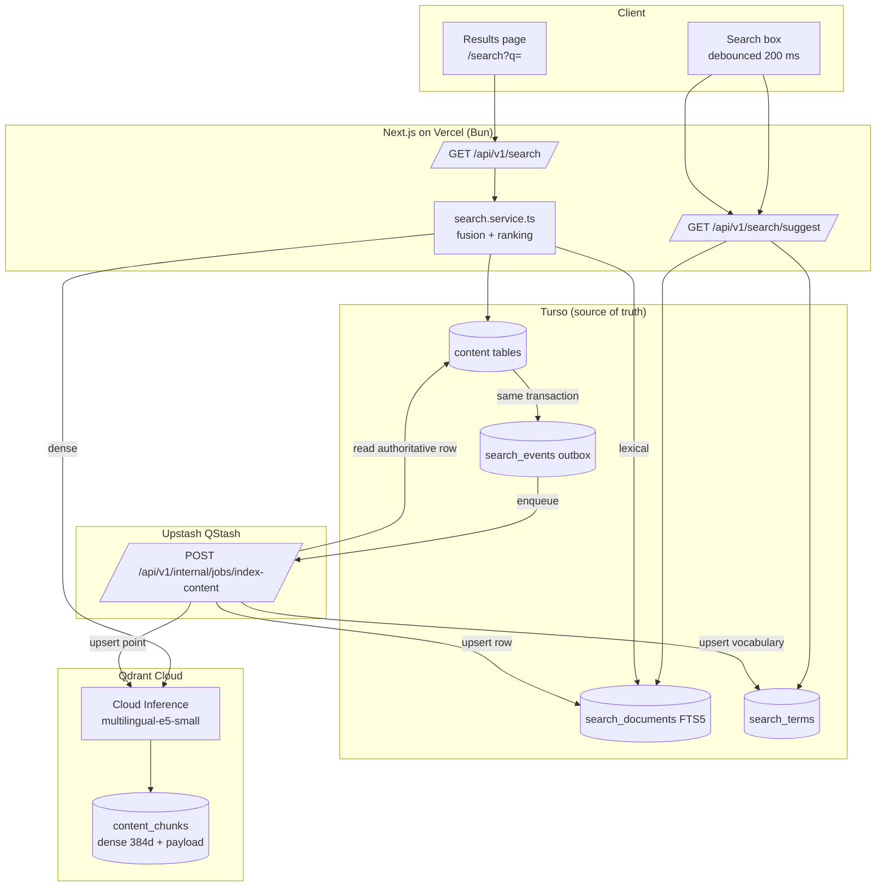
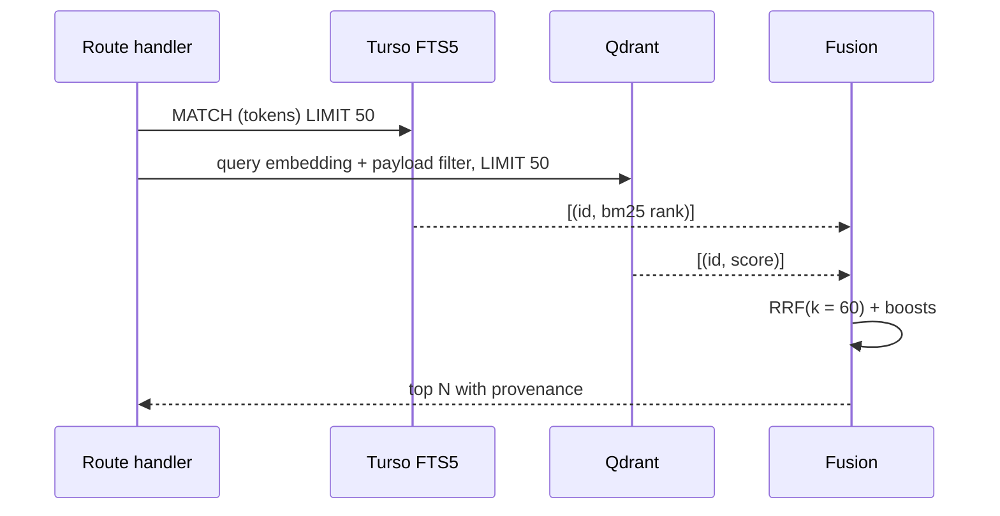
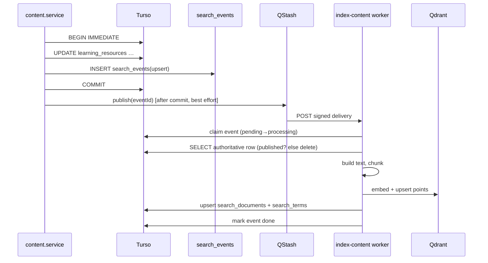

# Search Architecture — Exampify

| Field | Value |
|-------|-------|
| Version | 1.0 |
| Status | Proposed |
| Depends on | [DATABASE_SCHEMA.md](./DATABASE_SCHEMA.md), [CONTENT_MODEL.md](./CONTENT_MODEL.md), [BACKGROUND_JOBS.md](./BACKGROUND_JOBS.md) |
| Referenced by | [API_CONTRACTS.md](./API_CONTRACTS.md), [MVP_ROADMAP.md](./MVP_ROADMAP.md), [TESTING_STRATEGY.md](./TESTING_STRATEGY.md) |

---

## 1. Purpose and scope

How Exampify answers three different questions with three different mechanisms, and how the derived search index stays consistent with Turso.

**In scope:** capability allocation, index schemas, embedding model, lexical search, autocomplete, typo tolerance, hybrid fusion, ranking, filters, synchronisation, failure modes, evaluation.

**Out of scope:** question-bank search inside the studio (lexical only, `API_CONTRACTS.md` §7), UI components (`UI_UX_GUIDELINES.md` §6), database internals (`DATABASE_SCHEMA.md`).

**The one-sentence design:** Turso is the source of truth and answers prefix/fuzzy lookups; Qdrant is a derived semantic index; the API fuses both rankings and never lets Qdrant decide what a student is allowed to see.

---

## 2. Capability allocation (what each system actually does)

This table exists because the brief explicitly warns against assuming a vector database is a search engine. It is not.

| Capability | Provided by | Not provided by |
|---|---|---|
| Keyword / BM25 ranking | **Turso FTS5** (`search_documents`, `bm25()`), and optionally Qdrant sparse + full-text index | — |
| Prefix matching for autocomplete | **Turso** `search_terms.term LIKE 'mito%'` + FTS5 `token*` | Qdrant has no autocomplete API |
| Typo tolerance | **Application-side Levenshtein over the vocabulary table** (fallback: SQLean Fuzzy extension) | Qdrant does not correct spelling; a vector search will happily return unrelated neighbours for a misspelling |
| Semantic retrieval | **Qdrant dense vectors** (`multilingual-e5-small`, 384 dims) | Turso FTS5 |
| Metadata filtering | **Qdrant payload filters** (subject, topic, level, content type) *and* Turso `WHERE` clauses | — |
| Hybrid fusion | **Application-side RRF** over two ranked lists (optionally Qdrant native RRF) | Neither system fuses results from the other |
| Reranking | Not in MVP (gate: see §11.4) | — |
| "Popular searches" | **Turso** `search_terms.weight` + a query log table (Phase 5) | Qdrant |

**Consequence:** a search request makes at most two parallel calls (Turso, Qdrant) and fuses them in the route handler. If Qdrant is slow or down, the response degrades to lexical results with `degraded: true` rather than failing.

---

## 3. Architecture



---

## 4. What gets indexed

Only **public, published** entities. Questions, answer keys, drafts, private media and attempt data are never indexed.

| Entity | Indexed fields | Qdrant payload | Deep link |
|---|---|---|---|
| `curriculum` | name, short name, description | `entityType`, `curriculumId` | `/{curriculum}` |
| `education_level` | name, description | + `levelId` | `/{curriculum}/{level}` |
| `subject` | name, summary | + `subjectId`, `subjectGroup` | `/{curriculum}/{level}/{subject}` |
| `chapter` | title, summary | + `chapterId`, `subjectId` | `…/{chapter}` |
| `topic` | title, summary, learning objectives | + `topicId`, `chapterId`, `subjectId` | `…/{topic}` |
| `learning_resource` | title, subtitle, summary, prose from `rich_text` + `callout` + `heading` blocks | + `resourceId`, `topicId`, `subjectId`, `format` (`study_material`/`lesson_with_practice`), `difficulty` | `…/{topic}/learn/{slug}` |
| `assessment` | title, description | + `assessmentId`, `topicId`, `subjectId`, `mode` | `…/{topic}/practice/{slug}` or `/assessments/{slug}` |

**Chunking.** A resource longer than ~1,200 characters is split into overlapping chunks (≈900 characters, 150 overlap) on block boundaries; each chunk becomes one Qdrant point with `chunkIndex`. Turso FTS5 indexes the whole resource as one row. This is deliberate: BM25 prefers whole documents for term statistics, dense retrieval prefers passages.

**Point ids** are deterministic: `uuidv5(entityId + ':' + chunkIndex, NAMESPACE)`. A re-index overwrites the same point ids, so a retry cannot create duplicates. Chunks that no longer exist are deleted by `entityId` filter after the upsert (compare stored `chunkCount` payload).

---

## 5. Embeddings

| Decision | Value | Rationale |
|---|---|---|
| Provider | **Qdrant Cloud Inference** | One vendor, one API key, no separate embedding service to operate |
| Model | `intfloat/multilingual-e5-small` (384 dimensions, cosine) | Multilingual (Indonesian + English), **free on Qdrant Cloud**, small enough for fast query embedding |
| Alternative | `mixedbread-ai/mxbai-embed-large-v1` (1024, paid) | Better recall; evaluate only if §11.4 shows e5-small is insufficient |
| Collection | `content_v1`, `size: 384`, `distance: Cosine`, `on_disk_payload: true` | Version in the name so a model change is a new collection + reindex, never an in-place mutation |

**Model-specific rules that are easy to miss:**

1. E5 models are trained with prefixes. Passages are embedded as `"passage: " + text`; queries as `"query: " + text`. If Cloud Inference does not add them, the application must — this is validated in the Phase 1 spike, not assumed.
2. Normalise text before embedding: strip Markdown syntax, collapse whitespace, keep formulas as their LaTeX source, truncate to the model's context window (512 tokens for e5-small) at a sentence boundary.
3. Query and passage must use the **same** model and prefix scheme. Mixing them silently destroys relevance, so the model id, prefix scheme and dimensions are stored in a `search_config` row and asserted at startup.
4. Changing model or dimensions means a new collection and a full reindex (`OQ-S5`).

**Language handling.** Content may be Indonesian, English, or mixed. The multilingual model covers both without a language-detection step. Autocomplete and fuzzy matching operate on a normalised, diacritic-folded form, so `sel` matches `sel` and `fotosintesis` matches `fotosintesis` regardless of casing. Indonesian affixes (`meN-`, `-kan`, `-nya`) are **not** stemmed in MVP; query expansion via synonyms is the documented lever if recall is poor.

---

## 6. Lexical index (Turso FTS5)

```sql
CREATE VIRTUAL TABLE search_documents USING fts5(
  entity_id UNINDEXED,
  entity_type UNINDEXED,
  title,        -- weight A
  summary,      -- weight B
  body,         -- weight C
  tokenize = 'unicode61 remove_diacritics 2'
);
```

Query shape (parameterised, never string-concatenated):

```sql
SELECT entity_id, entity_type,
       bm25(search_documents, 10.0, 5.0, 1.0) AS rank
FROM search_documents
WHERE search_documents MATCH ?
ORDER BY rank
LIMIT ?;
```

- The MATCH expression is built from tokenised user input: each token quoted, `*` appended for the last token (prefix), joined with `AND`; the whole expression is passed as a **bound parameter**.
- A `subjectId`/`levelId` filter is applied by joining `search_documents.entity_id` against the content tables (FTS5 has no typed columns) or by filtering the fused list. For MVP, filter after retrieval with a bounded candidate set (≤ 200), because content volume is small; revisit at 100k documents.
- FTS5 has no snippets in libSQL's build — results show the stored summary, not a highlighted extract. If snippets become required, use `highlight()` or store an excerpt column.

**Index maintenance:** rows are written and deleted only by the indexer job, never by request handlers. A drift check (`search_documents` count vs published content count) runs nightly.

---

## 7. Autocomplete

Target: **p95 < 120 ms** for a 2–32 character prefix, no embedding call.

```
GET /api/v1/search/suggest?q=mito&subjectId=…&limit=8
```

Resolution order, stopping when the limit is filled:

1. **Exact term** (`term = lower(q)`) — always first.
2. **Prefix matches** on `search_terms.term` with the index, ordered by `weight DESC, length ASC` (`LIKE 'mito%'`; SQLite can use the index because the pattern has a constant prefix and the column is `COLLATE NOCASE`).
3. **Prefix matches inside multi-word terms** (`term LIKE '% mito%'`) — bounded to 200 rows.
4. **Topic-name prefix matches** from `topics.title` for the selected subject, if fewer than `limit` results.

Suggestion payload carries `kind`, `display`, `entityId`, `href`, `subjectName`, and a `highlight` range so the client does not re-implement matching.

**Rules:** minimum 1 character (2 for fuzzy), 200 ms client debounce, `AbortController` cancels in-flight requests, server clamps `limit` to 8, and results are cached for 60 s per `(q, subjectId)` in a Vercel data-cache entry. No embeddings, no Qdrant, no FTS5 scan of full bodies for keystrokes.

**Keyboard contract:** ↑/↓ move, Enter opens, Esc closes, `aria-activedescendant` tracks the active option, and the list announces result counts.

---

## 8. Typo tolerance

Semantic search is *not* a spell corrector. A misspelling like `mitocondria` produces a plausible-but-unrelated vector; users expect the right page, not a semantically adjacent one. Typo handling is therefore an explicit lexical step **before** semantic retrieval.

**Pipeline**

1. **Normalise:** lowercase, fold diacritics, strip punctuation, collapse whitespace, drop tokens < 2 chars.
2. **Exact/prefix first.** If a token matches a vocabulary term or prefix, no correction is attempted. This preserves scientific terms and abbreviations (`pH`, `ATP`, `DNA`, `mRNA`).
3. **Edit distance ≤ 2** (≤ 1 for tokens shorter than 6) against candidates from `search_terms` filtered by `term LIKE substr(q,1,1) || '%'` and `length(term) BETWEEN length(q)-2 AND length(q)+2`. Deterministic Levenshtein in `lib/search/fuzzy.ts` (no dependency), capped at 500 candidate rows and 5 ms.
4. **Acceptance rule:** a correction is used only if its `weight` is ≥ 3× the runner-up's, or it is the unique candidate. Otherwise the original token is kept and the UI offers "Did you mean …?" instead of silently replacing.
5. **Short-query guard:** queries of 1–3 characters never correct (false-positive rate is unacceptable); they return prefix results only.
6. **Multi-token:** correct token-by-token; never rewrite the whole phrase.
7. **Record** the raw and corrected forms in the query log so vocabulary gaps become visible.

**Optional accelerator:** Turso preloads **SQLean Fuzzy** (`editdist3`, `spellfix`-derived). If available on the target database, the candidate query can use `editdist3(term, ?) <= 2` instead of application-side scoring. This must be verified against the deployed libSQL build before use — it is not part of the SQLite core, and a dependency on an extension that disappears in a Turso Database migration would break search. Default is application-side; the extension is an optimisation recorded in `OQ-S3`.

**Exact-match priority** is a hard ranking rule: any entity whose title exactly equals the normalised query (case-insensitive) is pinned to position 1 in its group, above semantic results.

---

## 9. Hybrid retrieval and ranking



**Reciprocal Rank Fusion** over the two lists:

```
score(d) = Σ_over_lists  1 / (k + rank_i(d)),   k = 60
```

Applied separately per result group (`topic`, `resource`, `assessment`, `subject`), then concatenated in group order so a page never mixes a subject above the topic the student searched for.

**Boosts (applied after RRF, documented and bounded):**

| Signal | Multiplier | Why |
|---|---|---|
| Exact title match | ×3.0 | Intent certainty |
| Title token overlap | ×1.35 | Titles are curated |
| Entity is a `topic` | ×1.15 | Hubs are the best landing pages |
| Entity is a `learning_resource` of format `lesson_with_practice` | ×1.05 | Slightly more complete than study material |
| Subject equals the active subject filter | ×1.2 | Context |
| Published within 90 days | ×1.02 | Freshness, deliberately weak |

No personalisation in MVP (no per-user ranking, no history-weighted results). Attempt data is never used to rank public search — that would leak activity across users through cached results.

**Degradation:** if Qdrant exceeds 1,500 ms or errors, return lexical-only results with `"degraded": true` and log the failure. If Turso errors, return `503` — there is no meaningful search without the source of truth.

**Pagination:** cursor over `(score, id)` with a bounded `limit` (max 20 per group). Deep pagination beyond 5 pages is not offered; results beyond that are almost never useful and cost another fusion round.

---

## 10. Index synchronisation

Turso is authoritative. Qdrant and the FTS5 table are derived. The guarantee comes from a **transactional outbox**, not from a fire-and-forget HTTP call after a mutation.



**Rules**

1. The outbox insert happens in the **same transaction** as the content write. If the commit succeeds, the event exists.
2. Publishing to QStash after commit is an optimisation. If it fails, the sweeper still finds the pending row — no content is permanently unsearchable.
3. The worker **re-reads** the authoritative row. The event carries an id and a version, not content, so a stale message cannot re-index stale text.
4. If the row is no longer published (archived, unpublished, deleted), the worker performs a **delete**: remove Qdrant points by `entityId` filter, delete the FTS5 row, delete vocabulary entries that point at it.
5. Claiming is atomic: `UPDATE search_events SET status='processing', attempts=attempts+1 WHERE id=? AND status IN ('pending','failed')`; `changes()=0` means someone else owns it → return `200 {skipped:true}` (idempotent no-op).
6. A sweeper (every 10 min) re-enqueues `pending`/`failed` events whose `available_at` has passed, with exponential backoff capped at 1 h and a maximum of 8 attempts before `failed` + alert.
7. **Reconciliation** job (nightly): compare published entity ids against Qdrant `entityId`s and `search_documents`; enqueue repair events for both directions. This is the safety net for a lost outbox row or a manual database edit.
8. Publishing is never blocked on indexing. The content is live immediately on its own page; it becomes searchable within seconds to at most 10 minutes.

**Full reindex:** `POST /api/v1/internal/jobs/reindex?entityType=&since=` fans out one event per entity in pages of 200. Used after a model change, a tokenizer change, or a corruption event. It is idempotent and resumable because point ids are deterministic.

---

## 11. Quality, performance and cost

### 11.1 Latency budgets (server-side, p95)

| Operation | Budget |
|---|---|
| Suggest (prefix only) | 120 ms |
| Lexical search | 150 ms |
| Query embedding (Cloud Inference) | 250 ms |
| Qdrant search (50 candidates) | 200 ms |
| Fusion + DTO mapping | 30 ms |
| **Search total** | **600 ms** |

Measured in the Phase 1 spike on the deployed region, not on localhost. Vercel function region and the Turso primary location must be co-located; a cross-continent libSQL round trip adds 80–150 ms per query and will blow this budget.

### 11.2 Caching

- `GET /api/v1/search` — `s-maxage=60, stale-while-revalidate=300`, cache key includes the normalised query + filters. No user-specific data.
- `GET /api/v1/search/suggest` — `s-maxage=60`, plus an in-memory LRU (≈1,000 entries) per function instance for the 20 most common prefixes.
- Do **not** cache search results in the ISR layer; they are query-dependent and would explode tags.

### 11.3 Cost and limits (verify at signup, prices change)

| Service | Free tier relevant to search | Risk |
|---|---|---|
| Qdrant Cloud | 1 free cluster (small); Cloud Inference free for `multilingual-e5-small` and BM25 | Free cluster sleeps/limits; index size cap. Budget a paid cluster before launch traffic |
| Turso | 5 GB storage, 500 M rows read, 10 M rows written / month | Search adds reads on every keystroke; the suggest cache exists to contain this |
| Upstash QStash | 1,000 messages/day free, then $1 per 100k | A full reindex of 50k entities costs 500 messages; batch events per 100 entities if volume grows |
| Vercel | Function invocations + data cache | Search is the highest-invocation route; the CDN cache is the mitigation |

### 11.4 Evaluation before tuning

A golden set of **60 queries** (30 Indonesian, 30 English) with expected top-3 entity ids, covering exact terms, misspellings, natural-language questions and multi-word concepts. Measure `Recall@5`, `MRR@10` and click-through on the search results page. Gates: Recall@5 ≥ 0.85 for exact/prefix, ≥ 0.70 for semantic paraphrases. Reranking, a larger model or a sparse/BM25 vector in Qdrant are considered **only** if these gates fail.

---

## 12. Privacy and authorisation

- Qdrant payloads contain only public metadata (ids, titles, types). No user ids, no attempt data, no emails.
- Every Qdrant query includes a `must: [{ key: "status", match: { value: "published" } }]` filter, enforced by a single query builder that does not accept arbitrary filters from callers.
- The worker deletes points on unpublish **and** the query filters on `status`, so a missed delete cannot leak a draft.
- Draft and private content is excluded at the FTS5 layer too (rows are deleted, not flagged), so lexical search has no path to it.
- Search logs store the normalised query and timestamp with a rotating daily salt hash of the user id — never the raw IP, never the user id in clear.
- Studio search is a different query path over draft-inclusive tables and returns `answer_key`-free projections.

---

## 13. Failure modes

| Failure | Detection | Behaviour |
|---|---|---|
| Qdrant unreachable | Timeout / 5xx | Lexical-only results, `degraded: true`, alert |
| Qdrant slow (>1.5 s) | Timeout | Same as above; the request is not retried inline |
| Cloud Inference error | 5xx on embed | Skip dense retrieval for this request; enqueue nothing (the query is not content) |
| FTS5 table missing/corrupt | Query error | `503` on search; suggest still works from `search_terms` |
| Outbox backlog | `pending` older than 15 min | Alert; sweeper drains; content pages stay correct, only search lags |
| QStash delivery lost | Sweeper finds `pending` | Re-enqueued automatically |
| Duplicate delivery | Claim returns 0 changes | No-op `200` |
| Poison message (schema drift) | 8 failed attempts | `failed`, DLQ, alert with `entityType`/`entityId`; does not retry forever |
| Model/dimension mismatch | Startup assertion on `search_config` | App refuses to start search; deploy blocked, not silently wrong |
| Index drift | Nightly reconciliation | Repair events; report count in the health endpoint |

---

## 14. Edge cases

| # | Case | Behaviour |
|---|---|---|
| S-01 | Query is one character | Prefix-only suggest; search returns `data: []` with a hint (no error) |
| S-02 | Query is only punctuation/whitespace | Rejected by schema (`422`); the client does not send it |
| S-03 | Query contains FTS5 operators (`"`, `*`, `NEAR`, `-`) | Tokenised and quoted; operators are never passed through |
| S-04 | Query is 5,000 characters | Truncated to 120 chars before tokenising |
| S-05 | Result entity was unpublished 30 s ago | Qdrant filter excludes it; the FTS row is deleted by the worker; a stale CDN entry may show a 404 link for ≤ 60 s (accepted) |
| S-06 | Same title in two subjects | Both returned; the breadcrumb disambiguates |
| S-07 | Indonesian query against English content | Multilingual model retrieves cross-lingually; lexical stage returns nothing, so fusion relies on dense only |
| S-08 | Emoji or CJK characters | Tokeniser keeps them as tokens; no crash; recall may be poor (out of scope) |
| S-09 | Qdrant point exists but the Turso row is gone | Fusion joins to Turso and drops unmatched ids |
| S-10 | Two chunks of the same resource both rank | Collapse to the best chunk per entity before fusion; keep `matchedChunk` for highlighting |
| S-11 | "Did you mean" correction changes intent | Offered as a link, never auto-applied, except when the corrected term is unambiguous |
| S-12 | Search during a full reindex | New points overwrite deterministic ids; duplicates impossible; relevance may wobble for minutes |

---

## 15. Acceptance criteria

1. Suggest answers in < 120 ms p95 at 20 req/s with no embedding call (load test in Phase 2).
2. `mitocondria`, `photosintesis`, `gravitty`, `cellular respiraton` return the intended entity in the top 3.
3. "How do plants make food?" returns the photosynthesis resource in the top 3 without the word "photosynthesis" appearing in the query.
4. A draft or archived resource never appears in suggest, lexical, dense or fused results (automated test that publishes, searches, unpublishes, searches again).
5. Unpublishing removes the Qdrant points and the FTS row within 60 s (worker test).
6. Replaying the same `search_events` id twice produces one Qdrant point set and one FTS row.
7. A lost QStash delivery is repaired by the sweeper within 15 minutes (simulated by dropping the publish call).
8. With Qdrant blocked at the network layer, search still returns lexical results with `degraded: true`.
9. Exact title match ranks first for its entity type, even when semantic scores disagree.
10. Query strings containing FTS5 syntax characters never produce a SQL error.
11. Startup fails loudly if the collection's vector size ≠ the configured embedding dimensions.
12. Nightly reconciliation reports zero drift on an unchanged dataset.

---

## 16. Open questions

| # | Question | Impact |
|---|---|---|
| OQ-S1 | Is Indonesian content authored from launch, or is the multilingual model insurance? | Corpus for evaluation; may pick a different model — **Open — needs:** decide whether Indonesian is authored from launch (`OQ-04`); **blocks Phase 6**. |
| OQ-S2 | Does Qdrant Cloud free cluster meet the latency and size budget at launch? | Paid tier decision before launch — **Open — needs:** measure the free Qdrant cluster against the launch latency/size budget; **blocks Phase 6**. |
| OQ-S3 | Is SQLean Fuzzy present in the deployed libSQL build? | App-side Levenshtein vs SQL extension — **Open — needs:** verify SQLean Fuzzy exists in the deployed libSQL build; **blocks Phase 6**. |
| OQ-S4 | Do we need BM25 *inside* Qdrant as a third list, or is FTS5 enough? | One more vendor surface; gate on §11.4 — **Open — needs:** decide whether Qdrant BM25 becomes a third result list; **blocks Phase 6**. |
| OQ-S5 | Which model if `e5-small` underperforms: `mxbai-embed-large` (paid) or an external provider via Qdrant? | Cost and reindex effort — **Open — needs:** decide the fallback model if `e5-small` misses Recall@5 (`D-02`); **blocks Phase 6**. |
| OQ-S6 | Should search results include a generated answer/summary? | Product scope; not in MVP — **Open — needs:** decide whether results include a generated answer (not MVP); **blocks Phase 7**. |
| OQ-S7 | Is a query log with user hashes acceptable under the privacy policy? | Analytics capability vs retention obligations — **Open — needs:** decide whether a hashed query log is acceptable under the privacy policy; **blocks Phase 6**. |
