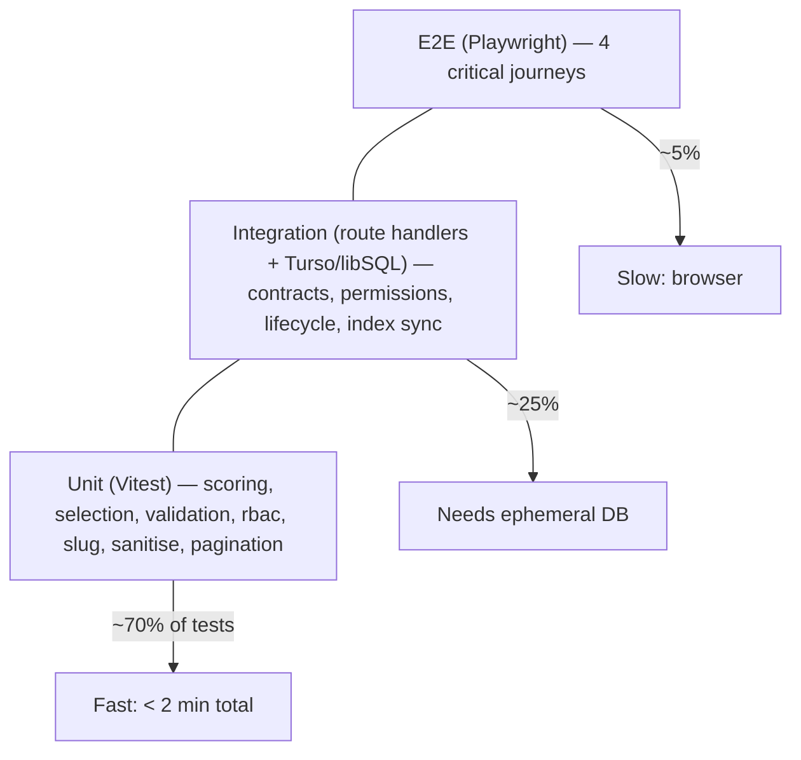

# Testing Strategy — Exampify

| Field | Value |
|-------|-------|
| Version | 1.0 |
| Status | Proposed |
| Supersedes | Version 0.1 (Postgres integration DB, no search/jobs coverage) |
| Depends on | [QUESTION_ENGINE.md](./QUESTION_ENGINE.md), [API_CONTRACTS.md](./API_CONTRACTS.md), [SECURITY_AND_PERMISSIONS.md](./SECURITY_AND_PERMISSIONS.md), [SEARCH_ARCHITECTURE.md](./SEARCH_ARCHITECTURE.md) |
| Referenced by | [MVP_ROADMAP.md](./MVP_ROADMAP.md) Phase 7, [TECHNICAL_STANDARDS.md](./TECHNICAL_STANDARDS.md) |

---

## 1. Purpose and scope

What we test, at which level, with which tools, and how it runs in CI. The strategy is risk-driven: effort concentrates on the four places where a bug destroys the product — **scoring, answer-key confidentiality, authorization, and content publication**.

**In scope:** test levels and their responsibilities, tooling, fixtures and data builders, target coverage, specific test suites, CI pipeline, flake policy, manual QA, and what we deliberately do not test.

**Out of scope:** load testing beyond a smoke run, penetration testing, visual regression tooling (deferred), content QA (`CONTENT_MODEL.md` §10 is the editorial contract).

---

## 2. Principles

1. **Test behaviour, not implementation.** Assert on the grading result and the API response, not on whether `gradeItem` calls `normalise`.
2. **Pure core, thin I/O.** Scoring, selection, validation and RBAC are pure modules; they get exhaustive unit tests. Route handlers get integration tests against a real database.
3. **One honest test beats five broad ones.** A test that cannot fail meaningfully is deleted.
4. **Fixtures are typed and minimal.** Builders with sensible defaults; each test overrides only what it is about.
5. **Security properties are tests, not assertions in prose.** The answer-key leak test is a hard gate.
6. **No testing of framework behaviour.** We do not test that Next.js routes, that React renders a `<div>`, or that Zod validates. We test *our* rules.

---

## 3. Levels



### 3.1 Unit tests (Vitest)

| Area | What is covered |
|---|---|
| `scoring.ts` | Truth tables for 4 types × {correct, incorrect, partially correct, unanswered, malformed}; partial-credit formula; integer rounding (hundredths); normalisation cases; totals reconciliation |
| `selection.ts` | Scope resolution, filters, capping, de-duplication, deterministic seed, `random_key` wraparound sampling, empty pool |
| `blocks` | Zod union per block type, table rectangularity, anchor uniqueness, payload size budget |
| `fusion.ts` / `fuzzy.ts` | RRF arithmetic, boost caps, exact-title pinning; edit-distance thresholds, short-query guard, ambiguous-correction rejection |
| `outbox` | Event claim semantics, backoff schedule, delete-vs-upsert decision |
| Validation schemas | Accept/reject fixtures per field; cross-field rules (option counts, answer-key label existence, slug format, length gates) |
| RBAC | Full capability matrix (4 roles × all capabilities), deny-by-default |
| Slug + redirect | Generation, collision suffixes, reserved words, chain collapse |
| Markdown | Sanitisation (script/iframe/event handlers/`javascript:` URLs), callout parsing, heading demotion, TOC extraction |
| Pagination | Cursor encode/decode, malformed cursor, stability |
| Progress math | Accuracy with `null` denominator, windows, focus-topic thresholds |
| Metadata | Title/description formulas, truncation, JSON-LD graph shape |

Pure functions must reach **90 %+** line and branch coverage. These are cheap and catch the expensive bugs.

**Example: scoring truth table**

| Type | Key | Answer | Expected points (max = 1) |
|---|---|---|---|
| multiple_choice | A | A | 1 |
| multiple_choice | A | B | 0 |
| multiple_choice | A | not answered | 0 |
| multiple_select (A,C; all_or_nothing) | A,C | A,C | 1 |
| multiple_select (A,C; all_or_nothing) | A,C | A | 0 |
| multiple_select (A,C; partial) | A,C | A | 0.5 |
| multiple_select (A,B,C; partial) | A,B,C | A,D | 0.33 (33 hundredths) |
| multiple_select (A,C; partial) | A,C | C,A | 1 (order-insensitive) |
| true_false | true | false | 0 |
| short_answer (accepted: "inertia") | — | "  Inertia. " | 1 |
| short_answer (keywords: ["mass","velocity"]) | — | "mass and velocity" | 1 |
| short_answer | — | "   " | 0 |

### 3.2 Integration tests (Vitest + a real Turso/libSQL database)

Run against an ephemeral libSQL database per CI run (a migrated, seeded schema, either a Turso branch or a local `file:` database through the Node entry of `@libsql/client`), not mocks. Mocking the database would hide exactly the bugs that matter here: `CHECK` constraints, foreign-key enforcement (`PRAGMA foreign_keys`), cascades, `changes()` semantics and table rebuilds.

| Suite | Coverage |
|---|---|
| Public read endpoints | Published-only filtering, 404 for drafts, pagination, search ranking sanity |
| Auth endpoints | Sign-up, duplicate email behaviour, verification requirement, sign-in failure genericism, session revocation |
| Attempt lifecycle | Create → save → resume → submit → review; idempotent submit; concurrent submit (one grading pass); timed-mode duration; expiry; abandon |
| Answer-key confidentiality | Every attempt endpoint's response scanned recursively for `answer_key`, `correct`, `explanation`, `isCorrect` before submit, in **both** modes; `reveal` present only in practice mode |
| Search sync | Publish → event row → worker → FTS5 row + Qdrant point; unpublish → removal; duplicate delivery → one row/one point set; lost publish call → sweeper repairs |
| Search query | FTS5 `MATCH` with operator characters is parameterised and never errors; fuzzy fixtures return the intended entity; Qdrant failure yields `degraded: true` |
| Media presign | URL issuance, `HEAD` verification, wrong MIME rejected, `pending` sweep, delete blocked while referenced |
| Email pipeline | Enqueue → worker with the stub provider sends once; duplicate delivery is a no-op; provider error retries then fails; suppressed address skipped |
| Privacy flows | Account deletion removes/ anonymises exactly the rows in `PRIVACY_AND_DATA_PROTECTION.md` §5.2; cookie inventory matches the set the server emits |
| Publish gates | Each blocking rule with a failing fixture and a passing counterpart |
| Concurrency | `expectedUpdatedAt` mismatch ⇒ `409`; two parallel publishes ⇒ idempotent; two parallel submits ⇒ one grading pass |
| RBAC enforcement | Matrix over real handlers: student/author/reviewer/admin × studio routes |
| CSRF/origin | Cross-origin mutation rejected before DB access |
| Rate limits | N+1 requests ⇒ `429` with `Retry-After` |
| Migrations | Apply from empty and from the previous tagged version; no destructive step in the same release; a table rebuild preserves row counts and indexes |
| Token permissions | The runtime token cannot `UPDATE`/`DELETE` `audit_logs` and cannot run DDL |

### 3.3 Contract tests

- **Response shape:** parse every documented response with its Zod schema in tests; a shape drift fails the suite.
- **Error taxonomy:** each documented error code is produced at least once by a test.
- **Leak scan:** reusable helper `expectNoSecrets(payload)` used on every student endpoint.
- **Public/private separation:** SSR HTML for a `403` page contains no protected data.

### 3.4 E2E tests (Playwright)

Four journeys only — breadth is not the goal:

1. **Anonymous discovery and study:** home → subject → chapter → topic → study material; breadcrumb and `<h1>` correct; no practice UI on a study-only page.
2. **Sign-up → verify (token from test mailbox) → launch practice → answer → submit → review** shows score and explanation.
3. **Author publishes a lesson:** create chapter → topic → resource with blocks → assessment → link → submit → reviewer publishes → public page and search result reachable.
4. **Resume:** start an attempt, reload mid-way, answers and position restored.
5. **Search:** query with a misspelling returns the intended topic; unpublishing it removes it from results.

E2E runs on a preview deployment against a seeded database. No E2E test asserts on exact pixel styling.

### 3.5 Accessibility tests

- `axe-core` integrated into Playwright for the 7 key screens (home, topic, study material, lesson, runner, review, dashboard) — zero critical/serious violations.
- Manual keyboard passes per phase: tab order, focus visibility, dialog trap, answer selection.
- One screen-reader smoke test (VoiceOver or NVDA) on the runner and review before launch.

### 3.6 Performance checks

- Lighthouse CI on a topic page with budgets: performance ≥ 90, accessibility ≥ 95, SEO ≥ 95, LCP < 2.5 s.
- Bundle size budget per route (JS shipped to a content page < 150 kB gzipped).
- Query budget: no page executes more than 6 SQL statements (instrumented in integration tests for the heavy templates).

---

## 4. Test data

### 4.1 Builders

```ts
// test/builders.ts
export const aQuestion = (overrides: Partial<QuestionRow> = {}): QuestionRow => ({ ... });
export const aChoiceQuestion = (correct: OptionLabel = 'A') => aQuestion({ ... });
export const anAttempt = (userId: string, items: AttemptItemRow[]) => ({ ... });
export const aResource = (blocks: BlockInput[] = [aRichTextBlock()]) => ({ ... });
export const anAssessment = (items: AssessmentItemInput[] = []) => ({ ... });
```

Rules: builders return valid defaults; a test overrides only its concern; no shared mutable fixtures; no snapshots of large objects (assert on specific fields).

### 4.2 Seed vs fixtures

- **Seed** (`seed/`): realistic content for local/preview browsing — 1 curriculum, 2 levels, 4 subjects, topics with a study material, a lesson + assessment and a standalone practice test.
- **Fixtures** (test-only): minimal, isolated, per-test rows created inside a transaction that rolls back where possible.

Never let an E2E test depend on seed content *counts*; assert on presence by name or by a fixture created in the test's setup.

---

## 5. Coverage targets

| Scope | Target | Enforcement |
|---|---|---|
| `lib/services/scoring`, `selection`, `lib/search/fusion` | 95 % branches | CI threshold |
| `lib/validation` | 90 % | CI threshold |
| `lib/rbac` | 100 % of the matrix | Test enumerates roles × capabilities |
| `lib/services/*` overall | 80 % | Reported, not blocking initially |
| `app/api/**` | Covered by integration suites per endpoint | Reported |
| UI components | Not measured | Behaviour covered via E2E and focused component tests for the runner |

Coverage is a floor, not a goal. A PR that adds a branch with no test is rejected in review regardless of the percentage.

---

## 6. CI pipeline

```
1. bun install --frozen-lockfile
2. typecheck (tsc --noEmit)
3. lint (eslint + prettier --check)
4. unit tests (vitest run --coverage)
5. migrate ephemeral libSQL DB + seed
6. integration tests (incl. index-sync worker against a stub Qdrant)
7. bun run --bun next build
8. E2E on the built app (preview env)
9. Lighthouse CI on a topic page
10. dependency audit (high/critical fail)
```

Qdrant is stubbed for CI integration tests (a fake client implementing the two methods the code uses) so the suite does not depend on a paid cluster; one opt-in nightly job runs against a real dev collection.

Rules:
- Steps 1–3 run in parallel where possible; 4–6 are sequential because they share the DB.
- A red pipeline blocks merge. No `--force`, no skipped tests (`test.skip` requires an issue link and an expiry date).
- Nightly: full E2E against the staging deployment + sitemap/metadata validation.

---

## 7. Flake policy

- A flaky test is fixed or deleted within one working day. Quarantine is not a destination.
- E2E waits are on conditions (`expect(locator).toBeVisible()`), never fixed timeouts.
- Tests must pass in random order and in isolation; shared state between tests is a defect.
- Any retry must be explicit and logged; silent retries are banned.

---

## 8. Manual QA (per release)

A short, repeatable checklist for things automation cannot see:

- [ ] Mobile 360 px and 768 px: no horizontal scroll, tap targets comfortable.
- [ ] Keyboard-only run of one practice session.
- [ ] Screen reader announces question change and answer state.
- [ ] Publish a topic and confirm the public page within 60 s.
- [ ] Sign-up, verify, reset password with a real inbox.
- [ ] Studio: unsaved-changes guard on navigation.
- [ ] Error pages show a `requestId` and no stack trace.
- [ ] Print a material page.
- [ ] Reduced motion: no transforms, state still visible.
- [ ] 200 % zoom on the runner.

---

## 9. What we do not test (and why)

| Not tested | Reason |
|---|---|
| Framework internals (routing, rendering, Zod) | Upstream responsibility |
| Exact CSS values | Design tokens are reviewed; visual regression is deferred until the UI stabilises |
| Every endpoint's happy path manually | Contract tests cover the shape; E2E covers the journeys |
| Third-party providers (email, storage) | Faked behind adapters; a single smoke test per provider before launch |
| Content correctness (is the physics right?) | Editorial review (`CONTENT_MODEL.md` §10), not automated |
| Load beyond a k6 smoke | Deferred to post-launch; the architecture's scaling path is documented |

---

## 10. Dependencies

| Suite | Depends on |
|---|---|
| Scoring tests | `QUESTION_ENGINE.md` §6 contract |
| Integration tests | Ephemeral DB provisioning, migrations, seed |
| E2E | A preview environment with auth and a test mailbox |
| Contract tests | `API_CONTRACTS.md` schemas (shared Zod) |
| A11y tests | Screens exist from Phase 1/4 |
| Lighthouse | A deployed build, not `next dev` |

---

## 11. Edge cases in testing

| # | Case | Handling |
|---|---|---|
| T-01 | Test needs the current time | Inject a clock; never `vi.useFakeTimers` globally |
| T-02 | Attempt expiry test | Create an attempt with `started_at` in the past; never `sleep` 24 h |
| T-03 | Random selection | Seed the RNG; assert on set membership and count, not order |
| T-04 | Concurrent submit test | Two `Promise.all` calls against the same attempt; assert one grading outcome and one stored result |
| T-05 | Email verification in E2E | Read the token from a test mailbox API or a DB query in test-only code |
| T-06 | Migration test | Apply all migrations to an empty DB, then run the previous release's suite |
| T-07 | Upload test with a real file at the size cap | Fixture generated once, stored in `test/fixtures`; presign tested against a stubbed S3 client plus one real Tigris smoke test |
| T-08 | Test isolation | Each integration test runs in a transaction rolled back at teardown where feasible |
| T-09 | SVG sanitisation test | Malicious SVG fixture; assert script nodes removed |

---

## 12. Acceptance criteria

1. CI runs typecheck, lint, unit, integration, build, E2E, Lighthouse and audit; a failure blocks merge.
2. Scoring has a truth table covering every type and state, and totals reconcile in a property test across 1,000 randomised sessions.
3. The answer-key leak test runs on every practice endpoint and fails closed.
4. The RBAC test enumerates all roles × capabilities and asserts deny-by-default.
5. Every documented error code is produced by at least one test.
6. Publish gates have a failing fixture per rule.
7. Migrations apply cleanly from empty and from the previous version.
8. Four E2E journeys pass on a preview deployment.
9. Axe reports zero critical/serious violations on seven key screens.
10. No test depends on wall-clock sleeps; total CI time under 15 minutes.
10a. Search sync tests prove duplicate delivery is idempotent and unpublish removes both indexes.
11. Coverage thresholds in §5 are enforced for the pure core.
12. A flaky test has an owner and a one-day fix window.

---

## 13. Open questions

| # | Question | Impact |
|---|---|---|
| OQ-T1 | Is a test mailbox service acceptable, or do we use a DB-token shortcut in E2E? | E2E realism vs setup cost — **Open — needs:** decide test mailbox vs a DB-token shortcut in E2E; **blocks Phase 2**. |
| OQ-T2 | Do we add visual regression (Playwright screenshots) after Phase 1? | UI churn cost — **Open — needs:** decide whether visual regression is added after Phase 1; **blocks Phase 7**. |
| OQ-T3 | Is a k6 smoke run required before launch? | Phase 6 scope — **Open — needs:** decide whether a k6 smoke run gates launch; **blocks Phase 7**. |
| OQ-T4 | Should integration tests use one shared schema with rollbacks, or a fresh database per file? | CI speed vs isolation — **Open — needs:** decide shared-schema rollbacks vs a fresh database per test file; **blocks Phase 1**. |
| OQ-T5 | Do we require 80 % coverage on `lib/services` as a blocking gate from Phase 2? | Delivery speed vs safety — **Open — needs:** decide whether 80% service coverage blocks from Phase 2; **blocks Phase 2**. |
