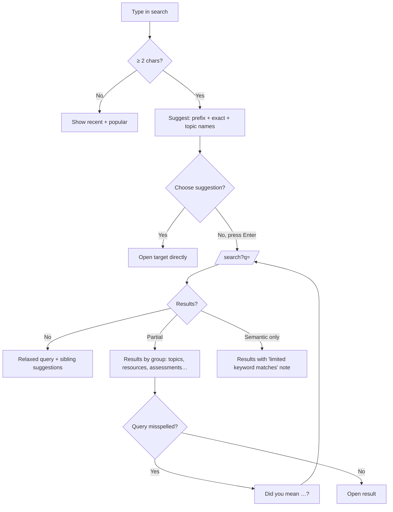
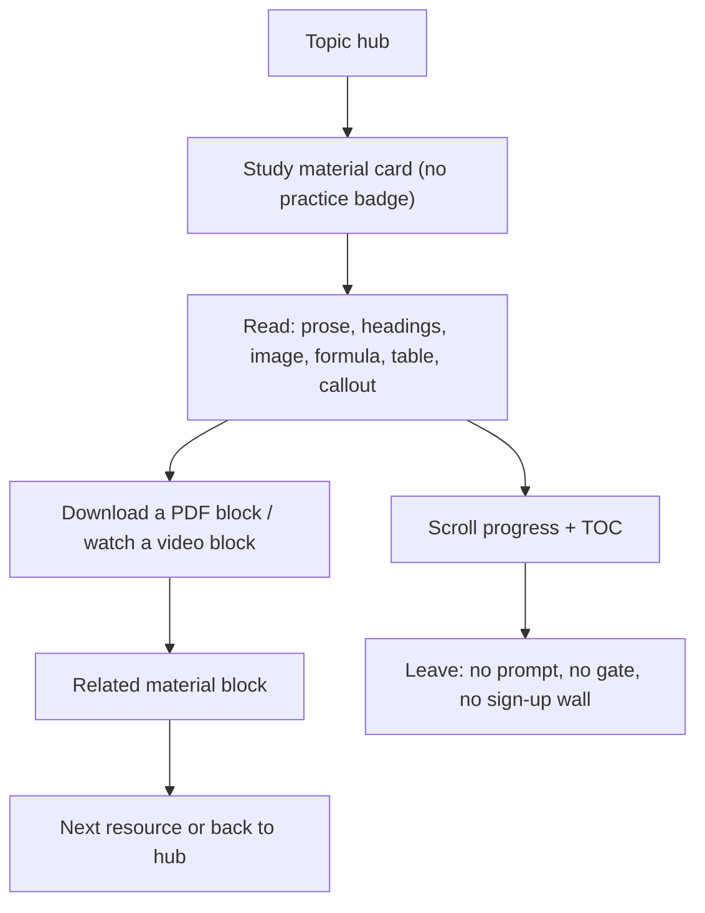
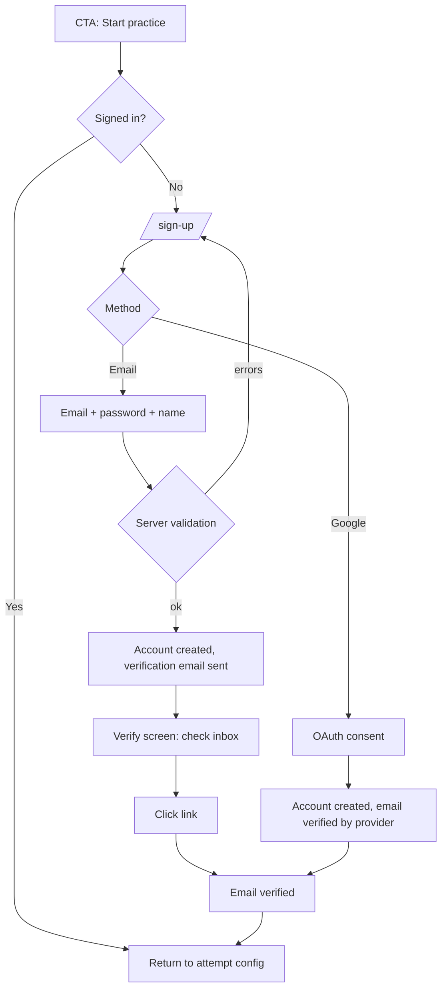
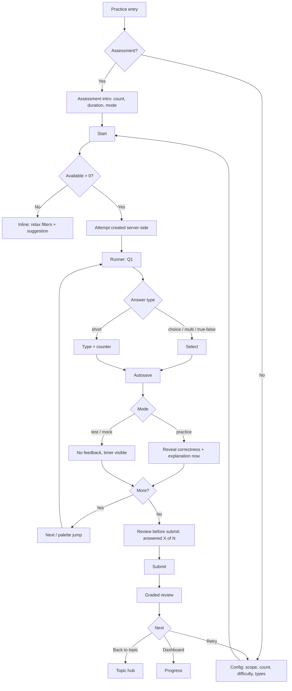
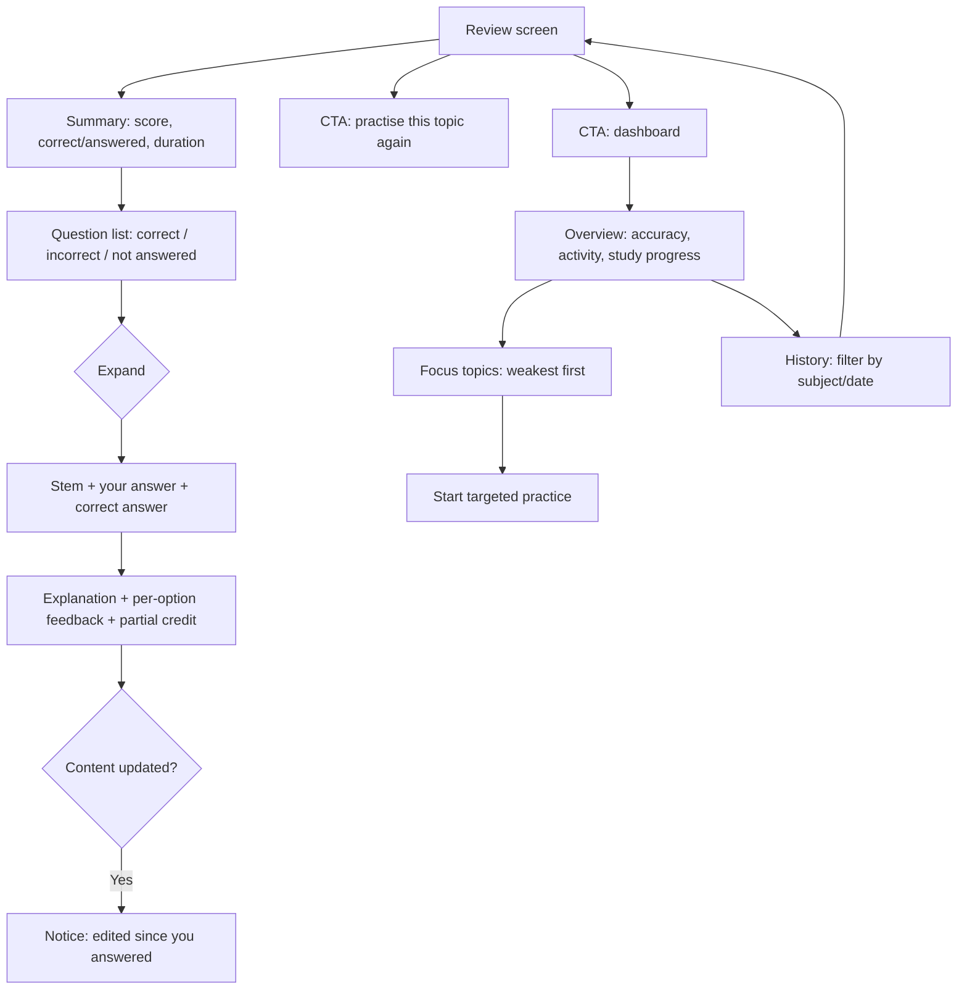
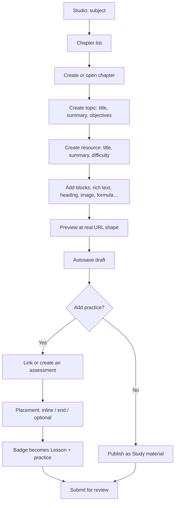
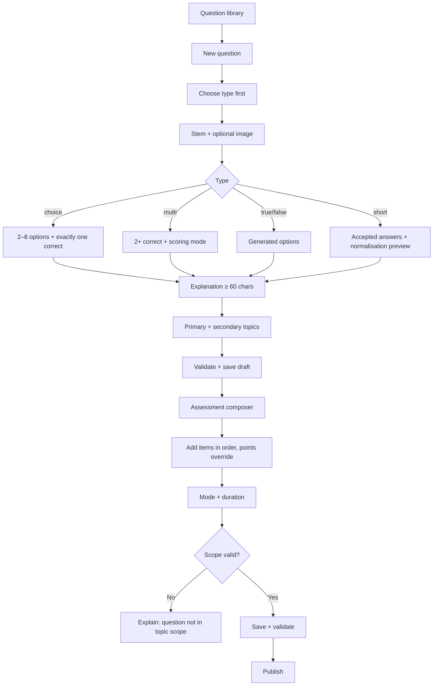
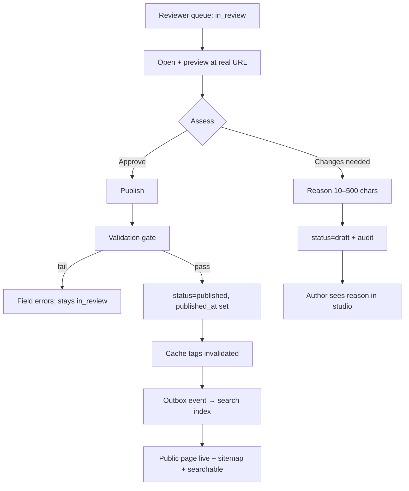
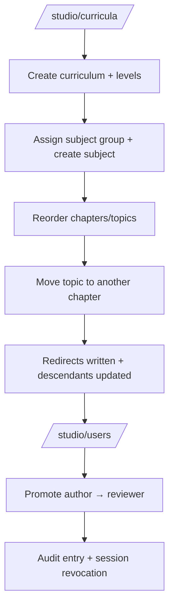

# User Flows — Exampify

| Field | Value |
|-------|-------|
| Version | 1.0 |
| Status | Proposed |
| Supersedes | Version 0.1 (materials/tutorials, session-first practice) |
| Depends on | [INFORMATION_ARCHITECTURE.md](./INFORMATION_ARCHITECTURE.md), [QUESTION_ENGINE.md](./QUESTION_ENGINE.md), [UI_UX_GUIDELINES.md](./UI_UX_GUIDELINES.md), [SEARCH_ARCHITECTURE.md](./SEARCH_ARCHITECTURE.md) |
| Referenced by | [TESTING_STRATEGY.md](./TESTING_STRATEGY.md), [MVP_ROADMAP.md](./MVP_ROADMAP.md) |

---

## 1. Purpose and scope

End-to-end journeys for every actor, including state machines and failure branches. Each flow lists entry points, steps, decisions, screens, data touched and acceptance criteria, so a reviewer can trace a journey back to requirements.

**In scope:** discovery, search, study without assessment, account creation, practice and timed tests, resume, review, progress, authoring (resources, blocks, assessments), review/publish, admin, and cross-cutting states.

**Out of scope:** component-level visual specs ([DESIGN_SYSTEM.md](./DESIGN_SYSTEM.md)), endpoint payloads ([API_CONTRACTS.md](./API_CONTRACTS.md)).

---

## 2. Flow index

| # | Flow | Actor | Primary requirements |
|---|---|---|---|
| F1 | Discover content and read | Visitor | FR-DISC-01…07, G1 |
| F2 | Find content by search or autocomplete | Visitor, Student | FR-SEARCH-01…08, G5 |
| F3 | Study a topic without any assessment | Visitor, Student | FR-DISC-06, FR-CMS-06, G2 |
| F4 | Create an account and verify email | Visitor → Student | FR-AUTH-01…03 |
| F5 | Practise (lesson practice or standalone test) | Student | FR-PRAC-01…13, G3 |
| F6 | Resume an interrupted attempt | Student | FR-PRAC-04 |
| F7 | Review results and find a weak topic | Student | FR-PROG-01…05 |
| F8 | Author a topic: study material + lesson | Author | FR-CMS-01…07, G4 |
| F9 | Author questions and an assessment | Author | FR-QB-01…09 |
| F10 | Review and publish | Reviewer | FR-CMS-08…12, FR-OPS-01…03 |
| F11 | Manage taxonomy and roles | Admin | FR-CMS-01, SEC §3 |
| F12 | Handle empty, error and expired states | All | FR-DISC-11, edge cases |

---

## 3. F1 — Discover content and read

**Entry points:** organic search, direct link, homepage.

```mermaid
flowchart TD
  A[Land on /] --> B{Knows their curriculum?}
  B -->|Yes| C[Pick curriculum + level]
  B -->|No| D[Search or browse popular subjects]
  C --> E[/subjects filtered/]
  D --> E
  D --> S[/search?q=/]
  S --> T2[Result: topic | resource | assessment | chapter | subject]
  E --> F[Subject page: chapters + coverage]
  T2 --> G[Topic hub]
  F --> H[Chapter page: topics + format badges]
  H --> G
  G --> I{Intent?}
  I -->|Understand| J[Study material page]
  I -->|Learn + practise| K[Lesson page: reading + practice section]
  I -->|Test myself| L[Practice test page]
  J --> M[Next resource / back to hub]
  K --> N{Start practice?}
  L --> N
  N -->|Yes, signed in| O[Attempt config]
  N -->|Yes, signed out| P[Sign-up with context preserved]
  N -->|No| G
```

**Steps and behaviour**

| Step | Screen | Behaviour |
|---|---|---|
| 1 | Home | Curriculum picker restored from a cookie; "Popular this term" = published subjects with the most topics (no usage tracking in MVP) |
| 2 | Directory | Filter chips (curriculum, level, group, format) in the URL so back/forward and sharing work |
| 3 | Subject | Chapter list with topic counts; assessment list; unpublished gaps hidden |
| 4 | Chapter | Ordered topics with **format badges** (Study material / Lesson + practice / Practice test) and estimated minutes |
| 5 | Topic hub | Objectives, resources and assessments, each labelled with its derived format; related resources |
| 6 | Study material | Reading layout, sticky TOC on desktop, prev/next; **no practice UI at all** |
| 7 | Lesson | Same reading layout, plus a clearly separated practice section (inline or at the end) that never auto-starts |
| 8 | Practice test | Scope, question count, duration, start CTA; no reading section |

**Failure/empty branches**

- No subjects for a filter → empty state with "clear filters" and the nearest populated combination.
- Subject with zero published chapters → `noindex`, "content coming soon", sibling subjects.
- Topic with **no assessment** → no practice UI; this is a valid, complete state, not a gap to apologise for.
- Topic with only an assessment → no reading section, not an empty placeholder.

**Acceptance:** a cold visitor reaches a resource page in ≤ 3 clicks on a 360 px viewport; back button restores scroll position; the format badge on every card matches `deriveFormat` for that row.

---

## 4. F2 — Find content by search or autocomplete

**Entry points:** header search, `/search`, homepage box, empty-state suggestion.



**Rules**

- Suggest fires after a 200 ms debounce; in-flight requests are aborted on the next keystroke.
- Arrow keys move, Enter opens, Esc closes; the list announces counts.
- A misspelling yields the intended entity in the top 3; the correction is **offered**, not silently applied.
- If the semantic index is unavailable, results are keyword-only with a visible "limited results" note; search never 500s because Qdrant is down.
- Filters persist in the URL; clearing them returns to the unfiltered canonical URL.

**Acceptance:** `mito` suggests Mitochondria and Mitosis; `mitocondria` returns Mitochondria in the top 3; "How do plants make food?" returns the photosynthesis resource without the word appearing in the query; no draft ever appears.

---

## 5. F3 — Study without any assessment

This flow exists to prove the product is not an exam funnel.



**Rules**

- No modal, banner or inline CTA demands practice, sign-up or email.
- A reading-progress indicator is visual only; it is not persisted in MVP (`OQ-UF1`).
- Download blocks are public in MVP (`OQ-11`); a future entitlement check has one insertion point.
- Internal links from prose open related topics/resources; external links open in a new tab with `rel="noopener"`.

**Acceptance:** an anonymous visitor reads a complete study material with zero prompts, and no network request is made to attempt, auth or personalisation endpoints.

---

## 6. F4 — Create an account and verify email



**Rules**

- The triggering CTA is preserved (`?next=` internal-only, allow-listed).
- Verification is required before the **first attempt**, not before browsing. A student can return to the resource and see the practice section; launching asks them to verify.
- Resend: max 3 per hour, with a countdown.
- Sign-in failure shows one generic message, keeps the email, clears the password.
- Reset: request (always "check your email") → link → new password → all sessions revoked → sign in.

**Acceptance:** sign-up → email → verified → attempt config completes on one origin; an unverified student gets `EMAIL_NOT_VERIFIED` with a resend action, not a bare error.

---

## 7. F5 — Practise

**Entry points:** a lesson's practice section, a practice test page, the topic hub's assessment list, `/practice`.



**Runner states**

| State | UI |
|---|---|
| `loading` | Skeleton matching the question card footprint, no layout shift |
| `unanswered` | Rendered; "next" enabled (skipping allowed) |
| `answered` | Selection shown with colour + icon + text (never colour alone) |
| `revealed` | Practice mode: correctness, correct option, explanation (inline, collapsible) |
| `saving` | Subtle "saving…"; failure shows "not saved — retry" |
| `save-failed` | Inline banner with retry; navigation allowed but state says "unsaved" |
| `time-low` | Timed modes: last 5 minutes highlighted once, no flashing |
| `submitting` | Button locked, page interactions disabled |
| `submitted` | Redirect to review |

**Rules**

- In `practice` mode, feedback appears only after that question is answered and disappears if the answer is cleared.
- In `test`/`mock`, no correctness, no explanation, no per-option feedback before submit — including in network payloads.
- Submit confirmation lists unanswered questions with "Go back" / "Submit anyway".
- Concurrent `in_progress` attempts are capped at 5; starting a sixth auto-abandons the oldest with a notice.

**Acceptance:** a 10-question attempt is completable with the keyboard only; answers survive refresh; the only correctness in the payload before submit is practice-mode `reveal` for answered questions.

---

## 8. F6 — Resume an interrupted attempt

**Triggers:** closed tab, battery death, another device, "Continue" card.

```mermaid
flowchart TD
  A[Attempt URL or Continue card] --> B{Exists and owned?}
  B -->|No| C[404 + start new]
  B -->|Yes| D{Status}
  D -->|in_progress, not expired| E[Load questions + saved answers]
  D -->|expired| F[Expired screen: answers preserved, no correctness, no score]
  D -->|submitted| G[Redirect to review]
  D -->|abandoned| H[Abandoned summary + start new]
  E --> I[Resume at first unanswered question]
```



**Rules**

- The Continue card shows subject, topic/assessment, answered/total, last activity.
- Resume position = first unanswered item, or the last position if all were answered.
- Multi-device: last write wins per item; answers are per item, so no revision conflict exists.
- A timed attempt keeps its original `expiresAt`; resuming does not extend it.
- Expired attempts reveal no correctness, not even for previously answered practice items.

**Acceptance:** closing the browser mid-attempt and reopening elsewhere restores every answer and the correct position; a timed attempt resumed after expiry shows the expired state.

---

## 9. F7 — Review results and find a weak topic



**Rules**

- Summary first, detail second: the explanation is the product, the score is the index.
- Incorrect answers expand by default; correct ones collapse.
- "Not answered" is distinct from "incorrect".
- Partial credit shows `0.5 / 1` and "Partially correct" — never "Correct".
- Accuracy and score percent are labelled separately, because they have different denominators (`QUESTION_ENGINE.md` §11).
- Review is read-only and reachable later from history.

**Acceptance:** every question in a submitted attempt has an explanation; focus topics list only topics with ≥ 5 answers and < 60 % accuracy; an edited question shows the `contentUpdated` notice.

---

## 10. F8 — Author a topic: study material + lesson

**Entry:** `/studio/topics/{id}`.



**Steps and screens**

| Step | Screen | Key interactions |
|---|---|---|
| 1 | Subject list | Filter by status; open subject |
| 2 | Subject detail | Chapters ordered; "Add chapter" inline |
| 3 | Chapter detail | Topics ordered with format + completeness badges |
| 4 | Topic detail | Objectives editor, status badge, publish checklist |
| 5 | Resource editor | Block list with add/insert/reorder/delete; per-block editor; Markdown + preview for prose; image picker; formula input with live render; table editor |
| 6 | Preview | Renders exactly as public, at the real URL shape, staff-only, `noindex` |
| 7 | Practice section | Link an existing assessment (searchable), set placement; create one inline (F9) |
| 8 | Publish checklist | Server-computed blocking items, warnings, "ready" state |

**Block editing rules**

- Ten block types, closed set; no free-form layout, no nested blocks.
- Insert happens at a position; positions are renumbered server-side.
- Deleting a block is undoable within the session (client-side) and audited after save.
- Autosave 4 s after the last keystroke: `Saving… / Saved 12:04 / Offline — retry`.
- Autosave never changes status and never discards local text on failure.
- Leaving with unsaved changes prompts; a conflict opens the `409` dialog (F12).

**Acceptance:** an author goes from an empty chapter to a submitted topic with a study material and a lesson, without leaving the studio; every field error is inline; the checklist blocks exactly the gates in `CONTENT_MODEL.md` §4.

---

## 11. F9 — Author questions and an assessment



**Rules**

- Changing question type after entering an answer resets answer fields with an explicit warning.
- The normalisation preview shows how a typed student answer would be compared (`QUESTION_ENGINE.md` §5) — no blind accepted-answer lists.
- Per-option feedback is optional but encouraged; the editor shows a completeness hint.
- The composer validates scope immediately: a question cross-listed to the topic is allowed, one outside it is rejected with the reason.
- `practice` mode forbids a duration; `test`/`mock` require one.
- The topic's difficulty distribution is visible while composing so gaps are obvious.

**Acceptance:** all four types author, validate, save and publish; a scope violation is caught before save; publishing an assessment with a draft question fails with a field-level error.

---

## 12. F10 — Review and publish



**Rules**

- The reviewer sees a full content summary: title, summary, objectives, block count and types, assessment count, open warnings.
- Publish is disabled until the checklist passes; the reason is shown next to it, not only in a toast.
- Publishing is idempotent; a double click cannot publish twice.
- After publish the reviewer sees "Live at <url>" plus an indexing status chip (`queued` → `indexed`), which may lag without blocking.
- A failed gate leaves the item `in_review` and unchanged.
- Rejecting requires a reason, shown on the author's topic page.

**Acceptance:** publish invalidates cache tags in the same action; the item is searchable within 60 s; every publish/reject is audited; a search-index failure is visible in `/studio/overview` instead of silently missing.

---

## 13. F11 — Admin taxonomy and roles



**Rules**

- Taxonomy writes are `admin`-only because they change public URLs.
- Moving a topic requires confirmation listing affected URLs and creates redirects.
- Role changes revoke the target's sessions; a last-admin guard prevents lockout.
- Destructive-looking actions are archive-first; hard delete is not exposed.

---

## 14. F12 — Cross-cutting states

| State | Where | Design |
|---|---|---|
| Loading (content) | Public pages | Server-rendered skeleton; never a full-page spinner |
| Loading (client data) | Dashboard, studio tables | Row skeletons matching column widths |
| Empty (no content) | Directory, chapter, topic | Explanation + nearest alternative + staff shortcut |
| Empty (no history) | Dashboard | "You haven't practised yet" + 3 suggested topics |
| 404 | Public | Friendly copy, breadcrumb, search box, popular subjects |
| 500 | App | Apology + `requestId` + retry; no stack trace |
| Expired attempt | Runner | Read-only answers, no correctness, restart CTA |
| Rate limited | Auth, attempts, search | "Try again in X" with `Retry-After` |
| Offline | Attempt, studio | Persistent banner; queued saves; explicit unsaved state |
| Forbidden | Studio | Redirect to sign-in, or 404 for the wrong role (no existence leak) |
| Degraded search | Search | "Showing limited results" note; keyword results still usable |
| Index lag | Studio | "Queued for search" chip; never blocks publish |

**Acceptance:** every state has a designed screen; none is blank, a raw error, or an infinite spinner.

---

## 15. Dependencies

| Flow | Depends on |
|---|---|
| F1–F3 | Published-content queries, ISR, SEO helpers |
| F2 | FTS5 + Qdrant + fusion + fuzzy |
| F4 | Better Auth, email provider |
| F5–F7 | Question engine, attempt schema, progress queries |
| F8–F10 | Studio, RBAC, gates, media, outbox |
| F11 | Taxonomy services, redirects, audit |

---

## 16. Edge cases across flows

| # | Case | Flow | Behaviour |
|---|---|---|---|
| UF-01 | Visitor bookmarks a draft preview URL | F1 | 404, or staff preview if signed in as staff |
| UF-02 | Verification email arrives after starting | F4/F5 | Attempt creation blocked; config preserved in the URL |
| UF-03 | Returns 25 h later | F6 | Expired screen; no correctness |
| UF-04 | Reviewer rejects while the author is offline | F10 | Stored; badge shows on next visit |
| UF-05 | Author edits a published resource | F8/F10 | Edit applies live and is audited; no second review unless re-submitted |
| UF-06 | Practice launched from a chapter with mixed availability | F5 | Count reflects published questions only; disabled at zero |
| UF-07 | Two attempts open at once | F5 | Allowed up to 5; each independent |
| UF-08 | Search result unpublished seconds ago | F1/F2 | 404 with suggestions, not a redirect loop |
| UF-09 | Browser back during save | F8 | Unsaved-changes guard; last autosave persisted |
| UF-10 | Admin moves a subject to another level | F11 | Descendants redirect; sitemap regenerated |
| UF-11 | Semantic index down during search | F2 | Keyword results, degraded note |
| UF-12 | Assessment unlinked from a lesson | F8 | Badge reverts to Study material; practice section disappears after revalidation |
| UF-13 | Student clears a practice-mode answer | F5 | Explanation hides again for that question |

---

## 17. Acceptance criteria

1. Every flow has a happy path, at least one failure branch, and a defined end state.
2. F1 and F3 work with JavaScript disabled for all content.
3. F3 makes no request to attempt, auth or personalisation endpoints.
4. F5 persists answers before navigation and recovers from a hard refresh.
5. F6 restores state across devices with no correctness leakage.
6. F5's `reveal` appears only in practice mode for answered questions.
7. F8 enforces every block and publish gate inline.
8. F10 publish invalidates caches and enqueues indexing without manual intervention.
9. F12 states exist for 404, 500, empty, expired, offline, degraded and forbidden.
10. No flow requires a page reload to see its own result.

---

## 18. Open questions

| # | Question | Impact |
|---|---|---|
| OQ-UF1 | Track reading progress (resources viewed) in MVP? | Adds a `resource_views` table and UI; currently visual-only — **Open — needs:** decide whether reading progress is tracked (adds a table and UI); **blocks Phase 5**. |
| OQ-UF2 | Is a homepage Continue card required at launch? | Homepage personalisation query — **Open — needs:** decide whether the homepage shows a Continue card; **blocks Phase 5**. |
| OQ-UF3 | Should attempts be pausable indefinitely rather than 24 h? | Expiry UX and sweep — **Open — needs:** decide whether attempts pause indefinitely vs the 24-hour expiry; **blocks Phase 4**. |
| OQ-UF4 | Does the studio need a distinct reviewer queue screen? | One extra screen — **Open — needs:** decide whether the studio needs a reviewer queue screen; **blocks Phase 2**. |
| OQ-UF5 | Is a two-step submit confirmation too heavy for 5 questions? | Measure drop-off — **Open — needs:** decide whether two-step submit confirmation is too heavy; **blocks Phase 4**. |
| OQ-UF6 | Should a lesson's practice section be linkable as its own page? | Currently both (anchor + own URL) **Open — needs:** decide whether lesson practice is linkable as its own page (ties `OQ-IA6`); **blocks Phase 2**. |
